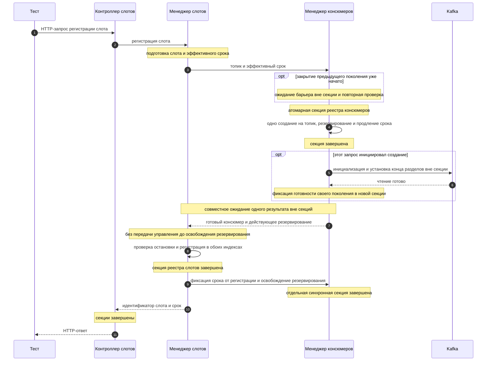
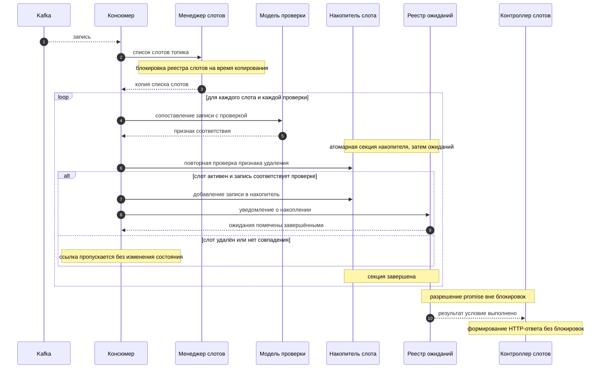
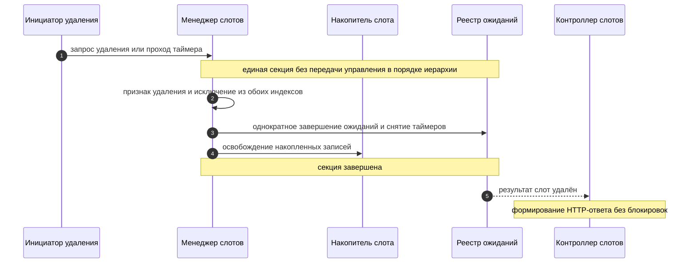

# Архитектура

Документ описывает внутреннее устройство сервиса: границы компонентов, потоки обработки записей, жизненный цикл слотов и консюмеров, а также правила конкурентного доступа. Упоминаемые далее блокировки означают [синхронные логические секции в Node.js](#значение-блокировки-в-nodejs), а не мьютексы или блокировку потока. Контракт HTTP API вынесен в [`api.md`](api.md), а параметры и правила конфигурации — в [`configuration.md`](configuration.md). Назначение проекта, требования к запуску и инструкции по сборке остаются в [`../readme.md`](../readme.md); общие правила ведения документации определены в [`../AGENTS.md`](../AGENTS.md).

Состав документа:

- Назначение и границы системы
- Компоненты и их ответственность
- Потоки публикации и обработки записей
- Взаимодействие компонентов: матрица, сценарии и инварианты
- Жизненный цикл слота и консюмера, включая имя группы топика, её удаление и позицию чтения
- Модель проверок и асинхронного ожидания
- Фоновая очистка и завершение ресурсов
- Конкурентный доступ и предотвращение взаимных блокировок
- Тестовая архитектура
- Принятые архитектурные допущения
- Выбор Kafka-клиента и граница нативного транспорта

## Назначение и границы системы

### Назначение

Сервис — вспомогательный инструмент тестировщика, который замыкает асинхронный контур проверки: тестируемая система публикует результат операции в Kafka, а тест заранее объявляет, какие записи он ожидает увидеть, и затем асинхронно дожидается их появления. Сервис решает три задачи:

1. **Публикация.** Принимает запись по HTTP и передаёт её в топик Kafka через нативный клиент Kafka, позволяя тесту инициировать асинхронную операцию без собственного клиента Kafka. HTTP используется только между тестом и этим сервисом.
2. **Наблюдение.** Держит открытые слоты — точки наблюдения за топиком, в которых накапливаются записи, удовлетворяющие заданным проверкам.
3. **Ожидание.** Позволяет тесту дождаться появления нужного числа записей без синхронного опроса, после чего прочитать накопленные записи или их количество.

Ключевая идея архитектуры: слот открывается **до** инициирования тестируемой операции (это рекомендуемый порядок работы), поэтому записи, появившиеся в топике после открытия слота, попадают в него автоматически. Тесту не нужно опрашивать Kafka и не нужно знать смещения (`offset`).

### Ограничения первой версии

- **Одна реплика.** Состояние (слоты, накопленные записи, ожидания, консюмеры) хранится только в памяти процесса. Горизонтальное масштабирование и разделение состояния между репликами не поддерживается; при перезапуске все слоты и накопленные записи теряются.
- **Целевая нагрузка 10–50 RPS.** Архитектура рассчитана на небольшой поток публикаций и умеренное число одновременно открытых слотов. Пропускная способность не оптимизируется под высокие нагрузки.
- **Мягкая гарантия доставки.** Запись попадает в слот только если консюмер уже читает соответствующий топик. Записи, опубликованные до открытия первого слота по топику, в слот не попадают.
- **Отсутствие персистентности.** Реестры слотов, консюмеров и ожиданий не сохраняются на диск.
- **Один процесс на кластер.** Предполагается, что сервис не конкурирует с другими участниками группы консюмеров за те же топики. Имя группы включает идентификатор запуска, поэтому несколько экземпляров сервиса не попадают в одну группу, но это не защищает от сторонних клиентов, использующих то же имя.

### Входит в ответственность сервиса

- Проверка допустимости топика публикации по списку регулярных выражений `publisherTopics` и отклонение публикации в недопустимый топик.
- Передача записи в Kafka и выбор режима подтверждения по параметру `ack`.
- Ведение реестра слотов, привязка слота к топику и набору проверок, автоматическое и ручное удаление слотов.
- Создание, продление времени жизни и остановка консюмеров по одному на топик, формирование отдельного имени группы для каждого топика и попытка удаления группы этого топика после закрытия консюмера.
- Сопоставление каждой полученной записи с проверками всех активных слотов этого топика и накопление подходящих записей.
- Регистрация асинхронных ожиданий, их разрешение при выполнении условия и завершение по тайм-ауту или при удалении слота.
- Периодическая фоновая очистка двумя независимыми таймерами: удаление устаревших слотов и остановка бездействующих консюмеров.
- Публикация спецификации OpenAPI и интерфейса Swagger UI для описанного контракта.

### Не входит в ответственность сервиса

- Гарантия того, что тестируемая система вообще отправит запись: сервис только наблюдает топик и не влияет на поведение системы.
- Хранение истории записей топика, воспроизведение прошлых сообщений и работа с группами консюмеров за пределами собственных консюмеров сервиса. Удаление группы выполняется только для группы собственного топика и только как попытка после закрытия консюмера.
- Управление топиками, разделами и правами доступа в Kafka.
- Трансформация, фильтрация или обогащение публикуемых записей по смыслу: сервис не изменяет состав заголовков, ключа и значения. При этом представление JSON/HTTP преобразуется в исходные байты согласно типам `STRING`, `BINARY`, `JSON`; такое преобразование описано в [`api.md`](api.md) и не является обогащением.
- Аутентификация и авторизация клиентов API, квоты и ограничение частоты запросов.
- Долговременное хранение результатов тестов и формирование отчётов.
- Работа в конфигурации с несколькими репликами и согласование состояния между ними.

Контракт HTTP API, включая состав полей, ограничения параметров и коды ответов, описан в [`api.md`](api.md). Полный перечень параметров конфигурации, их значения по умолчанию и влияние на поведение системы описаны в [`configuration.md`](configuration.md); в этом документе параметры упоминаются только по имени.

## Компоненты и их ответственность

Сервис разделён на слои: HTTP-слой принимает запросы и не содержит бизнес-логики; сервисные компоненты владеют состоянием и реализуют правила; инфраструктурные компоненты работают с Kafka и таймерами.

| Компонент | Роль |
| --- | --- |
| HTTP-слой: контроллер публикации | Приём запроса публикации и формирование ответа |
| HTTP-слой: контроллер слотов | Приём запросов регистрации, ожидания, подсчёта, чтения и удаления слота |
| Сервис публикации | Проверка допустимости топика и передача записи в Kafka |
| Менеджер слотов | Реестр слотов: регистрация, поиск, удаление, срок жизни |
| Менеджер консюмеров | Создание, продление времени жизни и остановка консюмеров, попытка удаления группы топика |
| Имя группы консюмеров | Формирование отдельного имени группы для каждого топика из префикса, идентификатора запуска и 64-битного отпечатка имени топика; имя топика неизменно в пределах запуска |
| Консюмер | Чтение записей топика и маршрутизация их в слоты |
| Модель проверки | Сопоставление записи с условиями проверки |
| Реестр асинхронных ожиданий | Регистрация, разрешение и отмена ожиданий |
| Планировщик очистки слотов | Периодический запуск удаления слотов с истёкшим сроком |
| Планировщик проверки бездействия консюмеров | Периодический запуск остановки консюмеров с истёкшим временем жизни |

Взаимодействие компонентов образует четыре ветви:

- ветвь публикации: `HTTP-слой` → `Сервис публикации` → Kafka;
- ветвь наблюдения: `HTTP-слой` → `Менеджер слотов` → `Менеджер консюмеров` → `Консюмер` → `Модель проверки` → накопитель слота → `Реестр асинхронных ожиданий` → `HTTP-слой`; имя группы для консюмера берётся из компонента «Имя группы консюмеров» по имени топика, а после закрытия консюмера менеджер консюмеров пытается удалить группу этого топика из Kafka;
- ветвь очистки слотов: `Планировщик очистки слотов` → `Менеджер слотов`;
- ветвь проверки бездействия: `Планировщик проверки бездействия консюмеров` → `Менеджер консюмеров`.

Ветви не вызывают друг друга напрямую: публикация не уведомляет наблюдение, а наблюдение не влияет на результат публикации. Ветвь наблюдения связана с ветвью публикации только через топик Kafka, а ветви очистки — только через реестры менеджеров. Обе ветви очистки работают независимо друг от друга и не разделяют общий таймер. Попытка удаления группы топика выполняется менеджером консюмеров после закрытия консюмера и не является отдельной ветвью.

### HTTP-слой

**Ответственность.** Преобразование HTTP-запроса в вызов сервисного компонента, валидация формы запроса и формирование HTTP-ответа. Слой не хранит состояние и не принимает архитектурных решений о судьбе слотов.

**Входы.** HTTP-запросы к операциям публикации, регистрации слота, ожидания, подсчёта, чтения записей и удаления слота.

**Выходы.** Вызовы сервиса публикации и менеджера слотов; HTTP-ответ, собранный из результата вызова.

**Зависимости.** Сервис публикации и менеджер слотов, предоставляющий в том числе операции асинхронного ожидания, подсчёта и чтения.

**Инварианты.**
- Контроллер ожидания не блокирует поток обработки запроса: он регистрирует ожидание и возвращает управление, а ответ формируется по завершении `promise`.
- Контроллеры не работают с реестрами напрямую и не удерживают блокировки при формировании ответа.
- Любая ошибка валидации или отсутствие сущности преобразуется в ответ, описанный в [`api.md`](api.md).

### Сервис публикации

**Ответственность.** Проверка топика на соответствие списку `publisherTopics` и передача записи в Kafka с учётом режима подтверждения `ack`.

**Входы.** Имя топика, тело записи, значение `ack`.

**Выходы.** Результат передачи: подтверждённая отправка, принятие к отправке без ожидания подтверждения, недопустимый топик, недопустимые данные либо отказ Kafka до фиксации результата.

**Зависимости.** Нативный клиент Kafka, конфигурация `publisherTopics` и `cluster`.

**Инварианты.**
- Пустой список `publisherTopics` означает отсутствие ограничений; непустой список требует совпадения хотя бы с одним регулярным выражением.
- Проверка топика выполняется до обращения к Kafka: недопустимый топик не создаёт сетевого вызова.
- Семантика заголовков, ключа и значения не изменяется, но представление преобразуется в исходные байты: `STRING` — UTF-8-байты текста, `JSON` — UTF-8-байты сериализованного JSON, `BINARY` — байты, полученные декодированием base64. В Kafka не передаются байты текста base64.
- Значения по умолчанию применяются только при отсутствии `type`: `STRING` для ключа и значений заголовков, `JSON` для значения. При некорректном `type` или некорректных данных публикация не выполняется с подстановкой типа по умолчанию.
- Публикация выполняется нативным клиентом Kafka по адресу `cluster`; HTTP используется только между тестом и нашим сервисом, а внешний REST-прокси Kafka не используется.
- Нативный клиент передаёт в Kafka исходные байты ключа, значения и заголовков; base64 применяется только на границе JSON/HTTP нашего API.
- Режим `ack` определяет необходимость подтверждения брокера; это не подтверждение накопления записи в слоте и на состав реестров слотов публикация не влияет. Точная граница принятия без подтверждения и правила немедленного и позднего отказа заданы в [контракте публикации](api.md#принятие-отправки-без-подтверждения).
- Выполняющаяся нативная отправка отслеживается до завершения, её отказ обрабатывается и регистрируется; необработанного асинхронного отказа быть не должно. Прикладных повторных попыток, отдельной очереди и фоновой досылки нет.

### Менеджер слотов

**Ответственность.** Владение реестром слотов: создание слота с вычислением срока автоматического удаления, поиск слота по идентификатору, выдача слотов по топику для маршрутизации записей, удаление слота по запросу и по сроку.

**Входы.** Запрос регистрации слота (топик, набор проверок, необязательный срок), идентификатор слота для поиска и удаления, имя топика от консюмера, момент времени от планировщика очистки слотов.

**Выходы.** Идентификатор созданного слота, найденный слот, список слотов топика, признак успешного удаления, список ожиданий, которые нужно прервать.

**Зависимости.** Реестр слотов, менеджер консюмеров (при открытии слота), реестр асинхронных ожиданий (при удалении слота), источник текущего времени.

**Инварианты.**
- Слот всегда привязан к одному топику и неизменяемому набору проверок.
- Срок автоматического удаления фиксируется в момент создания слота и далее не пересчитывается.
- Значение срока из запроса имеет приоритет над значением по умолчанию; правило выбора описано в [`configuration.md`](configuration.md).
- Слот, удалённый по сроку или вручную, исчезает из реестра и из списка слотов своего консюмера; повторное удаление не меняет состояние.
- Удаление слота — единственная операция, после которой накопленные записи и связанные ожидания становятся недоступны.

### Менеджер консюмеров

**Ответственность.** Ведение реестра консюмеров по топикам: создание консюмера при первом слоте топика, продление его времени жизни, остановка, освобождение ресурсов и попытка удаления группы этого топика из Kafka.

**Входы.** Имя топика и срок автоматического удаления слота при открытии слота; момент времени от планировщика проверки бездействия; признак остановки сервиса.

**Выходы.** Существующий или созданный консюмер, обновлённое время жизни, факт остановки консюмера, результат попытки удаления группы топика.

**Зависимости.** Клиент Kafka, конфигурация `consumerGroupPrefix` и `consumerIdleSeconds`, фабрика консюмеров, реестр консюмеров, компонент «Имя группы консюмеров».

**Инварианты.**
- В реестре не более одного консюмера на топик в пределах процесса.
- Время жизни консюмера только увеличивается: новое значение применяется, лишь если оно больше текущего.
- Остановка по бездействию запрещена, пока есть активные слоты или резервирования открываемых слотов; создание и закрытие согласуются по [состояниям жизненного цикла](#состояния-консюмера-и-переходы).
- Остановка консюмера освобождает сетевые ресурсы клиента Kafka и удаляет запись из реестра.
- Имя группы запрашивается у компонента «Имя группы консюмеров» по имени топика при каждом открытии консюмера и не хранится в реестре консюмеров.
- Консюмер подписывается на топик с конца разделов, поэтому записи за время отключения не воспроизводятся.
- После закрытия консюмера выполняется попытка удаления группы этого топика; ошибка удаления регистрируется в журнале и не прерывает выполнение остальных операций.
- Попытка удаления группы не выполняется, если консюмер не был создан или если при завершении работы консюмеров не было.
- Повторное открытие консюмера по тому же топику выполняется после завершения попытки удаления его предыдущей группы.

### Имя группы консюмеров

**Ответственность.** Формирование имени группы консюмеров отдельно для каждого топика.

**Входы.** Значение параметра `consumerGroupPrefix`, идентификатор запуска приложения, имя топика.

**Выходы.** Имя группы топика, передаваемое создаваемому консюмеру.

**Зависимости.** Конфигурация `consumerGroupPrefix`, источник идентификатора запуска, функция MD5.

**Инварианты.**
- Имя группы строится по шаблону `{prefix}-{uuid}-{topicHash}`, где `{uuid}` — идентификатор запуска, а `{topicHash}` — беззнаковое 64-битное число из имени топика. Правила вычисления описаны в [`configuration.md`](configuration.md).
- Идентификатор запуска создаётся один раз при старте приложения и одинаков для всех групп этого запуска; при перезапуске создаётся новый.
- Имя группы зависит от топика: у разных топиков разные группы, поэтому закрытие консюмера одного топика не затрагивает группы других топиков. Исключение — совпадение 64-битных отпечатков, описанное ниже.
- Имя группы одного топика не меняется в пределах запуска приложения: повторное открытие консюмера по тому же топику использует то же имя.
- Имя группы не сохраняется на диск: при перезапуске приложения создаётся новый идентификатор запуска и новые имена групп.
- Имя группы не удаляется при отказе создания консюмера: попытка удаления выполняется только после закрытия созданного консюмера.
- Имя группы зависит только от `consumerGroupPrefix`, идентификатора запуска и имени топика. Оно не зависит от слотов, ожиданий, накопленных записей, операций чтения и подсчёта, состояния других топиков, результата удаления группы и состояния группы в Kafka.
- Имя группы не удаляется при повторном открытии консюмера: удаление выполняется только при закрытии консюмера.
- Имя группы не удаляется при завершении работы, если консюмеров не было: удалять нечего.
- 64-битный отпечаток не гарантирует отсутствие коллизий: при совпадении отпечатков двух разных имён топиков имена групп совпадут. Компонент обнаруживает такое совпадение в пределах запуска и регистрирует его в журнале.

### Консюмер

**Ответственность.** Чтение записей закреплённого топика и передача каждой записи всем активным слотам этого топика.

**Входы.** Поток записей из Kafka.

**Выходы.** Вызовы модели проверки и менеджера слотов для каждой записи.

**Зависимости.** Клиент Kafka, менеджер слотов, модель проверки, реестр асинхронных ожиданий.

**Инварианты.**
- Консюмер не фильтрует записи самостоятельно: решение о соответствии принимает только модель проверки.
- Одна запись может попасть в несколько слотов и в несколько проверок одного слота.
- Порядок записей внутри слота соответствует порядку их поступления из Kafka.
- Консюмер не удерживает блокировки реестров во время сетевого взаимодействия с Kafka.
- При каждом открытии консюмер начинает чтение с конца разделов топика и не использует сохранённые смещения (`offset`), поэтому записи за время отключения не воспроизводятся.

### Модель проверки

**Ответственность.** Сопоставление записи с условиями одной проверки: сравнение ожидаемых заголовков и значений, извлечённых по `jsonPath`.

**Входы.** Запись из Kafka, описание проверки.

**Выходы.** Признак соответствия.

**Зависимости.** Стандартный разбор JSON, безопасный адаптер JSONPath (языка выбора узлов JSON) и строгий декодер UTF-8 для байтов заголовков и значения. Требования к адаптеру и статус выбора библиотеки определены в разделе [«Безопасное вычисление JSONPath»](#безопасное-вычисление-jsonpath).

**Инварианты.**
- Проверка считается выполненной только при совпадении **всех** заданных заголовков и **всех** заданных значений.
- Пустой набор условий означает отсутствие ограничения по этой части проверки.
- Отсутствие подходящего кандидата для условия заголовка или отсутствие значения записи при заданных условиях по нему трактуется как несовпадение, а не как ошибка; части записи без условий не проверяются.
- Заголовки сопоставляются после строгого декодирования UTF-8 по [правилам повторяющихся имён](#сопоставление-заголовков-и-повторяющихся-имён). Ошибочный кандидат не подменяется символом замены и не отменяет совпадение другого кандидата; непроверяемые заголовки не влияют на результат.
- Значение записи сопоставляется с `jsonPath` только как JSON UTF-8; при недекодируемых или невалидных байтах значения условия `values` не совпадают.
- Модель проверки не имеет состояния и не зависит от порядка вызовов.

### Реестр асинхронных ожиданий

**Ответственность.** Хранение незавершённых ожиданий, проверка условия срабатывания при поступлении записи, разрешение `promise`, завершение по тайм-ауту, при удалении слота и при штатной остановке сервиса.

**Входы.** Регистрация ожидания (слот, индекс проверки, требуемое число записей, тайм-аут); уведомление о новом накоплении; сигнал тайм-аута; сигнал удаления слота; сигнал штатной остановки сервиса.

**Выходы.** Завершённый `promise` только с результатом «условие выполнено», «тайм-аут», «слот удалён» или «сервис останавливается», без накопленных записей.

**Зависимости.** Менеджер слотов, таймер тайм-аутов, источник текущего времени.

**Инварианты.**
- Каждое ожидание завершается ровно один раз: по условию, по тайм-ауту, при удалении слота либо при штатной остановке сервиса. Побеждает первое событие, установившее признак завершённости; последующие события результат не меняют.
- Условие проверяется сразу при регистрации: если требуемое число записей уже накоплено, ожидание разрешается без взведения таймера.
- Запись ожидания удаляется из реестра при любом варианте завершения.
- `promise` разрешается вне блокировок реестров и слота.

### Планировщик очистки слотов

**Ответственность.** Периодический запуск с интервалом 1 минута: удаление слотов с истёкшим сроком автоматического удаления.

**Входы.** Сигнал таймера, текущее время.

**Выходы.** Вызовы удаления в менеджере слотов.

**Зависимости.** Менеджер слотов, планировщик задач.

**Инварианты.**
- Интервал фиксирован и равен 1 минуте; параметрами конфигурации он не настраивается.
- Проходы не пересекаются: следующий запуск не начинается, пока не завершён предыдущий.
- Удаление слота выполняется по общему пути удаления, тому же, что и при ручном удалении.
- Ошибка удаления одного слота не прерывает обработку остальных.
- Планировщик останавливается при завершении работы сервиса.

### Планировщик проверки бездействия консюмеров

**Ответственность.** Периодический запуск с интервалом 10 минут: остановка консюмеров с истёкшим временем жизни, у которых нет активных слотов.

**Входы.** Сигнал таймера, текущее время.

**Выходы.** Вызовы остановки в менеджере консюмеров.

**Зависимости.** Менеджер консюмеров, менеджер слотов (для проверки наличия активных слотов), планировщик задач.

**Инварианты.**
- Интервал фиксирован и равен 10 минутам; параметрами конфигурации он не настраивается.
- По бездействию останавливается только готовый консюмер с истёкшим временем жизни, без активных слотов и резервирований открываемых слотов.
- Проходы не пересекаются: следующий запуск не начинается, пока не завершён предыдущий.
- Ошибка остановки одного консюмера не прерывает обработку остальных.
- Планировщик останавливается при завершении работы сервиса.

## Потоки публикации и обработки записей

### Поток публикации (синхронный)

1. Тест отправляет HTTP-запрос публикации записи в топик с параметром `ack`.
2. Контроллер публикации передаёт имя топика, тело записи и значение `ack` в сервис публикации.
3. Сервис публикации проверяет топик по списку `publisherTopics`. Если список непуст и ни одно регулярное выражение не совпало, публикация отклоняется без обращения к Kafka, и контроллер формирует ответ об ошибке согласно [`api.md`](api.md).
4. Сервис публикации преобразует полезные данные заголовков, ключа и значения в исходные байты по типам `STRING`, `BINARY`, `JSON`, применяя значения по умолчанию только при отсутствии `type`. Некорректный тип или некорректные данные не публикуются с подстановкой типа по умолчанию.
5. Сервис публикации передаёт исходные байты нативному клиенту Kafka по адресу `cluster`; base64 используется только на границе JSON/HTTP нашего API и не передаётся в Kafka как текст.
6. При `ack`, требующем подтверждения, сервис дожидается подтверждения брокера через клиент Kafka и возвращает признак подтверждённой отправки. Без подтверждения сервис дожидается успешного завершения нативной операции в соответствующем режиме; это фиксирует принятие на стороне клиента, но не подтверждает доставку брокеру. Отказы до и после этой границы обрабатываются по [контракту публикации](api.md#принятие-отправки-без-подтверждения).
7. Контроллер формирует HTTP-ответ, соответствующий результату. Публичный ответ не является подтверждением накопления записи в слоте.

Поток публикации фиксирует прикладной результат до возврата HTTP-ответа, но без подтверждения не гарантирует завершения доставки: поздний отказ не меняет результат. Сетевые операции не блокируют цикл обработки запросов. Публикация не обращается к реестру слотов и не зависит от того, открыт ли слот по этому топику.

### Поток обработки записей (асинхронный)

1. Консюмер топика получает очередную запись из Kafka.
2. Консюмер запрашивает у менеджера слотов список активных слотов этого топика.
3. Если слотов нет, запись игнорируется: она не сохраняется и нигде не накапливается.
4. Для каждого слота и каждой проверки этого слота вызывается модель проверки.
5. При соответствии записи проверке повторно проверяется признак удаления слота; в активный слот запись добавляется в порядке поступления, счётчик увеличивается. Проверка признака, добавление и шаги 6–7 составляют одну секцию без передачи управления.
6. Для слота, в который произошло добавление, реестр ожиданий получает уведомление о новом накоплении.
7. Реестр ожиданий проверяет условия всех ожиданий этого слота и через общий механизм однократного завершения фиксирует результаты тех, чьё требуемое число записей достигнуто, удаляя их и снимая таймеры.
8. После освобождения блокировок помеченные ожидания разрешаются результатом «условие выполнено», и выполняется продолжение, формирующее HTTP-ответ на запрос ожидания.

Обработка записи не влияет на публикацию: консюмер не связан с HTTP-запросом публикации и не уведомляет его о результате.

### Развязка публикации и проверки

Публикация и наблюдение — независимые потоки, связанные только через топик Kafka:

- Слот можно открыть до публикации, после публикации или не открывать вовсе; публикация не проверяет наличие слота и не ждёт его появления.
- Порядок «сначала слот, затем публикация» — рекомендуемый сценарий теста, но не техническое требование архитектуры. Если слот открыт позже, уже прошедшие записи в него не попадут, поскольку консюмер начинает чтение с конца разделов.
- Публикация не возвращает идентификатор слота и не содержит признака попадания записи в слот: результат наблюдения проверяется только через операции ожидания, подсчёта и чтения.
- Задержка между подтверждением публикации и появлением записи в слоте определяется Kafka и не гарантируется сервисом; именно поэтому ожидание реализовано как асинхронное с тайм-аутом.
- Ни один из потоков не удерживает блокировку другого: публикация работает с клиентом Kafka, обработка — с реестрами в памяти.

## Взаимодействие компонентов: матрица, сценарии и инварианты

Раздел фиксирует взаимодействие компонентов на уровне пар и операций: какие компоненты вызывают друг друга, что именно передаётся и возвращается, какие блокировки удерживаются и как отказ на границе превращается в ответ. Контракт HTTP API, включая состав полей и коды ответов, описан в [`api.md`](api.md); значения параметров конфигурации — в [`configuration.md`](configuration.md). Здесь эти сведения не повторяются: упоминаются только имена операций, полей и параметров.

### Матрица взаимодействий компонентов

Обозначения в столбце «Синхронность»: **синхронный** — операция над состоянием завершается без передачи управления; **асинхронный** — результат приходит позже, при этом цикл событий свободен. Завершение операции до HTTP-ответа не означает синхронное выполнение сетевого вызова. Столбец «Блокировки» описывает логические синхронные секции владельцев в порядке иерархии из раздела [«Конкурентный доступ и предотвращение взаимных блокировок»](#конкурентный-доступ-и-предотвращение-взаимных-блокировок), а не мьютексы.

| Пара компонентов | Направление | Что передаётся | Что возвращается | Синхронность | Блокировки |
| --- | --- | --- | --- | --- | --- |
| Контроллер публикации → Сервис публикации | HTTP-слой → сервис | имя топика, тело записи с заголовками, ключом и значением, значение `ack` | результат передачи: подтверждено, принято к отправке, топик недопустим, отказ Kafka | асинхронный; результат до HTTP-ответа | нет; блокировки реестров не захватываются |
| Контроллер слотов → Менеджер слотов (регистрация) | HTTP-слой → менеджер | топик, набор проверок, необязательный `autoDeleteSeconds` | идентификатор слота и эффективный срок автоматического удаления | асинхронный при ожидании готовности или закрытия | отдельные секции реестра консюмеров и реестра слотов; промежуток защищён резервированием, сеть вне секций |
| Контроллер слотов → Менеджер слотов (ожидание) | HTTP-слой → менеджер | идентификатор слота, индекс проверки, требуемое число записей, тайм-аут | результат завершения: «условие выполнено», «тайм-аут», «слот удалён» или «сервис останавливается»; без записей | асинхронный, ответ откладывается | реестр слотов при проверке существования; накопитель, затем реестр ожиданий слота при регистрации; при формировании ответа блокировок нет |
| Контроллер слотов → Менеджер слотов (подсчёт) | HTTP-слой → менеджер | идентификатор слота, индекс проверки | текущее число накопленных записей | синхронный | блокировка накопителя слота только на время снятия счётчика |
| Контроллер слотов → Менеджер слотов (чтение) | HTTP-слой → менеджер | идентификатор слота, индекс проверки, смещение (`offset`), лимит выборки (`count`) | снимок накопленных записей | синхронный | блокировка накопителя слота только на время копирования снимка |
| Контроллер слотов → Менеджер слотов (удаление) | HTTP-слой → менеджер | идентификатор слота | признак удаления либо признак отсутствия слота | синхронный | реестр слотов, затем накопитель, затем реестр ожиданий слота — общий путь удаления |
| Менеджер слотов → Менеджер консюмеров | менеджер → менеджер | имя топика и эффективный срок открываемого слота; затем фиксация либо освобождение резервирования | готовый консюмер, резервирование его поколения, обновлённое внутреннее поле `expiresAt` | асинхронное получение готовности; синхронная фиксация резервирования | секции реестра консюмеров только на переходы; инициализация и ожидание барьера — вне секций |
| Менеджер консюмеров → Имя группы консюмеров (чтение) | менеджер → компонент имени | имя топика | имя группы этого топика | синхронный | нет; имя группы вычисляется без блокировок |
| Менеджер консюмеров → Консюмер (создание) | менеджер → консюмер | имя топика, имя группы топика, ссылки на менеджер слотов и реестр ожиданий | готовый экземпляр, читающий с конца разделов | асинхронный; один результат на поколение | состояние создания публикуется в секции; инициализация — вне секции |
| Менеджер консюмеров → Консюмер (повторное открытие) | менеджер → консюмер | имя топика и имя группы топика | новое поколение с тем же именем группы, читающее с конца разделов | асинхронный, после барьера предыдущего закрытия и попытки удаления группы | после ожидания состояние проверяется заново; сеть вне секций |
| Менеджер консюмеров → Консюмер (остановка) | менеджер → консюмер | команда остановки | подтверждение завершения текущего обработчика и освобождения ресурсов | асинхронный; один владелец закрытия | переход и публикация барьера в секции; закрытие клиента Kafka — вне секции |
| Менеджер консюмеров → Kafka (удаление группы) | менеджер → Kafka | имя группы топика | подтверждение удаления либо отказ | асинхронный, после подтверждённого закрытия консюмера | нет; отдельный барьер топика сохраняется до завершения попытки |
| Консюмер → Менеджер слотов (слоты топика) | консюмер → менеджер | имя топика | копия списка активных слотов топика | синхронный | блокировка реестра слотов только на время копирования списка |
| Консюмер → Модель проверки | консюмер → модель | запись и описание одной проверки | признак соответствия | синхронный | нет; модель проверки не имеет состояния |
| Консюмер → Накопитель слота | консюмер → накопитель | запись и индекс проверки | признак добавления и новое число накопленных записей | синхронный | блокировка накопителя слота; при проверке условий — вместе с реестром ожиданий слота в порядке иерархии |
| Консюмер → Реестр асинхронных ожиданий | консюмер → реестр | идентификатор слота и признак нового накопления | набор ожиданий, помеченных завершёнными | синхронный вызов, разрешение `promise` — отложенное | накопитель слота, затем реестр ожиданий слота; `promise` разрешается после освобождения блокировок |
| Менеджер слотов → Реестр асинхронных ожиданий (регистрация) | менеджер → реестр | слот, индекс проверки, требуемое число записей, тайм-аут | `promise` и признак немедленного завершения | синхронный | накопитель слота, затем реестр ожиданий слота |
| Менеджер слотов → Реестр асинхронных ожиданий (отмена при удалении) | менеджер → реестр | идентификатор слота | число отменённых ожиданий | синхронный | реестр слотов, накопитель, реестр ожиданий слота |
| Менеджер слотов → Накопитель слота (снимок) | менеджер → накопитель | идентификатор слота, индекс проверки, `offset`, `count` | копия записей и счётчик | синхронный | блокировка накопителя слота на время копирования |
| Таймер тайм-аута ожидания → Реестр асинхронных ожиданий | таймер → реестр | идентификатор ожидания, текущее время | признак завершения по тайм-ауту | отложенный, асинхронный | блокировка реестра ожиданий слота; `promise` разрешается после освобождения |
| Реестр асинхронных ожиданий → HTTP-слой | реестр → HTTP-слой | только результат завершения ожидания, без снимка накопленных записей | HTTP-ответ, собранный контроллером по контракту API | асинхронный | нет; продолжение выполняется вне блокировок |
| Планировщик очистки слотов → Менеджер слотов | планировщик → менеджер | текущее время и признак автоматического удаления | список удалённых слотов и ошибки по отдельным слотам | синхронный | по одному слоту: реестр слотов, накопитель, реестр ожиданий слота |
| Планировщик проверки бездействия → Менеджер консюмеров | планировщик → менеджер | текущее время | список остановленных консюмеров и ошибки по отдельным консюмерам | асинхронный | атомарная проверка срока, слотов и резервирований с переходом к закрытию; сеть вне секций |
| Планировщик проверки бездействия → Менеджер слотов | планировщик → менеджер консюмеров → менеджер слотов | имя топика проверяемого консюмера | признак наличия активных слотов | синхронный | реестр слотов при удерживаемой блокировке реестра консюмеров; порядок иерархии «реестр консюмеров → реестр слотов» соблюдён |
| Сервис публикации → Kafka | сервис → Kafka | исходные байты записи и режим `ack` через нативный клиент | подтверждение отправки либо отказ клиента Kafka | асинхронный в обоих режимах; без подтверждения не ожидается ответ брокера | нет; блокировки реестров не удерживаются |
| Консюмер → Kafka | консюмер → Kafka | подписка на топик с конца разделов и запрос очередной записи | запись либо отсутствие данных | асинхронный поток чтения | нет; сетевой обмен идёт без блокировок реестров |

Направление зависимостей по матрице: планировщики зависят от менеджеров, менеджеры от планировщиков не зависят; HTTP-слой зависит от сервиса публикации и менеджера слотов и не обращается к реестрам напрямую; реестры и накопитель не вызывают менеджеров; консюмер не вызывает менеджер консюмеров и не управляет собственным жизненным циклом. Удаление группы топика выполняет только менеджер консюмеров, и только после закрытия консюмера. Имя группы вычисляет только компонент «Имя группы консюмеров».

Пары, которые в архитектуре отсутствуют и не должны появиться в реализации: контроллеры не обращаются к реестрам, накопителю и реестру ожиданий; сервис публикации не обращается к менеджерам и реестрам; консюмер не изменяет реестр слотов и реестр консюмеров и не удаляет группу; менеджер консюмеров не обращается к накопителю и реестру ожиданий; планировщики не вызывают друг друга и не обращаются к накопителю и реестру ожиданий напрямую. Удаление группы топика не выполняется при открытии консюмера: оно выполняется только при закрытии.

### Сквозные сценарии взаимодействия

Сценарии описывают последовательность вызовов с указанием участников и границ блокировок. Общие правила вычисления сроков, совпадения проверок и завершения ожиданий описаны в соответствующих разделах документа и здесь не повторяются.

#### С1. Регистрация слота

1. Тест отправляет HTTP-запрос регистрации слота. Контроллер слотов проверяет форму запроса; безопасный адаптер проверяет и подготавливает все пути по [допустимому синтаксису](api.md#допустимый-синтаксис-jsonpath). Только после успешной проверки всех условий вызывается менеджер слотов. При недопустимом пути регистрация целиком отклоняется до создания или продления консюмера и изменения реестров. Блокировки не удерживаются.
2. Менеджер слотов вычисляет эффективный срок автоматического удаления: значение `autoDeleteSeconds` из запроса либо значение `autoDeleteSlotsSeconds`; правило приоритета описано в [`configuration.md`](configuration.md). Вычисление выполняется без блокировок.
3. Менеджер слотов обращается к менеджеру консюмеров за готовностью и резервированием. Тот атомарно проверяет состояние топика, присоединяет открытие к одному созданию либо использует готовый консюмер, выдаёт резервирование и увеличивает срок. При уже начатом закрытии сначала ожидается отдельный барьер топика, затем состояние проверяется повторно.
4. Единственный инициатор создания выполняет сетевую инициализацию вне секции. Все открытия этого поколения совместно ожидают готовность чтения с конца разделов. Переходы и обработка отказа определены только в разделе [«Состояния консюмера и переходы»](#состояния-консюмера-и-переходы).
5. После готовности менеджер слотов без передачи управления проверяет признак остановки и действительность резервирования, регистрирует подготовленный слот в обоих индексах, вычисляя срок от момента регистрации, затем отдельным вызовом фиксирует резервирование у менеджера консюмеров с повторным продлением срока. Секции двух владельцев последовательно завершаются; резервирование действует до появления слота.
6. Менеджер слотов возвращает контроллеру идентификатор слота и эффективный срок; к этому моменту резервирование освобождено, секции завершены, наблюдение готово. Записи, обработанные до регистрации, в слот не добавляются.
7. Контроллер слотов формирует HTTP-ответ вне секций состояния.
8. При отказе открытия слот не остаётся в индексах и резервирование освобождается. При отказе общей инициализации ни один её участник не регистрирует слот, частичный клиент освобождается без удаления группы; контроллер формирует ответ об отказе согласно [`api.md`](api.md).

#### С2. Публикация записи

1. Тест отправляет HTTP-запрос публикации. Контроллер публикации передаёт сервису публикации имя топика, тело записи и значение `ack`. Блокировки не удерживаются.
2. Сервис публикации сравнивает топик со списком `publisherTopics`: пустой список означает отсутствие ограничений, непустой требует совпадения хотя бы с одним регулярным выражением.
3. **Недопустимый топик.** Публикация отклоняется до обращения к Kafka: нативный клиент Kafka не вызывается, сетевое соединение не устанавливается, реестры не изменяются. Контроллер публикации формирует ответ об отказе согласно [`api.md`](api.md).
4. **Допустимый топик.** Сервис публикации преобразует заголовки, ключ и значение в исходные байты согласно типам `STRING`, `BINARY`, `JSON` и передаёт их нативному клиенту Kafka по адресу `cluster`. Состав заголовков, ключа и значения не изменяется, меняется только представление на границе API.
5. Сервис публикации получает результат нативной операции в выбранном режиме: подтверждение брокера либо принятие на стороне клиента без подтверждения. Граница принятия и обработка отказов заданы в [контракте публикации](api.md#принятие-отправки-без-подтверждения); простой запуск асинхронной операции не считается успешным результатом.
6. Контроллер публикации формирует HTTP-ответ по результату передачи. Блокировки не удерживаются.
7. Публикация не обращается к реестру слотов и не сообщает наблюдению о результате: попадание записи в слот проверяется только последующими операциями ожидания, подсчёта и чтения.

#### С3. Обработка записи консюмером

1. Консюмер получает очередную запись из Kafka. Сетевой обмен выполняется без блокировок реестров.
2. Консюмер вызывает менеджер слотов и запрашивает список активных слотов своего топика. Менеджер слотов захватывает блокировку реестра слотов, копирует список и освобождает блокировку; консюмер работает с копией.
3. Если копия пуста, запись игнорируется: накопления не происходит, уведомлений реестру ожиданий не поступает.
4. Для каждого слота копии и каждой проверки этого слота консюмер вызывает модель проверки. Модель проверки не имеет состояния и не удерживает блокировок.
5. При соответствии записи проверке консюмер входит в секцию накопителя и повторно проверяет терминальный признак удаления у ссылки из копии списка. Если слот удалён, ссылка пропускается; иначе копия записи добавляется и счётчик увеличивается. Проверка и добавление выполняются без передачи управления.
6. Не освобождая накопитель, консюмер захватывает блокировку реестра ожиданий этого слота — порядок иерархии соблюдён — и уведомляет реестр о новом накоплении. Реестр помечает завершёнными ожидания, чьё требуемое число записей достигнуто, и удаляет их записи из реестра.
7. Блокировки освобождаются в обратном порядке: реестр ожиданий слота, затем накопитель.
8. После освобождения блокировок помеченные `promise` разрешаются результатом «условие выполнено»; продолжение формирует HTTP-ответ на ранее пришедший запрос ожидания.
9. Шаги 4–8 повторяются для каждого слота и каждой проверки независимо; блокировки разных слотов никогда не удерживаются одновременно.
10. Обработка записи не влияет на публикацию: консюмер не связан с HTTP-запросом публикации и не сообщает ему о результате.

#### С4. Асинхронное ожидание

1. Тест отправляет HTTP-запрос ожидания: слот, индекс проверки, требуемое число записей, тайм-аут. Контроллер слотов передаёт параметры менеджеру слотов. Блокировки не удерживаются.
2. Менеджер слотов под блокировкой реестра слотов проверяет существование слота, фиксирует ссылку на него и освобождает блокировку. Если слот отсутствует, контроллер формирует ответ об отсутствии слота согласно [`api.md`](api.md).
3. Менеджер слотов в секции накопителя повторно проверяет признак удаления у полученной ссылки. Если слот уже удалён, новое ожидание не создаётся и сообщается об отсутствии слота. Иначе в порядке «накопитель → реестр ожиданий» создаётся ожидание с асинхронным результатом и признаком завершённости.
4. Под той же блокировкой выполняется немедленная проверка условия: если требуемое число записей уже накоплено, ожидание помечается завершённым результатом «условие выполнено» и удаляется из реестра; таймер тайм-аута не взводится.
5. Если условие не выполнено, до выхода из той же секции сохраняется отменяемый таймер, обработчик которого вызывается только позднее через цикл событий. Между проверкой счётчика, регистрацией и сохранением таймера передачи управления нет.
6. Секция завершается. Немедленный результат разрешается вне секции; иначе управление возвращается в цикл событий, а HTTP-ответ откладывается до завершения ожидания. Поток обработки запроса не удерживается.
7. **Завершение по условию.** При добавлении записи консюмером реестр ожиданий под своей блокировкой помечает ожидание завершённым и удаляет его; после освобождения блокировок `promise` разрешается результатом «условие выполнено».
8. **Завершение по тайм-ауту.** Отложенная задача захватывает блокировку реестра ожиданий слота. Если признак завершённости не установлен, ожидание помечается завершённым результатом «тайм-аут» и удаляется из реестра; после освобождения блокировки `promise` разрешается.
9. **Повторное событие.** Если ожидание уже завершено другим событием, отложенная задача не выполняет действий: повторного разрешения `promise` не происходит, ответ формируется один раз.
10. **Штатная остановка.** Незавершённое ожидание помечается завершённым результатом «сервис останавливается», удаляется из реестра, таймер снимается; после освобождения блокировок `promise` разрешается. Если другое событие уже завершило ожидание, результат не меняется.
11. После разрешения `promise` контроллер слотов формирует ответ только по результату завершения. Накопленные записи не передаются в продолжение и не возвращаются в ответе ожидания; для их получения предназначен отдельный метод чтения. Коды и тела ответов определяет [контракт ожидания](api.md#асинхронное-ожидание-записей); при формировании ответа блокировки не удерживаются.

#### С5. Удаление слота вручную и по сроку

Инициатором выступает либо HTTP-запрос удаления, либо проход планировщика очистки слотов. Оба варианта используют один и тот же путь удаления.

1. Инициатор вызывает менеджер слотов: контроллер слотов передаёт идентификатор слота, планировщик очистки слотов — текущее время и признак автоматического удаления. На входе блокировки не удерживаются.
2. Менеджер слотов начинает секцию реестра слотов, помечает слот удалённым и исключает его из обоих индексов. Если слота нет, ручное удаление сообщает об отсутствии слота, а проход таймера пропускает шаг; повторное удаление состояние не меняет.
3. Не освобождая реестр слотов, менеджер слотов захватывает блокировку накопителя слота, затем блокировку реестра ожиданий слота — порядок иерархии соблюдён.
4. Под блокировкой реестра ожиданий все незавершённые ожидания слота помечаются завершёнными результатом «слот удалён» и удаляются из реестра; отложенные задачи тайм-аута снимаются.
5. Накопленные записи всех проверок освобождаются вместе со слотом. Операции подсчёта и чтения по удалённому слоту сообщают об отсутствии слота согласно [`api.md`](api.md).
6. Блокировки освобождаются в обратном порядке: реестр ожиданий слота, накопитель, реестр слотов.
7. После освобождения блокировок разрешаются `promise` отменённых ожиданий; контроллер слотов формирует ответы на ранее пришедшие запросы ожидания.
8. Исключение слота из списка слотов консюмера происходит в том же шаге 2, поскольку список слотов топика хранится в реестре слотов: отдельное уведомление консюмеру не требуется, а в следующей копии списка удалённый слот отсутствует. Если удалён последний слот топика, консюмер переходит в состояние `Простаивает` и не останавливается до истечения `expiresAt`.
9. Шаги 2–6 выполняются без передачи управления как один атомарный участок. Даже ранее скопированная ссылка не позволяет добавить запись после удаления: путь накопления проверяет терминальный признак по [правилам использования ссылки](#ранее-полученная-ссылка-на-слот).

#### С6. Фоновая очистка консюмера

1. Проход планировщика проверки бездействия консюмеров начинается по расписанию 10 минут. Предыдущий проход уже завершён, пересечения нет; на входе блокировки не удерживаются. Идентификатор запуска уже создан при старте приложения, а имя группы топика вычисляется по нему и не пересчитывается.
2. Планировщик передаёт менеджеру консюмеров текущее время и запрашивает проверку консюмеров с истёкшим временем жизни: текущий момент больше `expiresAt`. Блокировки на этом шаге не удерживаются.
3. Для каждого кандидата менеджер консюмеров начинает секцию своего реестра и повторно проверяет поколение, состояние «Готов» и актуальный срок: ранее снятый список не даёт права закрыть уже продлённый консюмер.
4. Без передачи управления менеджер проверяет отсутствие резервирований и через менеджер слотов — отсутствие активных слотов топика в порядке владения «реестр консюмеров → реестр слотов».
5. Если срок уже продлён, есть слот или резервирование либо состояние изменилось, кандидат пропускается; секция завершается без закрытия.
6. Иначе в той же секции фиксируется состояние «Закрывается» и публикуется отдельный барьер топика. Новое открытие теперь ожидает этот барьер, а не использует закрываемый клиент.
7. После секции асинхронно прекращается чтение, завершается текущий обработчик и освобождается клиент Kafka. Только подтверждённое закрытие позволяет исключить запись клиента из реестра; барьер сохраняется.
8. Вне секций выполняется одна попытка удаления группы; после её завершения барьер снимается по [правилам жизненного цикла](#состояния-консюмера-и-переходы). Ошибка удаления журналируется и не запрещает повторное открытие.
9. Ошибка на одном консюмере регистрируется и не прерывает проход: остальные кандидаты обрабатываются по тем же шагам.
10. Проход не удаляет слоты и не вызывает второй таймер: удаление слотов выполняет планировщик очистки слотов, а планировщики не вызывают друг друга и не разделяют общий таймер. Сохранённый готовый консюмер будет проверен повторно через 10 минут.

### Диаграммы последовательности для С1, С3 и С5

Диаграммы дополняют нумерованные шаги и показывают те же вызовы в порядке времени. Примечания обозначают границы синхронных секций без передачи управления, а не удержание физических блокировок. С1 показывает успешную регистрацию; правила отказа и остановки определены в [жизненном цикле](#состояния-консюмера-и-переходы).

С1. Регистрация слота.



С3. Обработка записи консюмером.



С5. Удаление слота.



### Правила межкомпонентного взаимодействия

1. **HTTP-слой не удерживает блокировки и не работает с реестрами.** Контроллеры вызывают только сервис публикации и менеджер слотов, получают результат и формируют ответ после завершения секций состояния. Ожидание по проверке откладывает ответ до прикладного события; публикация и регистрация также могут асинхронно ожидать сеть или готовность, но не будущие записи.
2. **Сервис публикации изолирован от наблюдения.** Он не обращается к реестру слотов, реестру консюмеров и реестру ожиданий, не проверяет наличие слота и не влияет на накопление. Связь публикации с наблюдением существует только через топик Kafka.
3. **Консюмер не фильтрует записи сам.** Решение о соответствии принимает только модель проверки; консюмер не сравнивает заголовки и значения и не отбрасывает записи по собственным правилам. Во время сетевого взаимодействия с Kafka консюмер не удерживает блокировки реестров.
4. **Единственные точки изменения реестров.** Реестр слотов изменяется только через менеджер слотов, реестр консюмеров — только через менеджер консюмеров. Планировщики, консюмер и HTTP-слой изменяют эти реестры исключительно вызовами соответствующих менеджеров. Имя группы вычисляется компонентом «Имя группы консюмеров» по имени топика и не хранится в реестрах; удаление группы топика выполняет только менеджер консюмеров.
5. **Единственный путь изменения накопителя.** Накопитель слота изменяется только по пути «консюмер → модель проверки → накопитель». Операции подсчёта и чтения работают со снимком и накопитель не изменяют; менеджер слотов освобождает накопитель только при удалении слота.
6. **Ограниченный набор операций реестра ожиданий.** Реестр ожиданий изменяется регистрацией ожидания, разрешением по условию, завершением по тайм-ауту, при удалении слота и при штатной остановке сервиса. Все варианты завершения используют один механизм однократного результата и освобождения таймеров.
7. **Независимость планировщиков.** Планировщик очистки слотов и планировщик проверки бездействия консюмеров не вызывают друг друга, не делят общий таймер и не выполняют работу другого: первый удаляет слоты, второй останавливает консюмеров.
8. **Направление зависимостей.** Планировщики зависят от менеджеров; менеджеры от планировщиков не зависят. Реестры и накопитель не вызывают менеджеров. Консюмер зависит от менеджера слотов, модели проверки и реестра ожиданий, но не от менеджера консюмеров. Менеджер консюмеров запрашивает имя группы топика у компонента «Имя группы консюмеров» и не хранит его.
9. **Отсутствие обратного прохода по блокировкам.** Если операции требуются данные более высокого уровня, она фиксирует их под верхней блокировкой, освобождает её и продолжает работу; удержание нижней блокировки при захвате верхней запрещено.

### Синхронность и асинхронность операций

| Операция | Относительно HTTP-запроса | Что ожидает | Что не ожидает | Предельное время удержания ресурсов |
| --- | --- | --- | --- | --- |
| Публикация записи | результат фиксируется до HTTP-ответа; сетевой вызов неблокирующий | успешное завершение нативной операции: с подтверждением брокера либо без него по выбранному режиму | появления слота и обработки записи консюмером; без подтверждения также не ожидает подтверждения доставки брокеру | длительность нативной операции; блокировки реестров не удерживаются |
| Регистрация слота | результат до HTTP-ответа; при необходимости асинхронная | барьера предыдущего закрытия, готовности одного создания и фиксации слота | первой записи из Kafka и первого ожидания | короткие секции владельцев; резервирование действует до регистрации; сетевое ожидание вне секций |
| Ожидание по проверке | асинхронная, ответ откладывается | разрешения `promise` по событию | поступления записей в потоке обработки запроса и удержания блокировки при формировании ответа | до разрешения `promise`, но не дольше тайм-аута ожидания; поток не удерживается, блокировки — только на время пометки |
| Подсчёт записей проверки | синхронная | снимка счётчика накопителя | новых записей и завершения ожиданий | время копирования счётчика под блокировкой накопителя |
| Чтение записей проверки | синхронная | снимка накопителя по `offset` и `count` | новых записей и завершения ожиданий | время копирования снимка под блокировкой накопителя |
| Удаление слота | синхронная | исключения слота из реестра и отмены ожиданий | разрешения отменённых `promise` | три блокировки в пути удаления: реестр слотов, накопитель, реестр ожиданий слота; `promise` разрешаются после освобождения |
| Обработка записи консюмером | вне HTTP-запроса | копии списка слотов топика и блокировок накопителя и ожиданий | HTTP-запроса публикации и его ответа | блокировки только на время добавления и проверки условий; сетевой обмен с Kafka вне блокировок |
| Создание консюмера | асинхронная в составе регистрации слота | готовности чтения после установки конца разделов | первой записи и первого слота по топику | секции только на изменение состояния; один общий результат готовности, сеть вне секций |
| Остановка консюмера | вне HTTP-запроса либо при завершении работы | решения по слотам и резервированиям, завершения текущего обработчика и закрытия клиента | будущих записей | секция только на переход к закрытию; асинхронное освобождение ресурсов вне секции |
| Удаление группы топика | вне HTTP-запроса, после закрытия консюмера | подтверждения удаления группы от Kafka | закрытия консюмера и освобождения его ресурсов | блокировки реестров не удерживаются; ошибка только регистрируется в журнале |
| Проход планировщика очистки слотов | вне HTTP-запроса | завершения предыдущего прохода | HTTP-запросов и разрешения ожиданий | блокировки по одному слоту за раз в порядке иерархии |
| Проход планировщика проверки бездействия | вне HTTP-запроса | завершения предыдущего прохода | HTTP-запросов | реестр консюмеров, при проверке слотов — реестр слотов; по одному консюмеру за раз |

Термин «отложенный ответ» для ожидания по проверке означает ожидание будущего прикладного события — накопления записей, тайм-аута, удаления или остановки. Публикация и регистрация тоже используют неблокирующие асинхронные операции Kafka и барьеры жизненного цикла, но не ожидают будущего накопления. Это различие не меняет HTTP-контракт. Во всех случаях цикл событий получает управление на время ожидания; блокирующих пауз и опроса счётчиков нет.

### Обработка отказов на границах компонентов

| Ситуация | Кто обнаруживает | Действие компонента | Кто формирует ответ API |
| --- | --- | --- | --- |
| Сетевой отказ или отказ нативного клиента Kafka до успешного результата публикации | Сервис публикации | Возвращается типизированный отказ по [контракту публикации](api.md#принятие-отправки-без-подтверждения); фактическая доставка может быть неизвестна, поэтому нельзя гарантировать, что запись не передана; прикладных повторных попыток, очередей и фоновой досылки нет; реестры не затрагиваются | Контроллер публикации |
| Поздний отказ после принятия отправки без подтверждения | Адаптер Kafka, сервис публикации | Ошибка обрабатывается и записывается в журнал; уже зафиксированный результат не меняется, повторной отправки нет; доставка не гарантируется | Новый HTTP-ответ не формируется |
| Отказ создания консюмера при открытии слота | Менеджер консюмеров | Все участники общего создания получают отказ; слоты не регистрируются, резервирования освобождаются, частичный клиент очищается без удаления группы по [правилам жизненного цикла](#состояния-консюмера-и-переходы) | Контроллер слотов |
| Недопустимый синтаксис `jsonPath` при регистрации | Безопасный адаптер JSONPath, HTTP-слой | Весь запрос отклоняется до изменения реестров и обращения к менеджеру консюмеров по [контракту регистрации](api.md#ограничения-условий-проверки) | Контроллер слотов |
| Ошибка вычисления ранее проверенного `jsonPath` при обработке записи | Модель проверки | Трактуется как несовпадение, а не как отказ обработки; запись не попадает в эту проверку, но может попасть в другие проверки и слоты; консюмер продолжает обработку | Ответ не формируется, операция выполняется вне HTTP-запроса |
| Отказ при удалении слота в проходе таймера | Менеджер слотов, планировщик очистки слотов | Ошибка регистрируется, проход продолжается; удаление выполняется в одной критической секции, поэтому слот либо удалён полностью, либо не изменён; повторный проход идемпотентен | Ответ не формируется, операция фоновая |
| Обрыв соединения консюмера с Kafka | Консюмер, менеджер консюмеров | Ошибка регистрируется; реестры не изменяются, накопленные записи сохраняются; ожидания не получают отдельный результат отказа Kafka и продолжают жить по общим правилам до условия, тайм-аута, удаления слота или остановки сервиса; поступление новых записей не гарантируется | Сам обрыв соединения не формирует ответ API; операция выполняется вне HTTP-запроса |
| Отказ удаления группы топика | Менеджер консюмеров | Ошибка регистрируется в журнале; удаление не повторяется в рамках того же закрытия; остальные операции закрытия, обработка запросов и фоновая очистка продолжаются; состояние слотов и ожиданий не изменяется; при следующем открытии консюмер всё равно читает с конца разделов | Ответ не формируется, операция выполняется вне HTTP-запроса |
| Штатная остановка сервиса во время активных ожиданий | Сервис при завершении работы | Незавершённые ожидания разрешаются отдельным результатом «сервис останавливается» до очистки слотов, без подмены результатом удаления; таймеры снимаются; уже завершённые ожидания не меняются | Контроллеры по [контракту ожидания](api.md#асинхронное-ожидание-записей), если соединение ещё допускает отправку ответа; иначе HTTP-ответ не гарантируется |

Отказ на границе не «протекает» через слои: сервисные компоненты возвращают типизированный результат без знания о кодах HTTP, а преобразование результата или отказа в ответ API выполняет исключительно HTTP-слой. Соответствие результатов и кодов описано в [`api.md`](api.md). Регистрация либо оставляет целый слот в обоих индексах, либо не оставляет слот и резервирование; изменения других открытий не откатываются. Временное состояние освобождения клиента учитывается менеджером до подтверждённой очистки. Удаление слота идемпотентно и допускает повторный проход.

## Жизненный цикл слота и консюмера

### Состояния слота и переходы

Слот проходит следующие состояния:

- **Создан (активен, накопление).** Слот зарегистрирован в реестре, привязан к топику и проверкам, срок автоматического удаления вычислен. В этом состоянии записи сопоставляются с проверками и накапливаются.
- **Ожидание (активен, есть незавершённые ожидания).** Подсостояние активного слота: в реестре ожиданий есть хотя бы одна запись для этого слота. Накопление продолжается параллельно с ожиданием; состояние не блокирует приём записей.
- **Удалён по сроку.** Слот удалён планировщиком очистки слотов, поскольку его срок автоматического удаления истёк.
- **Удалён вручную.** Слот удалён по явному запросу до истечения срока.

Переходы:

1. `Создан` → `Ожидание`: регистрация первого ожидания по любой проверке слота.
2. `Ожидание` → `Создан`: завершение последнего ожидания (условие выполнено, тайм-аут или удаление слота).
3. `Создан` или `Ожидание` → `Удалён по сроку`: срабатывание прохода таймера очистки слотов при истёкшем сроке.
4. `Создан` или `Ожидание` → `Удалён вручную`: явный запрос удаления.

Состояния «удалён» терминальны: слот не восстанавливается, его идентификатор больше не используется, повторное удаление не является ошибкой состояния реестра и обрабатывается как отсутствие слота.

### Правила вычисления срока автоматического удаления

- Срок вычисляется один раз, в момент создания слота, как `now() + autoDeleteSeconds`, где `autoDeleteSeconds` — значение из запроса слота, а при его отсутствии — значение параметра `autoDeleteSlotsSeconds` (правило приоритета и значения по умолчанию описаны в [`configuration.md`](configuration.md)).
- Значение слота имеет приоритет над значением по умолчанию; значение по умолчанию не переопределяет явно заданный срок.
- Срок не продлевается при поступлении записей, при регистрации ожиданий и при операциях чтения: слот живёт ровно отведённое ему время с момента создания.
- Срок не продлевается при удалении соседних слотов того же топика.

### Состояния консюмера и переходы

Менеджер консюмеров — единственный владелец состояний жизненного цикла по топикам. Каждое создание получает уникальный в пределах процесса признак поколения: отложенное завершение может изменить только свою запись, но не запись последующего создания. Имя группы по-прежнему вычисляется отдельным компонентом по топику и не дублируется в реестре консюмеров или барьеров.

| Состояние топика | Содержание и допустимые действия |
| --- | --- |
| Отсутствует | Нет записи консюмера и незавершённого барьера предыдущего поколения. Первое открытие атомарно создаёт состояние «Создаётся» до запуска сетевой инициализации. |
| Создаётся | В реестре есть поколение, один общий асинхронный результат готовности и резервирования открываемых слотов. Только инициатор выполняет инициализацию; остальные открытия присоединяются к тому же результату. Готовность означает начало чтения с конца разделов по [барьеру нативного адаптера](#подтверждение-начала-чтения-без-воспроизведения-сохранённых-смещений), а не только успешную подписку. |
| Очищается после отказа создания | Инициализация завершилась отказом, результат готовности больше не может стать успешным и новые резервирования запрещены. Частичный клиент освобождается вне секции; новые открытия ожидают завершения этой очистки, затем заново проверяют состояние. Это не закрытие успешно созданного консюмера и не основание удалять группу. |
| Готов | Инициализация завершена. «Работает» и «Простаивает» — признаки наличия или отсутствия активных слотов, а не отдельные сетевые переходы. До регистрации первого слота готовый консюмер может иметь только резервирования; остановка по бездействию в этот момент запрещена. |
| Закрывается | Решение о закрытии зафиксировано, новые резервирования этого поколения запрещены. Один владелец закрывает клиент вне критической секции; конкурентные инициаторы остановки используют один результат закрытия. После подтверждённого закрытия запись клиента исключается из реестра, но отдельный барьер топика сохраняется. |
| Удаляется группа | Клиент уже закрыт, записи консюмера нет; барьер хранит поколение и общий результат завершения закрытия и одной попытки удаления группы. До завершения попытки новое создание того же топика запрещено. Ошибка удаления журналируется и не препятствует снятию барьера. |

Успешный путь: «Отсутствует» → «Создаётся» → «Готов» → «Закрывается» → «Удаляется группа» → «Отсутствует». При отказе: «Создаётся» → «Очищается после отказа создания» → «Отсутствует», без удаления группы. Повторное открытие — новый проход с новым поколением, но с тем же именем группы. Результат удаления группы не меняет правило чтения с конца разделов; записи за время отключения не воспроизводятся. Другие топики не ожидают этот барьер.

**Совместное создание и резервирование.** Для каждого открытия менеджер консюмеров атомарно выдаёт отдельное резервирование, связанное с поколением, и продлевает срок только в сторону увеличения. Резервирование появляется до ожидания готовности и сохраняется после неё до фиксации слота либо отказа открытия. Ожидающий запрос не создаёт второй клиент и не удерживает критическую секцию. Если началось закрытие, запрос сначала асинхронно ожидает барьер, затем заново проверяет состояние топика: после пробуждения несколько запросов снова должны присоединиться к одному созданию, а не каждый создать клиента.

После готовности менеджер слотов фиксирует подготовленный слот в обоих индексах реестра, отсчитывая срок от этого момента. Резервирование освобождается ровно один раз **после** успешной регистрации либо при любом отказе. Между регистрацией и освобождением резервирования управление не передаётся; при регистрации резервирование ещё действует, поэтому промежутка без слота и без резервирования нет. Нижний компонент не вызывает верхний: менеджер слотов заканчивает изменение своего реестра и только затем отдельным вызовом освобождает резервирование у менеджера консюмеров. На фиксации срок консюмера повторно продлевается от времени регистрации по [общему правилу](#правило-продления-времени-жизни-консюмера), чтобы долгая инициализация не сократила предусмотренное время бездействия. При отказе отдельного открытия освобождается только его резервирование; другие открытия и уже готовый консюмер не откатываются, достигнутый срок не уменьшается.

**Отказ создания.** Все участники одного создания получают один отказ готовности, ни один слот этого создания не регистрируется. Менеджер освобождает их резервирования и частично созданный клиент; сетевое освобождение выполняется вне критической секции. До подтверждения освобождения временное поколение остаётся недоступным для нового создания; после него удаляется только соответствующая запись, а не возможное более новое поколение. Группа при отказе инициализации не удаляется. Ошибка освобождения журналируется; пока освобождение клиента не подтверждено, новое создание того же топика не разрешается.

**Закрытие и барьер.** При остановке по бездействию проверка актуального состояния «Готов», истечения срока, отсутствия активных слотов и резервирований и переход в «Закрывается» составляют один атомарный участок. В нём же публикуется барьер топика, до любого сетевого вызова. Устаревший список кандидатов не заменяет повторную проверку. При успешном закрытии, включая завершение текущего обработчика, менеджер исключает запись клиента и переводит барьер к удалению группы; вне критической секции выполняет ровно одну попытку, затем атомарно снимает барьер своего поколения и разрешает общий результат за пределами секции. Открытия ждут **завершения попытки**, а не её успешности. Ошибка закрытия клиента не равна ошибке удаления группы: без подтверждённого освобождения клиента группа не удаляется и барьер не снимается; отказ журналируется, остальные топики продолжают работу.

При штатной остановке новые резервирования и регистрации запрещаются общим признаком остановки. Уже начатая инициализация остаётся отслеживаемой: её завершение не может зарегистрировать слот после этого признака; резервирования освобождаются, успешно созданный клиент закрывается по общему пути, а отказавшая инициализация очищается без удаления группы. Штатная остановка присоединяется к уже начатым закрытиям и барьерам, не запускает второе закрытие или удаление и не допускает повторного открытия.

### Правило продления времени жизни консюмера

При каждом открытии слота для топика менеджер консюмеров вычисляет предполагаемое время жизни:

```
предполагаемое = now() + consumerIdleSeconds + autoDeleteSeconds
```

где `autoDeleteSeconds` — эффективный срок автоматического удаления открываемого слота. Предполагаемое значение применяется только если оно больше текущего. Время, до которого консюмер должен жить, хранится во внутреннем поле `expiresAt` (момент истечения времени жизни консюмера):

```
expiresAt = max(expiresAt, предполагаемое)
```

Следствия правила:

- Время жизни никогда не уменьшается: открытие слота с коротким сроком не сокращает жизнь уже существующего консюмера.
- Консюмер гарантированно переживает все свои слоты: срок жизни включает время бездействия плюс срок последнего открытого слота.
- Время жизни не пересчитывается при поступлении записей и при операциях чтения, поэтому активное наблюдение не удерживает консюмер бесконечно.
- Время жизни не продлевается при ручном удалении слота: удаление слота не создаёт нового обязательства по чтению топика.

### Условие остановки консюмера

Условие проверяется планировщиком проверки бездействия консюмеров раз в 10 минут. Для состояния «Готов» консюмер останавливается, когда одновременно выполнены три условия:

1. Текущий момент превышает внутреннее поле `expiresAt` консюмера.
2. У консюмера нет активных слотов.
3. Нет резервирований открываемых слотов.

Проверка и переход к закрытию неделимы; состояния «Создаётся» и уже начатое закрытие не выбираются повторно. Порядок переходов и действие барьера определены в разделе [«Состояния консюмера и переходы»](#состояния-консюмера-и-переходы).

Если срок истёк, но активные слоты есть, консюмер продолжает работать: слоты остаются наблюдаемыми до собственного удаления. Такая ситуация возможна только при расхождении часов или при ручном изменении срока и рассматривается как защитное условие. При остановке освобождаются сетевые соединения клиента Kafka, фоновый поток чтения и запись реестра, после чего выполняется попытка удаления группы этого топика из Kafka. Ошибка удаления группы записывается в журнал и не прерывает выполнение остальных операций: закрытие других консюмеров, обработку запросов и фоновую очистку.

### Правила удаления группы консюмеров

Правила формирования имени группы описаны в разделе «Имя группы консюмеров», а значения параметра `consumerGroupPrefix` — в [`configuration.md`](configuration.md).

- Группа принадлежит одному топику, поэтому её удаление после закрытия консюмера не затрагивает консюмеров других топиков. Исключение — совпадение 64-битных отпечатков двух имён топиков, которое обнаруживается и регистрируется в журнале.
- Удаление группы выполняется при каждом закрытии консюмера, в том числе при закрытии по бездействию. Это желаемое поведение: при следующем открытии консюмера записи, пришедшие за время отключения, не воспроизводятся.
- Ошибка удаления группы не является отказом закрытия консюмера: консюмер к этому моменту уже закрыт, его запись удалена из реестра, а слоты и ожидания не затронуты.
- Попытка удаления выполняется один раз на закрытие консюмера; повторных попыток и фоновой досылки нет.
- Попытка удаления не выполняется, если консюмер не был создан: при отказе создания консюмера группа не удаляется.
- Новый консюмер использует то же имя группы и ожидает завершения попытки удаления предыдущего поколения через [барьер топика](#состояния-консюмера-и-переходы). Успех удаления не является условием повторного открытия.
- Удаление группы не изменяет позицию чтения: новый консюмер читает топик с конца разделов на момент создания независимо от результата удаления.
- Перед выходом из программы попытка удаления выполняется для каждого закрытого консюмера; её результат только записывается в журнал и не препятствует завершению работы.
- Если при завершении работы консюмеров не было, попытка удаления группы не выполняется: удалять нечего.
- Удаление группы не удерживает блокировки реестров: оно выполняется после освобождения ресурсов консюмера и удаления его записи из реестра консюмеров.

### Что происходит при удалении слота

Удаление слота — по сроку или вручную — выполняется как единая операция:

1. Слот помечается удалённым и исключается из реестра слотов, поэтому новые записи в него больше не маршрутизируются.
2. Слот исключается из списка слотов своего консюмера.
3. Все незавершённые ожидания этого слота завершаются результатом «слот удалён»; их записи удаляются из реестра ожиданий, таймеры тайм-аутов снимаются.
4. Накопленные записи всех проверок слота освобождаются вместе со слотом и становятся недоступны: операции подсчёта и чтения по удалённому слоту возвращают признак отсутствия слота согласно [`api.md`](api.md).
5. Если слот был последним для топика, консюмер переходит в состояние `Простаивает`, но не останавливается до истечения времени жизни.

## Модель проверок и асинхронного ожидания

### Структура проверки

Проверка состоит из двух независимых наборов условий:

- **Заголовки.** Набор ожидаемых пар «имя заголовка — значение заголовка». Ожидаемое значение — обычная UTF-8-строка, а не base64.
- **Значения.** Набор ожидаемых пар «`jsonPath` — ожидаемое значение», где `jsonPath` вычисляется по значению записи, представленному как JSON UTF-8.

Слот содержит упорядоченный набор проверок; каждая проверка адресуется своим индексом внутри слота и ведёт собственный накопитель записей и собственный счётчик. Состав полей и правила их передачи описаны в [`api.md`](api.md).

### Правило совпадения

Запись удовлетворяет проверке, только если совпали **все условия** из обоих наборов:

- для каждого ожидаемого заголовка найден хотя бы один совпавший одноимённый заголовок по [правилам ниже](#сопоставление-заголовков-и-повторяющихся-имён);
- для каждой пары из `values` найден хотя бы один результат её `jsonPath`, строковое представление которого точно равно ожидаемому по [правилам преобразования](#преобразование-и-сопоставление-результатов-jsonpath).

Правила уточнения:

- Отсутствующий или пустой набор заголовков либо значений не накладывает ограничения по этой части. Проверка без обоих наборов принимает любую запись топика, в том числе непредставимую при чтении.
- Несовпадение хотя бы одного условия означает, что запись не попадает в проверку; частичного накопления и «частичного совпадения» не существует. Несколько совпавших кандидатов одного условия не приводят к нескольким добавлениям: одна обрабатываемая запись добавляется в одну проверку не более одного раза.
- Все строки сравниваются точно, с учётом регистра, пробелов и последовательности кодовых единиц UTF-16; обрезка пробелов, нормализация Unicode, преобразование регистра и приведение ожидаемой строки к другому типу не выполняются.
- При заданных условиях по значению отсутствие значения записи, ошибка строгого декодирования UTF-8 или разбора JSON означают несовпадение этих условий. Отсутствующий путь даёт пустой набор результатов, а ошибка вычисления ранее проверенного пути — несовпадение соответствующего условия, не отказ обработки Kafka. Недопустимый синтаксис запроса выявляется раньше, при регистрации, по [контракту API](api.md#ограничения-условий-проверки).
- Если условий по значению нет, его отсутствие или непредставимость на совпадение не влияют. Условия не проверяют ключ записи.
- Запись может одновременно удовлетворять нескольким проверкам одного слота и проверкам нескольких слотов: копии накапливаются независимо. Ошибка одного условия не мешает обработке других проверок.

### Сопоставление заголовков и повторяющихся имён

Каждый элемент `headers` — независимое условие существования пары «имя — строковое значение»:

1. Имя сравнивается точно по общему правилу строк, без правил регистронезависимости HTTP-заголовков. Порядок заголовков не участвует в сопоставлении.
2. Среди всех заголовков с таким именем достаточно одного с присутствующим значением, байты которого строго декодируются как UTF-8 и дают ожидаемую строку. Отсутствующее значение или ошибочные байты исключают только этого кандидата; другой одноимённый заголовок всё ещё может обеспечить совпадение. Подстановка символа замены не выполняется.
3. Повторяющиеся имена в ожидаемых условиях допустимы; все такие условия должны совпасть, но могут использовать один и тот же заголовок записи. Кандидаты не расходуются: это не сравнение количества повторений и не взаимно однозначное сопоставление.
4. Пустые байты существующего значения соответствуют пустой строке; отсутствие заголовка или его значения — нет. Непроверяемые заголовки не влияют на совпадение, даже если не представимы при чтении.

В таблице значения заголовков показаны JSON-строками после строгого декодирования; отсутствие значения и ошибочные байты обозначены словами.

| Заголовки записи | Ожидаемые пары | Результат |
| --- | --- | --- |
| Имя `tag`, значения `"a"`, `"b"` | `tag` — `"b"` | Совпадение, хотя первый кандидат не подходит |
| Имя `tag`, значения `"a"`, `"b"` | `tag` — `"a"` и `tag` — `"b"` | Совпадение обоих условий |
| Имя `tag`, одно значение `"a"` | Дважды `tag` — `"a"` | Совпадение; два экземпляра заголовка не требуются |
| Имя `tag`, одно значение `"a"` | `tag` — `"a"` и `tag` — `"b"` | Несовпадение |
| Имя `tag`, ошибочные байты и значение `"b"` | `tag` — `"b"` | Совпадение; чтение записи отдельно может завершиться ошибкой |
| Имя `tag`, только ошибочные байты или отсутствие значения | `tag` — `""` | Несовпадение |
| Имя `tag`, пустые байты значения | `tag` — `""` | Совпадение |
| Имя `Tag`, значение `"a"` | `tag` — `"a"` | Несовпадение |
| Заголовков нет | `tag` — `""` | Несовпадение |

### Преобразование и сопоставление результатов JSONPath

Путь применяется к разобранному значению записи, а не к объекту HTTP-представления и не к тексту JSON. Допустимые формы пути задаются только в [контракте API](api.md#допустимый-синтаксис-jsonpath). Результат вычисления — последовательность выбранных узлов; один узел-массив не смешивается с последовательностью результатов.

Для каждого условия из `values`:

1. Строго декодировать значение записи как UTF-8 и разобрать стандартным разбором JSON JavaScript. Дополнительного разбора JSON-текста внутри строки не выполнять.
2. Получить все выбранные узлы, не разворачивая выбранные массивы. Пустая последовательность означает несовпадение с любой ожидаемой строкой, включая пустую.
3. Преобразовать каждый узел по таблице ниже. Условие совпадает, если хотя бы один узел представим строкой и эта строка точно равна `value` условия. Остальные кандидаты, их порядок и кратность совпадения не меняют результат. Результаты не соединяются строкой и не сериализуются как общий массив.
4. Условия с одинаковым путём независимы: разные результаты одного пути могут удовлетворить разным условиям. Как и для заголовков, кандидаты не расходуются.

| Выбранный узел | Строка для сравнения |
| --- | --- |
| Строка, включая пустую | Содержимое без внешних JSON-кавычек и без повторного экранирования |
| Конечное число | Компактная сериализация числа средствами JavaScript; дробная часть и экспонента исходного текста не сохраняются |
| Логическое значение | `true` или `false` в нижнем регистре |
| JSON-значение `null` | Четыре символа `null`; это существующий узел, а не отсутствие результата |
| Объект или массив | Компактная сериализация JSON без отступов и добавленных пробелов; вложенные строки остаются в JSON-кавычках |
| Нет выбранного узла | Строки нет; несовпадение |

Сериализация соответствует стандартной операции `JSON.stringify` без замены значений и форматирования. Имена свойств объектов **не сортируются**: собственные имена, являющиеся индексами массива, идут по возрастанию числового значения, остальные строковые имена — в порядке создания при разборе JSON; это правило применяется и к вложенным объектам. Порядок элементов массива сохраняется. Сравнение объектов не является структурным: другая последовательность неиндексных свойств или лишние пробелы в ожидаемой строке могут дать несовпадение. Вложенные пустые объекты, массивы и `null` сериализуются обычным образом. При повторении имени свойства в исходном JSON стандартный разбор сохраняет последнее значение этого свойства; отдельного сравнения исходного текста нет.

Числа разбираются в двоичное 64-битное представление JavaScript, а не как десятичные числа произвольной точности. Поэтому `1`, `1.0` и `1e0` дают строку `1`, отрицательный ноль — `0`, а целое вне безопасного диапазона может округлиться. Если выбранный узел — неконечное число после переполнения при разборе, либо объект или массив содержит такое число на любой глубине, этот кандидат не имеет строки и не совпадает: запрещена молчаливая подмена такого числа на `null`. Другой представимый кандидат может совпасть. Это правило сопоставления не меняет отдельно установленную политику представления при чтении.

В таблице исходные значения и ожидаемые строки записаны как валидные JSON-фрагменты: внешние кавычки ожидаемой строки обозначают строку запроса, а не дополнительные символы для сравнения. Каждая строка таблицы задаёт отдельное условие.

| JSON значения записи | Путь | Ожидаемая строка в JSON | Результат |
| --- | --- | --- | --- |
| `{"x":"foo"}` | `$.x` | `"foo"` | Совпадение |
| `{"x":"foo"}` | `$.x` | `"\"foo\""` | Несовпадение: лишние кавычки |
| `{"x":"42"}` или `{"x":42}` | `$.x` | `"42"` | Совпадение в обоих случаях; тип не различается |
| `{"x":1.0}` или `{"x":1e0}` | `$.x` | `"1"` | Совпадение |
| `{"x":-0}` | `$.x` | `"0"` | Совпадение; с `"-0"` — несовпадение |
| `{"x":true}` или `{"x":false}` | `$.x` | `"true"` | Совпадение только для первого значения |
| `{"x":null}` | `$.x` | `"null"` | Совпадение; с `""` — несовпадение |
| `{"x":""}` | `$.x` | `""` | Совпадение |
| `{}` | `$.x` | `""` или `"null"` | Несовпадение: узел отсутствует |
| `{"x":{}}` | `$.x` | `"{}"` | Совпадение |
| `{"x":{"b":2,"a":1}}` | `$.x` | `"{\"b\":2,\"a\":1}"` | Совпадение; с обратным порядком свойств — несовпадение |
| `{"x":{"2":"b","1":"a"}}` | `$.x` | `"{\"1\":\"a\",\"2\":\"b\"}"` | Совпадение: индексные имена упорядочены численно |
| `{"x":[1,"a",null]}` | `$.x` | `"[1,\"a\",null]"` | Совпадение; с `"1"` — несовпадение |
| `{"x":[]}` | `$.x` | `"[]"` | Совпадение: выбран один пустой массив |
| `{"x":[]}` | `$.x[*]` | `"[]"` или `""` | Несовпадение: результатов нет |
| `{"x":[1,2]}` | `$.x[*]` | `"2"` | Совпадение; с `"[1,2]"` — несовпадение |
| `{"x":[[1,2],[3]]}` | `$.x[*]` | `"[1,2]"` | Совпадение: выбранный вложенный массив не разворачивается |
| `{"x":[{"v":1},{"y":2},{"v":null}]}` | `$.x[*].v` | `"null"` | Совпадение; отсутствующее свойство второй ветви не создаёт узел |
| `{"x":{"a":1,"b":2}}` | `$.x[*]` | `"2"` | Совпадение: выбраны значения собственных свойств |
| `{"x":[1]}` | `$.x[1]` | `"null"` | Несовпадение: индекс вне границ |
| `{"x":{"0":"a"}}` | `$.x[0]` | `"a"` | Несовпадение: индекс применяется только к массиву |
| `{"x":"abc"}` | `$.x.length` | `"3"` | Несовпадение: у строки свойства не выбираются |
| `{}` | `$.constructor` | Любая строка | Несовпадение: наследуемое свойство недоступно |
| `{"constructor":"a"}` | `$.constructor` | `"a"` | Совпадение: собственное поле JSON допустимо |
| `{"x":" a "}` | `$.x` | `"a"` | Несовпадение: пробелы сохраняются |
| `{"x":"e\u0301"}` | `$.x` | `"é"` | Несовпадение: нормализация Unicode не выполняется |
| `null` | `$` | `"null"` | Совпадение: корнем может быть любое JSON-значение |
| `{"x":9007199254740993}` | `$.x` | `"9007199254740992"` | Совпадение после округления; с `"9007199254740993"` — несовпадение |
| `{"x":1e400}` | `$.x` | `"null"` или `"Infinity"` | Несовпадение: неконечное число |
| `{"x":{"n":1e400}}` | `$.x` | `"{\"n\":null}"` | Несовпадение: неконечное вложенное число не подменяется |
| Отсутствующее значение Kafka, пустые байты, ошибочный UTF-8 или некорректный JSON | `$` | Любая строка | Несовпадение при наличии условия по значению |

### Безопасное вычисление JSONPath

Адаптер изолирует библиотеку от модели проверки и обеспечивает семантику независимо от особенностей её результата:

- До регистрации слота разбирается **весь** путь по разрешённому синтаксису из [API](api.md#допустимый-синтаксис-jsonpath), а не проверяется только префикс или наличие опасных подстрок. После подготовки набор условий неизменяем. Синтаксис библиотеки не расширяет публично разрешённый язык.
- Обход выполняется только по данным разобранного JSON: выбор имени разрешён только для собственного свойства объекта; выбор индекса — только для существующего элемента массива. Несоответствие вида узла операции даёт пустую ветвь: свойство строки, свойство массива, индекс объекта или переход через `null` ничего не выбирают. Выбор всех непосредственных узлов возвращает значения собственных свойств объекта либо элементы массива; для скаляра результатов нет.
- Наследуемые свойства, прототипы и объекты среды исполнения недоступны. Имена `__proto__`, `constructor` и `prototype` сами по себе не исполняются и выбираются только как собственные поля JSON-объекта, если такие поля действительно присутствуют; их отсутствие не открывает доступ к прототипу. Адаптер не объединяет пользовательские данные с объектами настроек библиотеки.
- Пользовательский текст никогда не передаётся в `eval`, конструктор `Function`, модуль `vm`, вычислитель выражений, пользовательскую функцию или исполняемый обратный вызов. Песочница и «безопасное» выполнение выражений не заменяют полного отключения вычислителя. Фильтры и вычисляемые селекторы не допускаются даже при наличии у библиотеки собственного интерпретатора.
- Результаты возвращаются как последовательность узлов без разворачивания выбранных массивов и без подмены пустой последовательности на `null`. При исключении во время вычисления соответствующее условие не совпадает; исключение не выходит в цикл обработки Kafka. Зависимость не получает доступ к сети, файловой системе или контексту приложения через параметры адаптера.

**Кандидат и граница проверки безопасности.** Основной кандидат — JSONPath Plus, пакет `jsonpath-plus`, только в режиме полного отключения вычисления выражений: параметр `eval` со значением `false`, без переданного вычислителя и с предварительной проверкой разрешённого языка. Наличие и фактическое действие этого режима в конкретной версии необходимо проверить; название «безопасный режим» само по себе недостаточно. Пакет `jsonpath` можно рассматривать лишь как резервного кандидата для проверки: поддержка им исполняемых выражений не считается допустимой, и без доказанного полного отключения соответствующих ветвей он отклоняется. Ни один кандидат пока не утверждён как проверенная безопасная зависимость.

В задаче 05 инструмент выполнения команд отсутствовал: сведения реестра npm, актуальные версии, совместимость с Node.js 22+ и известные уязвимости **не проверены**. Версия не закрепляется, пакет не добавляется. В задаче 26 до добавления зависимости обязательно проверить метаданные выбранной версии и прямые и транзитивные зависимости на уязвимости, изучить отключение вычислителя и проверить адаптер на разрешённом синтаксисе, отказах для исполняемых выражений, доступе к прототипам и сохранении выбранных массивов. Наличие уязвимости требует обновления до безопасной версии либо выбора другого кандидата; результат и точную версию необходимо зафиксировать здесь. Если кандидат не обеспечивает требования без выполнения кода, он не допускается в проект. Утверждённой частью решения сейчас являются семантика и требования к адаптеру, а не неподтверждённая безопасность пакета.

### Накопление и порядок записей

- Накопление начинается с момента регистрации слота; записи, обработанные до этого момента, в слот не попадают.
- В накопитель проверки попадают все подходящие записи без ограничения количества; лимит применяется только при чтении.
- Накопитель хранит исходные байты ключа, значения и заголовков с признаками отсутствия данных, а не объект представления HTTP. Отсутствующие данные не подменяются пустыми байтами или байтами JSON-текста `null`; изменяемые байты копируются или изолируются от последующего изменения другими владельцами.
- Представимость при чтении не является дополнительным условием накопления. Непредставимая запись сохраняется и учитывается, если удовлетворяет проверке; ошибка декодирования проверяемой части означает только несовпадение соответствующего условия, а не отбрасывание записи из других проверок.
- Порядок записей в накопителе соответствует порядку получения из Kafka. При чтении из нескольких разделов абсолютный порядок не гарантируется, поскольку он определяется Kafka.
- Накопление не прерывается при регистрации и завершении ожиданий: ожидание лишь наблюдает за счётчиком.
- Операции подсчёта и чтения работают с текущим снимком накопителя и не изменяют его.
- Страница выбирается из исходного накопителя до преобразования в представление HTTP. Преобразование выполняется по снимку вне блокировок; его отказ не меняет записи, счётчик, порядок или результаты ожиданий. Форма отсутствующих данных и ответ всей страницы определены только в [контракте чтения](api.md#непредставимая-запись-и-ответ-всей-страницы).

### Модель ожидания

Ожидание — это запись в реестре ожиданий, содержащая:

- ссылку на слот и индекс проверки;
- условие срабатывания — требуемое число записей в накопителе этой проверки;
- тайм-аут ожидания;
- `promise`, который разрешается результатом завершения;
- признак завершённости, защищающий от повторного разрешения.

Семантика:

1. **Регистрация.** Ожидание добавляется в реестр и привязывается к слоту. Сразу после регистрации проверяется условие: если в накопителе уже достаточно записей, ожидание помечается завершённым немедленно, без взведения таймера, и разрешается после освобождения блокировок.
2. **Срабатывание по условию.** При добавлении записи в накопитель проверяются все ожидания этого слота; ожидание, чьё условие выполнено, помечается завершённым результатом «условие выполнено», удаляется из реестра и разрешается после освобождения блокировок.
3. **Срабатывание по тайм-ауту.** Если условие не выполнено за отведённое время, ожидание помечается завершённым результатом «тайм-аут», удаляется из реестра и разрешается после освобождения блокировок. Длительность по умолчанию задаётся параметром `defaultWaitSeconds` (см. [`configuration.md`](configuration.md)).
4. **Отсутствие влияния на накопление.** Ожидание не изменяет накопление: записи продолжают собираться и после разрешения ожидания.
5. **Штатная остановка.** Все ещё незавершённые ожидания получают результат «сервис останавливается», освобождают таймеры и удаляются из реестра до очистки слотов. Это отдельный результат, не удаление слота и не тайм-аут.
6. **Однократность.** Каждое ожидание завершается ровно один раз; первое событие, установившее признак завершённости, определяет результат, повторное разрешение игнорируется. Результат не содержит накопленных записей.

### Удаление слота во время ожидания

Если слот удалён — по сроку или вручную — пока ожидание не завершено, ожидание разрешается результатом «слот удалён». HTTP-ответ в этом случае формируется как ошибка конфликта состояния согласно [`api.md`](api.md): тест должен трактовать это как прекращение наблюдения, а не как тайм-аут. Таймер тайм-аута снимается, чтобы не разрешать `promise` повторно и не удерживать ссылку на слот.

### Отсутствие синхронных ожиданий

В сервисе не применяются блокирующие паузы и синхронные ожидания, удерживающие поток обработки запроса:

- контроллер ожидания регистрирует ожидание и возвращает управление; ответ формируется по завершении `promise` в момент, определяемый событием, а не опросом;
- консюмер не ждёт появления слота и не приостанавливается, если слотов нет;
- планировщик очистки слотов и планировщик проверки бездействия консюмеров не ждут завершения операций чтения;
- проверка условия выполняется по событию добавления записи, а не периодическим опросом счётчиков.

## Фоновая очистка и завершение ресурсов

Фоновое обслуживание выполняют два независимых таймера с разными интервалами и разными задачами. Разделение сделано осознанно: слот живёт секунды и минуты, а консюмер — часы, поэтому общий таймер либо удалял бы слоты слишком редко, либо будил бы процесс без пользы слишком часто.

| Таймер | Интервал | Что делает | Кого затрагивает |
| --- | --- | --- | --- |
| Планировщик очистки слотов | 1 минута | Удаляет слоты с истёкшим сроком автоматического удаления | Менеджер слотов, реестр ожиданий, консюмер (список его слотов) |
| Планировщик проверки бездействия консюмеров | 10 минут | Останавливает консюмеры с истёкшим временем жизни, у которых нет активных слотов | Менеджер консюмеров |

Оба интервала фиксированы архитектурой и не настраиваются параметрами конфигурации.

### Очистка слотов раз в 1 минуту

За один проход выполняются шаги:

1. Из реестра слотов выбираются все слоты с истёкшим сроком автоматического удаления.
2. Каждый такой слот удаляется по общему правилу удаления: исключение из реестра слотов, исключение из списка слотов консюмера, завершение связанных ожиданий с результатом «слот удалён», освобождение накопленных записей.
3. Консюмер, потерявший последний слот, в этом проходе не останавливается: его судьбу решает отдельный таймер бездействия.

Свойства прохода:

- очистка идемпотентна: повторный проход по тем же данным не находит устаревших элементов;
- ошибка при удалении одного слота регистрируется и не прерывает обработку остальных;
- проходы не пересекаются: следующий запуск не начинается, пока не завершён предыдущий;
- удаление слота вручную и очистка по сроку используют один и тот же путь удаления, поэтому поведение ожиданий и накопленных записей идентично;
- максимальная задержка удаления слота после истечения срока равна интервалу таймера, то есть примерно одной минуте.

### Проверка бездействия консюмеров раз в 10 минут

За один проход выполняются шаги:

1. Из реестра выбираются готовые консюмеры с истёкшим временем жизни.
2. Каждый кандидат повторно проверяется и при допустимости переводится к закрытию по [общему условию](#условие-остановки-консюмера); наличие слотов или резервирований исключает остановку.
3. Закрытие клиента, исключение его записи и одна попытка удаления группы выполняются по [состояниям и барьеру топика](#состояния-консюмера-и-переходы); сетевые операции не входят в секции состояния.
4. Пропущенный готовый консюмер сохраняется до следующего прохода; проверка повторяется через 10 минут.
5. Ошибка закрытия или удаления группы записывается в журнал и не прерывает обработку остальных топиков.

Свойства прохода:

- решение об остановке принимается по актуальному на момент проверки списку слотов, поэтому консюмер с действующим слотом не останавливается;
- проход не удаляет слоты: удаление слотов — задача первого таймера;
- ошибка остановки одного консюмера регистрируется и не прерывает обработку остальных;
- ошибка удаления группы регистрируется и не прерывает проход: удаление группы не является условием остановки консюмера;
- проходы не пересекаются: следующий запуск не начинается, пока не завершён предыдущий.

### Взаимодействие двух таймеров

Таймеры работают независимо и не синхронизируются, поэтому один и тот же консюмер может наблюдаться обоими в произвольном порядке. Корректность обеспечивается не порядком вызовов, а правилами:

- слот, удалённый таймером слотов, немедленно исчезает из списка слотов консюмера, поэтому таймер бездействия увидит либо активный слот, либо его отсутствие — промежуточного состояния нет;
- консюмер, остановленный таймером бездействия, не может иметь активных слотов, поэтому слот, удаляемый первым таймером, никогда не ссылается на уже остановленный консюмер;
- повторное открытие ожидает барьер предыдущего закрытия и попытки удаления группы без блокировки потока; остальные топики продолжают работать;
- гонки удаления последнего слота и нового открытия с проверкой бездействия разрешаются атомарным решением менеджера консюмеров по актуальным слотам, сроку и резервированиям; сетевое закрытие начинается только после фиксации решения.

### Завершение ресурсов при остановке сервиса

При штатной остановке сервис выполняет упорядоченное завершение:

1. Атомарно устанавливается признак остановки: новые резервирования, регистрации слотов и ожиданий запрещены. Прекращается приём новых HTTP-запросов без ожидания завершения активных запросов ожидания до их отмены. Соединения сохраняются для отправки результатов штатной остановки, пока это возможно; уже выполнявшаяся операция ожидания при регистрации проверяет этот признак и фиксирует результат остановки, а не создаёт новое незавершённое ожидание.
2. Останавливаются оба планировщика: таймер слотов и таймер бездействия консюмеров. Новые проходы не запускаются, текущий проход дожидается завершения.
3. Все незавершённые ожидания однократно разрешаются результатом «сервис останавливается» и удаляются из реестра; таймеры снимаются. Контроллеры отправляют соответствующий ответ по [контракту ожидания](api.md#асинхронное-ожидание-записей), если соединение допускает запись; уже зафиксированные результаты не заменяются.
4. Все консюмеры останавливаются независимо от времени жизни и наличия слотов. Уже начатые создания остаются отслеживаемыми, не регистрируют новые слоты и освобождают резервирования; готовые клиенты закрываются, текущие обработчики завершаются. Сервис присоединяется к уже выполняющимся закрытиям по [общему жизненному циклу](#состояния-консюмера-и-переходы), не дублируя их.
5. Для каждого успешно закрытого клиента выполняется одна попытка удаления группы. Уже начатые удаления ожидаются, но не повторяются. Ошибка удаления журналируется и не препятствует завершению работы; отказавшие инициализации очищаются без удаления группы. Новые попытки при остановке выполняются последовательно вне секций состояния; барьеры сохраняются до их завершения.
6. Сервис ограниченно дожидается выполняющихся нативных отправок, обрабатывая их отказы, затем закрывает клиент публикации и клиент управления группами. Принятые отправки не помещаются в очередь досылки, доставка при закрытии не гарантируется.
7. Реестры слотов, консюмеров и ожиданий очищаются, накопленные записи освобождаются; завершается закрытие HTTP-сервера.

Освобождаемые ресурсы: сетевые соединения клиента Kafka для чтения, соединения для публикации, потоки консюмеров, таймеры ожиданий, оба таймера планировщиков, память под накопленные записи и реестры. Персистентное состояние отсутствует, поэтому после остановки восстанавливать нечего: следующий запуск начинается с пустыми реестрами и с новым идентификатором запуска, а значит, и с новыми именами групп.

## Конкурентный доступ и предотвращение взаимных блокировок

### Значение блокировки в Node.js

Прикладное состояние принадлежит одному циклу событий одного процесса Node.js; параллельный доступ к нему из рабочих потоков не допускается. Термины «блокировка», «захват» и «освобождение» в этом документе обозначают **логическую критическую секцию**: короткую синхронную операцию чтения и изменения состояния, которая целиком выполняется в одном непрерывном участке обработки события. Это не мьютекс операционной системы, не блокировка потока и не удержание глобального разрешения на время асинхронной операции.

Внутри критической секции запрещены операторы асинхронного ожидания, любая иная передача управления, сетевой ввод-вывод, разрешение асинхронных результатов и вызовы внешних обработчиков, способных повторно обратиться к состоянию. Даже ожидание уже готового асинхронного результата разрывает атомарность. Однопоточность не устраняет гонки между участками до и после такой приостановки: к моменту продолжения состояние мог изменить запрос, таймер или обработчик Kafka.

Операция с сетью разбивается на три фазы:

1. **Решение.** Синхронно проверить актуальное состояние, зафиксировать переход и опубликовать общий результат создания либо барьер закрытия с признаком поколения.
2. **Внешнее действие.** Вне секции запустить сетевую операцию и асинхронно дождаться результата. Другие запросы и топики продолжают обрабатываться; ожидающие тот же переход используют его общий результат, а не глобальную блокировку.
3. **Фиксация.** В новом синхронном участке повторно проверить поколение, состояние и признак остановки, применить допустимый результат. После выхода разрешить общие результаты и выполнить продолжения. Устаревшее завершение не меняет новое поколение и не создаёт слот после остановки.

Отсутствие передачи управления обеспечивает неделимость относительно других событий, но не откат исключений: входные данные и ресурсы для изменения подготавливаются заранее, а изменения индексов при локальном отказе откатываются в том же участке до выхода. Вычисление условий по неизменяемым данным и преобразование снимка для HTTP выполняются вне секций. Секции не охватывают полный обход всех топиков или сетевое ожидание; обработка выполняется короткими участками по одному топику либо слоту.

### Защищаемые структуры

| Структура | Что защищает | Владелец изменения |
| --- | --- | --- |
| Реестр консюмеров и отдельные барьеры топиков | Поколение и состояние клиента, общий результат создания, время жизни, резервирования, незавершённое закрытие и удаление группы | Только менеджер консюмеров; планировщик вызывает его операции |
| Идентификатор запуска | Уникальный идентификатор запуска приложения, общий для всех групп | Только при запуске приложения; далее только читается |
| Реестр слотов | Соответствие «идентификатор → слот», индекс слотов топика, терминальный признак удаления | Только менеджер слотов; планировщик вызывает его операции |
| Накопитель слота | Коллекции исходных записей по индексам проверок и их счётчики | Путь накопления консюмера; менеджер слотов освобождает при удалении; чтение выдаёт снимок |
| Реестр ожиданий слота | Условие, результат, таймер и признак завершённости каждого ожидания | Реестр ожиданий через единый механизм регистрации и однократного завершения; остальные компоненты вызывают его операции |

Чтение и запись изменяемых структур выполняются только в соответствующих синхронных секциях владельцев. Копия списка слотов содержит ссылки, но не гарантирует их актуальность: перед использованием нужна [проверка признака удаления](#ранее-полученная-ссылка-на-слот). Идентификатор запуска и подготовленные проверки неизменяемы и не требуют секций для чтения.

### Порядок захвата блокировок

Сохраняется единый иерархический порядок владения состоянием, а не набор физических мьютексов. Приведённый порядок определяет допустимую композицию синхронных секций; его нарушение запрещено:

```
реестр консюмеров → реестр слотов → блокировка накопителя слота → блокировка реестра ожиданий слота
```

Правила:

- Блокировка более высокого уровня может удерживаться при захвате блокировки более низкого уровня, но не наоборот.
- Операции, которые изменяют накопитель и проверяют условия ожиданий, захватывают блокировку накопителя и блокировку ожиданий одного слота вместе и только в указанном порядке. Операции, которые только читают накопитель, ограничиваются его блокировкой.
- Обратный проход (например, от ожиданий к реестру слотов) запрещён: если операция требует данных верхнего уровня, она сначала фиксирует нужные значения под верхней блокировкой, отпускает её и продолжает работу.
- Блокировки никогда не удерживаются во время сетевого взаимодействия с Kafka и во время формирования HTTP-ответа. Это относится и к удалению группы топика: оно выполняется после освобождения блокировок и удаления записи консюмера из реестра.
- Повторное открытие консюмера по тому же топику выполняется после завершения попытки удаления его предыдущей группы; ожидание завершения удаления не удерживает блокировки реестров.
- В общем случае одна операция удерживает не более двух блокировок; удержание трёх одновременно допускается только в пути удаления слота, где это необходимо для согласованного удаления из реестра слотов, накопителя и реестра ожиданий.
- Оба планировщика подчиняются тому же порядку: таймер слотов захватывает реестр слотов, затем накопитель и реестр ожиданий слота; таймер бездействия захватывает реестр консюмеров, а при проверке активных слотов — реестр слотов. Таймер бездействия никогда не захватывает реестр слотов перед реестром консюмеров.

### Запрет разрешения `promise` и вызова продолжений под блокировкой

Разрешение `promise` и любые пользовательские продолжения выполняются **только после освобождения блокировок**:

1. Под блокировкой реестра ожиданий определяется набор ожиданий, подлежащих завершению, и каждое помечается завершённым; завершённые ожидания удаляются из реестра.
2. Блокировки отпускаются в порядке, обратном порядку захвата: реестр ожиданий, накопитель слота, реестр слотов.
3. После освобождения блокировок разрешаются `promise` и выполняются продолжения, формирующие HTTP-ответы.

Правило действует для всех четырёх вариантов завершения: по условию, по тайм-ауту, при удалении слота и при штатной остановке сервиса. Таймер тайм-аута также разрешает `promise` только после освобождения блокировки, в которой ожидание было помечено завершённым.

Разрешение общего результата создания и барьера закрытия подчиняется тому же правилу. Обработчики стандартного асинхронного результата JavaScript запускаются позже как микрозадачи, а не непосредственно при разрешении; тем не менее разрешение вынесено за границы секции, чтобы внешние обработчики и подменяемые адаптеры никогда не наблюдали промежуточное состояние. Защита определяется явной границей изменения состояния, а не предположением о порядке продолжений.

Проверка счётчика, проверка признака удаления, добавление ожидания и сохранение отменяемого таймера при невыполненном условии составляют один непрерывный участок без передачи управления. Планировщик тайм-аута не вызывает обработчик синхронно при постановке; его задача возвращается в цикл событий. Любое завершение одним атомарным переходом устанавливает признак и неизменяемый результат, исключает ожидание из реестра, снимает таймер и отделяет список действий для разрешения после секции. Уже поставленный в очередь обработчик таймера повторно проверяет признак и ничего не меняет. При уже выполненном условии таймер не создаётся.

### Ранее полученная ссылка на слот

Ссылка, полученная при поиске или в копии списка слотов топика, может пережить удаление. Исключение из индексов само по себе недостаточно: в объекте слота остаётся терминальный признак удаления, который никогда не сбрасывается; идентификатор повторно не используется.

- Удаление одной секцией помечает слот, исключает его из обоих индексов, очищает накопители и фиксирует завершение незавершённых ожиданий. Разрешение результатов выполняется после секции.
- Перед добавлением записи, снятием счётчика или снимка и регистрацией ожидания владелец проверяет признак удаления в той же секции, где выполняет действие. Между проверкой и действием передачи управления нет. После вычисления условий вне секции признак проверяется снова непосредственно перед добавлением. Чтение этого признака через ссылку не является обратным обращением к реестру слотов; изменяет его только менеджер слотов в общем пути удаления.
- Если удаление победило, обработчик записи пропускает ссылку, чтение и подсчёт сообщают об отсутствии слота, новое ожидание не регистрируется. Результат «слот удалён» получают только ранее зарегистрированные незавершённые ожидания по [контракту API](api.md#асинхронное-ожидание-записей).
- Если действие победило, добавленная запись учитывается до удаления, а уже снятый изолированный снимок допустимо преобразовать и вернуть после удаления. Удаление не меняет ранее зафиксированный результат ожидания или снимок и не разрешает доступ к живому накопителю через старую ссылку.

### Запрет синхронных ожиданий

- В коде отсутствуют блокирующие паузы, ожидание по таймеру в потоке обработки запроса и опрос счётчиков в цикле.
- Тайм-аут ожидания реализуется отложенной задачей, которая помечает ожидание завершённым, удаляет запись из реестра и разрешает `promise` после освобождения блокировки, а не удержанием потока.
- Консюмер не блокируется при отсутствии слотов и при отсутствии ожиданий.
- Операции чтения и подсчёта выполняются по снимку накопителя и завершаются без ожидания новых записей.

### Гонка «тайм-аут и приход записи одновременно»

Ситуация, когда условие выполняется в тот же момент, когда истекает тайм-аут, разрешается детерминированно:

- Оба события — добавление записи и срабатывание тайм-аута — обрабатываются под блокировкой реестра ожиданий слота.
- Регистрация ожидания выполняется под той же блокировкой, поэтому одновременная регистрация и приход записи сериализуются: ожидание либо сразу видит уже накопленную запись, либо подписывается на последующие.
- Побеждает то событие, которое первым установило признак завершённости ожидания; второе событие видит признак установленным и не выполняет никаких действий.
- Результат ожидания соответствует победившему событию: «условие выполнено» либо «тайм-аут». Двойного разрешения `promise` не происходит, ответ формируется один раз.
- Запись, добавленная в накопитель, сохраняется независимо от исхода гонки: накопление не откатывается, поэтому последующее ожидание или чтение увидит её.
- Гонка «удаление слота и приход записи» разрешается атомарной проверкой терминального признака перед добавлением, даже если список ссылок был скопирован раньше; подробности определены в разделе [«Ранее полученная ссылка на слот»](#ранее-полученная-ссылка-на-слот).

## Тестовая архитектура

### Модульные тесты (основной вид)

Модульные тесты покрывают правила, не требующие Kafka и HTTP:

- **Модель проверки.** Нормативные случаи из таблиц [заголовков](#сопоставление-заголовков-и-повторяющихся-имён) и [результатов JSONPath](#преобразование-и-сопоставление-результатов-jsonpath), точное сравнение регистра, пробелов и Unicode, независимые условия с одинаковым именем или путём, пустые наборы условий и множественное совпадение одной записи с несколькими проверками. Отдельно проверяются отклонение недопустимого синтаксиса до изменения состояния, отсутствие выполнения выражений как кода и доступа к наследуемым свойствам по [требованиям безопасного адаптера](#безопасное-вычисление-jsonpath).
- **Менеджер слотов.** Создание слота, вычисление срока с приоритетом значения слота над значением по умолчанию, поиск, удаление по сроку и вручную, идемпотентность повторного удаления, освобождение накопленных записей.
- **Менеджер консюмеров.** Создание консюмера при первом слоте топика, отсутствие дубликатов на топик, правило `max(текущее, now() + consumerIdleSeconds + autoDeleteSeconds)`, запрет уменьшения времени жизни, условие остановки при наличии активных слотов, стабильность имени группы топика при повторном открытии консюмера, попытка удаления группы топика после закрытия, продолжение выполнения при ошибке удаления группы, чтение с конца разделов при каждом открытии.
- **Имя группы консюмеров.** Формирование по шаблону `{prefix}-{uuid}-{topicHash}`, контрольные значения отпечатка для известных имён топиков, различие имён групп у разных топиков, совпадение имени при повторном открытии того же топика, различие имён у двух запусков с одинаковым префиксом, новое имя после перезапуска, обнаружение совпадения отпечатков.
- **Реестр ожиданий.** Немедленное разрешение при уже выполненном условии, разрешение при добавлении записи, завершение по тайм-ауту, завершение при удалении слота, однократность завершения, отсутствие разрешения под блокировкой.
- **Планировщик очистки слотов.** Выбор только слотов с истёкшим сроком, использование общего пути удаления, продолжение прохода после ошибки на одном слоте, отсутствие пересечения проходов.
- **Планировщик проверки бездействия консюмеров.** Остановка только консюмеров с истёкшим временем жизни и без активных слотов, сохранение консюмера с активным слотом, продолжение прохода после ошибки на одном консюмере, продолжение прохода после ошибки удаления группы, отсутствие пересечения проходов.
- **Сервис публикации.** Разрешение топика по регулярным выражениям, поведение пустого списка `publisherTopics`, отказ до обращения к Kafka, различие режимов `ack`, преобразование типов `STRING`, `BINARY`, `JSON` в исходные байты и применение значений по умолчанию только при отсутствии `type`.

Модульные тесты используют подменяемые часы, чтобы проверять сроки и тайм-ауты без реальных задержек.

### Интеграционные тесты

Интеграционные тесты подключаются к уже доступному брокеру Kafka по адресу `localhost:9092` по умолчанию; адрес можно переопределить настройкой тестов. Обязательное развёртывание Kafka, Kafka REST API или REST-прокси не требуется. Тесты не останавливают чужой брокер и очищают только созданные ими топики, группы и прочие собственные ресурсы. Они содержат по одному позитивному сценарию на каждый метод контроллера:

1. Публикация записи в допустимый топик и подтверждение успешной передачи.
2. Регистрация слота с проверками и получение идентификатора слота.
3. Ожидание по проверке после публикации подходящей записи — ожидание завершается по условию, а не по тайм-ауту.
4. Подсчёт записей проверки после публикации нескольких подходящих записей.
5. Чтение записей проверки с параметрами смещения (`offset`) и лимита выборки (`count`).
6. Удаление слота и последующая недоступность слота.

Интеграционные тесты проверяют сквозную цепочку «HTTP нашего сервиса → нативный клиент Kafka → Kafka → нативный консюмер → слот», включая фактическое преобразование заголовков, ключа и значения в исходные байты и обратное представление при чтении, но не подменяют цель: они дополняют модульные тесты, а не заменяют их.

### Подменяемые зависимости

- **Клиент Kafka для публикации** — подменяется в модульных тестах, чтобы проверять проверку топика и режимы `ack` без брокера.
- **Фабрика консюмеров** — подменяется управляемой реализацией, которая позволяет вручную подавать записи в консюмер и проверять маршрутизацию без Kafka.
- **Клиент Kafka для управления группами** — подменяется управляемой реализацией, которая фиксирует имя группы при подписке и позволяет задать результат удаления группы: успех или отказ.
- **Источник идентификатора запуска** — подменяется фиксированным значением, чтобы проверять формирование имени группы и его стабильность.
- **Источник текущего времени** — подменяется управляемыми часами для проверки сроков удаления, времени жизни консюмеров и тайм-аутов ожиданий.
- **Планировщик задач** — подменяется ручным триггером, чтобы запускать проходы обоих таймеров по требованию вместо ожидания 1 минуты и 10 минут.
- **HTTP-слой** — в модульных тестах не участвует; сервисные компоненты вызываются напрямую.

### Тестирование асинхронного ожидания и очистки

- Ожидание проверяется без реальных задержек: тест регистрирует ожидание, подаёт запись через управляемый консюмер и проверяет, что `promise` разрешён результатом «условие выполнено» и запись удалена из реестра.
- Тайм-аут проверяется управляемыми часами: тест переводит время за границу тайм-аута, запускает отложенную задачу и проверяет результат «тайм-аут» и удаление записи ожидания.
- Гонка «тайм-аут и приход записи» проверяется последовательным воспроизведением обоих порядков событий: в каждом случае ожидание завершается один раз, а накопленная запись сохраняется.
- Удаление слота во время ожидания проверяется отдельным тестом: ожидание завершается результатом «слот удалён», последующие операции по слоту сообщают об отсутствии слота.
- Очистка слотов проверяется ручным запуском прохода таймера слотов с управляемыми часами: слот с истёкшим сроком удаляется вместе с накопленными записями и ожиданиями, слот с действующим сроком сохраняется.
- Проверка бездействия консюмеров проверяется отдельным запуском своего таймера: консюмер с истёкшим временем жизни и без активных слотов останавливается, консюмер с активным слотом сохраняется.
- Удаление группы проверяется подменяемым клиентом Kafka: после закрытия консюмера по бездействию и при завершении работы выполняется ровно одна попытка удаления группы этого топика; при отказе клиента ошибка регистрируется, а закрытие остальных консюмеров и обработка запросов продолжаются.
- Отсутствие попытки удаления при отказе создания консюмера проверяется отдельным тестом: подменяемый клиент не получает вызова удаления группы, а слот не регистрируется.
- Стабильность имени группы проверяется тестом, в котором консюмер закрывается и открывается заново по тому же топику: имя группы совпадает с вычисленным ранее, а у другого топика имя отличается.
- Контрольные значения отпечатка проверяются тестом с фиксированными именами топиков: для каждого имени ожидается заранее вычисленное десятичное число, а для имён, различающихся регистром или пробелами, — разные числа.
- Независимость групп топиков проверяется тестом с двумя одновременно открытыми топиками: закрытие консюмера одного топика удаляет только его группу, а консюмер другого топика продолжает работать.
- Пропуск записей за время отключения проверяется тестом, в котором записи публикуются, пока консюмер закрыт, а после повторного открытия в слот не попадают; тест повторяется при отказе удаления группы.
- Независимость таймеров проверяется тестом, в котором выполняется проход только одного таймера: проход таймера слотов не останавливает консюмеров, а проход таймера бездействия не удаляет слотов.
- Отсутствие синхронных ожиданий проверяется тестом, который убеждается, что регистрация ожидания завершается до наступления события, а результат приходит позже.
- Совместное создание проверяется управляемой задержкой готовности: несколько открытий одного топика запускают одну инициализацию, разные топики не ждут друг друга, общий отказ не оставляет слотов или резервирований.
- Резервирование проверяется запуском проверки бездействия между готовностью и фиксацией слота: закрытие запрещено; после регистрации резервирование снято, срок продлён от регистрации, при отказе освобождено без уменьшения достигнутого срока.
- Барьер проверяется задержкой закрытия и удаления группы: новые открытия того же топика не создают клиента до завершения попытки, после неё совместно создают одно поколение даже при ошибке удаления. Повторный инициатор остановки не дублирует закрытие и удаление; отказ закрытия не разрешает новое создание.
- Устаревшая ссылка проверяется удалением после снятия копии списка слотов: последующее добавление и регистрация ожидания ничего не восстанавливают; чтение до удаления сохраняет изолированный снимок.
- Остановка во время создания проверяется поздней готовностью: слот не регистрируется, резервирование освобождается, клиент закрывается ровно один раз; ранее зафиксированные результаты ожиданий не меняются.

## Принятые архитектурные допущения

Исходные требования допускают несколько прочтений. Ниже зафиксированы решения, принятые в этой архитектуре; реализация и тесты должны соответствовать именно им.

1. **Роль `consumerGroupPrefix`.** Параметр задаёт префикс, а не полное имя группы. Имя группы создаётся отдельно для каждого топика по шаблону `{prefix}-{uuid}-{topicHash}`, где `{uuid}` — идентификатор запуска, создаваемый один раз при старте приложения, а `{topicHash}` — беззнаковое 64-битное число из первых 8 байтов MD5 от UTF-8 имени топика в порядке от старшего байта к младшему. Поскольку на каждый топик создаётся ровно один консюмер, конкуренции за разделы внутри группы не возникает, а идентификатор запуска исключает конкуренцию между экземплярами сервиса с одинаковым префиксом.
   После закрытия консюмера выполняется одна попытка удаления группы его топика по [правилам удаления](#правила-удаления-группы-консюмеров). Повторное открытие ожидает завершения попытки, но не её успешности; согласование создания и закрытия определено в [жизненном цикле](#состояния-консюмера-и-переходы).
1.1. **Позиция чтения при открытии консюмера.** При каждом открытии консюмер начинает чтение с конца разделов топика, а не с сохранённых смещений (`offset`). Поэтому записи, пришедшие за время, пока консюмер был закрыт, в слот не попадают и не искажают время асинхронных откликов. Это поведение не зависит от результата предыдущего удаления группы: даже при ошибке удаления записи за период отключения не воспроизводятся.
2. **Разделение фонового обслуживания на два таймера.** Исходные требования называют один периодический таймер, но задачи у него разной природы и разного масштаба времени: слот живёт секунды и минуты, консюмер — часы. Принято решение использовать два независимых таймера: очистка слотов раз в 1 минуту и проверка бездействия консюмеров раз в 10 минут. Каждый таймер изменяет только свои структуры и не выполняет работу другого.
3. **Что удаляет каждый таймер.** Таймер слотов удаляет слоты с истёкшим сроком автоматического удаления. Таймер бездействия останавливает консюмеры с истёкшим временем жизни. Другие структуры (накопленные записи, ожидания) удаляются только как следствие удаления слота. Отдельной очистки «просроченных» записей или ожиданий не существует.
4. **Момент применения срока удаления слота.** Срок проверяется только в проходе таймера слотов, ленивой проверки при обращении к слоту нет. Слот, чей срок истёк между проходами, остаётся доступным до ближайшего прохода. Это упрощает поведение и делает его предсказуемым для тестов; максимальная задержка удаления равна интервалу таймера слотов, то есть примерно одной минуте.
5. **Условие остановки консюмера.** По бездействию закрывается только готовый консюмер с истёкшим сроком, без активных слотов и резервирований; проверка и переход неделимы по [общему условию](#условие-остановки-консюмера).
6. **Продление времени жизни консюмера.** Время жизни продлевается только при открытии слота, по формуле `now() + consumerIdleSeconds + autoDeleteSeconds` с эффективным сроком слота. Ручное удаление слота, чтение записей и подсчёт время жизни не продлевают.
7. **Одновременный тайм-аут и приход записи.** Побеждает событие, первым установившее признак завершённости ожидания под блокировкой реестра ожиданий. Второе событие не меняет результат. Запись при этом всегда остаётся в накопителе, даже если ожидание завершилось тайм-аутом.
8. **Результат ожидания при удалении слота.** Ожидание завершается отдельным результатом «слот удалён», который контроллер преобразует в ошибку конфликта состояния согласно [`api.md`](api.md). Это отличается от тайм-аута, чтобы тест мог отличить истечение времени от прекращения наблюдения.
9. **Маршрутизация записей.** Запись сопоставляется со всеми активными слотами своего топика и со всеми проверками каждого слота. Отдельного индекса по заголовкам или `jsonPath` не строится: при целевой нагрузке полный перебор проверок дешевле поддержки индексов.
10. **Проверка без условий.** Если у проверки не задан ни один заголовок и ни одно значение, проверке удовлетворяет любая запись топика. Это позволяет использовать слот как счётчик всех записей топика без описания условий.
11. **Начало накопления.** Накопление начинается с момента регистрации слота. Записи, полученные консюмером до регистрации слота, в него не попадают, даже если консюмер уже работал по этому топику.
12. **Идемпотентность удаления.** Повторное удаление уже удалённого слота не является ошибкой состояния реестра; контроллер сообщает об отсутствии слота согласно [`api.md`](api.md). Это позволяет безопасно повторять запросы удаления.
13. **Отсутствие персистентности и репликации.** Состояние живёт только в памяти одной реплики; при перезапуске слоты, записи и ожидания теряются, а тест должен открыть слот заново. Идентификатор запуска также не сохраняется: при перезапуске создаётся новый, а значит, и новые имена групп для всех топиков.
14. **Интервалы таймеров.** Значения 1 минута для очистки слотов и 10 минут для проверки бездействия консюмеров зафиксированы в архитектуре и не выносятся в параметры конфигурации; изменение интервала — изменение поведения, а не настройка.

## Выбор Kafka-клиента и граница нативного транспорта

Раздел фиксирует решение задачи выбора Kafka-клиента и ограничения, которые оно накладывает на инфраструктурные адаптеры. Выбранная версия пакета и результат проверки на уязвимости закреплены ниже в подразделе «Решение»; пакет добавлен в зависимости проекта.

### Собранные факты о кандидатах

Сведения получены командами `npm view` на момент принятия решения.

| Пакет | Последняя версия | Требование к Node.js | Прямые зависимости | Дата последнего изменения |
| --- | --- | --- | --- | --- |
| `kafkajs` | `2.2.4` | `>=14.0.0` | нет | 2023-02-27 |
| `node-rdkafka` | `3.6.1` | `>=16` | `bindings`, `nan` | 2025-12-03 |

`kafkajs` — чистый JavaScript-клиент без нативных зависимостей и без транзитивных пакетов. `node-rdkafka` — обёртка над библиотекой librdkafka, требующая нативной сборки и зависящая от `bindings` и `nan`.

### Проверка KafkaJS по функциональным требованиям

| Требование | Поддержка в KafkaJS | Как используется |
| --- | --- | --- |
| Нативная публикация исходных байтов | `producer.send` принимает `key` и `value` как `Buffer` и `headers` как `IHeaders`; байты передаются без преобразования | Сервис публикации передаёт байты, полученные из JSON/HTTP, без base64-конверта для Kafka |
| Оба режима `ack` | Поле `acks` в `ProducerRecord` и `ProducerBatch`; `acks: -1` — подтверждение всеми репликами, `acks: 0` — без ожидания подтверждения | Режим выбирается по параметру `ack` запроса |
| Готовность подписки после применения позиции | `subscribe` возвращает `Promise`, но не гарантирует применения позиции чтения; позиция задаётся через `seek` и подтверждается событием `GROUP_JOIN` с назначенными разделами | Готовность подтверждается после назначения разделов и явной установки позиции, а не сразу после `subscribe` |
| Явный переход к концу разделов | `consumer.seek({ topic, partition, offset })` и `admin.fetchTopicOffsets` для получения последних смещений; `fromBeginning: false` сам по себе недостаточен | Позиция каждого раздела устанавливается на последнее смещение, полученное от брокера |
| Порядок записей и дубликаты заголовков | `IHeaders` — объект, где значение может быть массивом `(Buffer \| string)[]`; порядок записей сохраняется в пределах раздела | Дубликаты заголовков представляются массивом значений; порядок записей сохраняется в пределах раздела |
| Закрытие клиента | `consumer.disconnect`, `producer.disconnect`, `admin.disconnect` возвращают `Promise` | Закрытие выполняется после снятия подписки и завершения текущего обработчика |
| Удаление группы консюмеров | `admin.deleteGroups(groupIds)` возвращает `DeleteGroupsResult[]` | Попытка удаления группы топика выполняется после закрытия консюмера |

Ограничения KafkaJS, которые необходимо учитывать:

- **Заголовки как объект, а не массив пар.** `IHeaders` — объект с ключами-именами; повторяющиеся имена представляются массивом значений. Исходный порядок заголовков между разными именами не гарантируется, поэтому адаптер нормализует заголовки в упорядоченный список пар при чтении и обратно при публикации.
- **Готовность подписки не равна готовности чтения.** `subscribe` не подтверждает применение позиции; барьер готовности строится на событии `GROUP_JOIN` и явном `seek`.
- **`fromBeginning: false` недостаточен.** Без явного `seek` на последнее смещение консюмер может начать с сохранённого смещения группы, поэтому позиция устанавливается явно.
- **`idempotent` и `acks`.** Идемпотентный продюсер требует `acks: -1` и ограничивает `maxInFlightRequests`; режим `acks: 0` с идемпотентностью несовместим. Прикладные повторные попытки отключаются, а идемпотентность не используется как замена подтверждению.

### Решение

Выбран **KafkaJS**: он покрывает все функциональные требования без нативной сборки и без транзитивных зависимостей, что упрощает установку и проверку на уязвимости. `node-rdkafka` остаётся резервным вариантом на случай, если проверка на уязвимости выявит неустранимые проблемы у KafkaJS.

### Зафиксированная версия и проверка на уязвимости

В зависимости проекта добавлен пакет `kafkajs` версии `2.2.4` (точная версия закреплена в [`package.json`](../package.json)). Пакет не имеет транзитивных зависимостей, поэтому проверка на уязвимости охватывает только его самого.

| Проверка | Результат |
| --- | --- |
| Требование к Node.js | `>=14.0.0`, совместимо с требованием проекта `>=22` |
| Прямые и транзитивные зависимости | отсутствуют |
| Дата последнего изменения пакета | 2023-02-27 |
| `npm audit` до установки | 0 уязвимостей |
| `npm audit` после установки | 0 уязвимостей (все уровни: `info`, `low`, `moderate`, `high`, `critical`) |

Известных уязвимостей у `kafkajs` `2.2.4` и его зависимостей не обнаружено, поэтому переходить к резервному `node-rdkafka` не требуется. Решение: оставить `kafkajs` `2.2.4` без замены компоненты и без обновления версии. После установки проверка типов и сборка проекта проходят без ошибок.

### Граница нативного транспорта

Инфраструктурные адаптеры изолируют KafkaJS и не пропускают его типы в прикладной слой:

- **Публикация.** Адаптер принимает исходные байты ключа, значения и упорядоченный список пар заголовков, формирует `ProducerRecord` с выбранным `acks` и возвращает типизированный результат без типов KafkaJS.
- **Чтение.** Адаптер создаёт консюмер, подписывается на топик, устанавливает позицию на конец разделов, подтверждает готовность после назначения разделов и передаёт записи прикладному обработчику в порядке получения.
- **Управление группами.** Отдельный адаптер администратора выполняет удаление только переданного имени группы и возвращает типизированный результат; решение о вызове остаётся в менеджере консюмеров.

### Подтверждение начала чтения без воспроизведения сохранённых смещений

Начало чтения подтверждается в такой последовательности:

1. Консюмер подключается и подписывается на топик с `fromBeginning: false`.
2. Адаптер получает последние смещения разделов через `admin.fetchTopicOffsets`.
3. После события `GROUP_JOIN` с назначенными разделами адаптер для каждого раздела вызывает `seek` на последнее смещение.
4. Готовность подтверждается только после применения позиции ко всем назначенным разделам; до этого момента слот не регистрируется.

Такой порядок гарантирует, что записи, пришедшие за время отключения, не воспроизводятся, а новая запись после подтверждения готовности читается.
