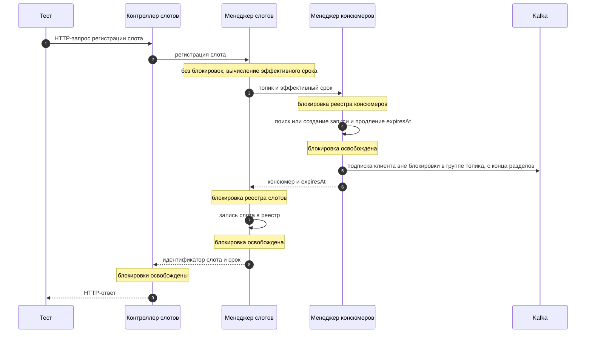
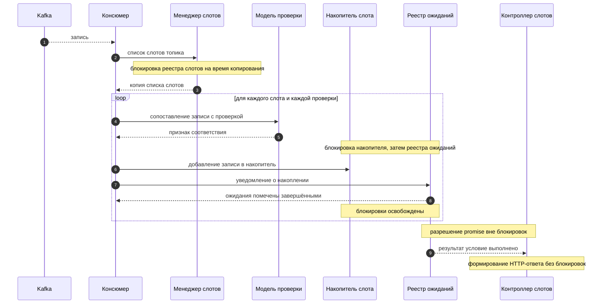
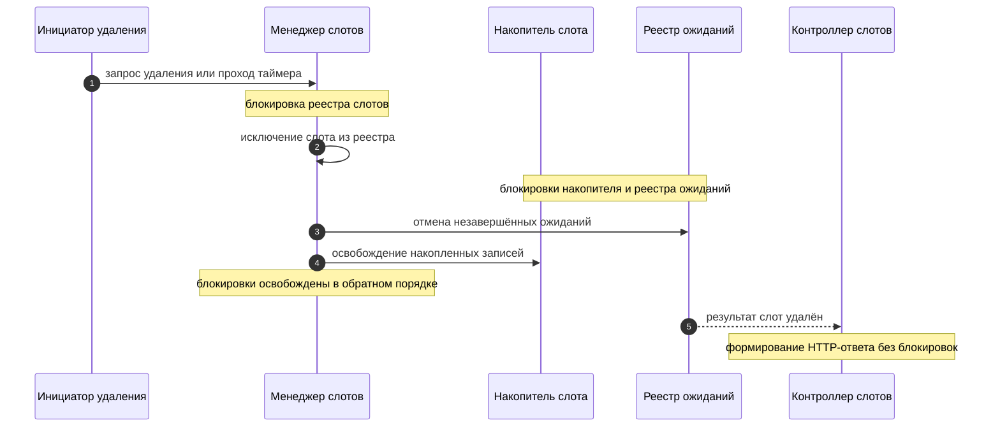

# Архитектура

Документ описывает внутреннее устройство сервиса: границы компонентов, потоки обработки записей, жизненный цикл слотов и консюмеров, а также правила конкурентного доступа. Контракт HTTP API вынесен в [`api.md`](api.md), а параметры и правила конфигурации — в [`configuration.md`](configuration.md). Назначение проекта, требования к запуску и инструкции по сборке остаются в [`../readme.md`](../readme.md); общие правила ведения документации определены в [`../AGENTS.md`](../AGENTS.md).

Состав документа:

- Назначение и границы системы
- Компоненты и их ответственность
- Потоки публикации и обработки записей
- Взаимодействие компонентов: матрица, сценарии и инварианты
- Жизненный цикл слота и консюмера, включая имя группы топика, её удаление и позицию чтения
- Модель проверок и асинхронного ожидания
- Фоновая очистка и завершение ресурсов
- Конкурентный доступ и предотвращение взаимных блокировок
- Тестовая архитектура
- Принятые архитектурные допущения

## Назначение и границы системы

### Назначение

Сервис — вспомогательный инструмент тестировщика, который замыкает асинхронный контур проверки: тестируемая система публикует результат операции в Kafka, а тест заранее объявляет, какие записи он ожидает увидеть, и затем асинхронно дожидается их появления. Сервис решает три задачи:

1. **Публикация.** Принимает запись по HTTP и передаёт её в топик Kafka, позволяя тесту инициировать асинхронную операцию без собственного клиента Kafka.
2. **Наблюдение.** Держит открытые слоты — точки наблюдения за топиком, в которых накапливаются записи, удовлетворяющие заданным проверкам.
3. **Ожидание.** Позволяет тесту дождаться появления нужного числа записей без синхронного опроса, после чего прочитать накопленные записи или их количество.

Ключевая идея архитектуры: слот открывается **до** инициирования тестируемой операции (это рекомендуемый порядок работы), поэтому записи, появившиеся в топике после открытия слота, попадают в него автоматически. Тесту не нужно опрашивать Kafka и не нужно знать смещения (`offset`).

### Ограничения первой версии

- **Одна реплика.** Состояние (слоты, накопленные записи, ожидания, консюмеры) хранится только в памяти процесса. Горизонтальное масштабирование и разделение состояния между репликами не поддерживается; при перезапуске все слоты и накопленные записи теряются.
- **Целевая нагрузка 10–50 RPS.** Архитектура рассчитана на небольшой поток публикаций и умеренное число одновременно открытых слотов. Пропускная способность не оптимизируется под высокие нагрузки.
- **Мягкая гарантия доставки.** Запись попадает в слот только если консюмер уже читает соответствующий топик. Записи, опубликованные до открытия первого слота по топику, в слот не попадают.
- **Отсутствие персистентности.** Реестры слотов, консюмеров и ожиданий не сохраняются на диск.
- **Один процесс на кластер.** Предполагается, что сервис не конкурирует с другими участниками группы консюмеров за те же топики. Имя группы включает идентификатор запуска, поэтому несколько экземпляров сервиса не попадают в одну группу, но это не защищает от сторонних клиентов, использующих то же имя.

### Входит в ответственность сервиса

- Проверка допустимости топика публикации по списку регулярных выражений `publisherTopics` и отклонение публикации в недопустимый топик.
- Передача записи в Kafka и выбор режима подтверждения по параметру `ack`.
- Ведение реестра слотов, привязка слота к топику и набору проверок, автоматическое и ручное удаление слотов.
- Создание, продление времени жизни и остановка консюмеров по одному на топик, формирование отдельного имени группы для каждого топика и попытка удаления группы этого топика после закрытия консюмера.
- Сопоставление каждой полученной записи с проверками всех активных слотов этого топика и накопление подходящих записей.
- Регистрация асинхронных ожиданий, их разрешение при выполнении условия и завершение по тайм-ауту или при удалении слота.
- Периодическая фоновая очистка двумя независимыми таймерами: удаление устаревших слотов и остановка бездействующих консюмеров.
- Публикация спецификации OpenAPI и интерфейса Swagger UI для описанного контракта.

### Не входит в ответственность сервиса

- Гарантия того, что тестируемая система вообще отправит запись: сервис только наблюдает топик и не влияет на поведение системы.
- Хранение истории записей топика, воспроизведение прошлых сообщений и работа с группами консюмеров за пределами собственных консюмеров сервиса. Удаление группы выполняется только для группы собственного топика и только как попытка после закрытия консюмера.
- Управление топиками, разделами и правами доступа в Kafka.
- Трансформация, фильтрация или обогащение публикуемых записей по смыслу: сервис не изменяет состав заголовков, ключа и значения. При этом представление JSON/HTTP преобразуется в исходные байты согласно типам `STRING`, `BINARY`, `JSON`; такое преобразование описано в [`api.md`](api.md) и не является обогащением.
- Аутентификация и авторизация клиентов API, квоты и ограничение частоты запросов.
- Долговременное хранение результатов тестов и формирование отчётов.
- Работа в конфигурации с несколькими репликами и согласование состояния между ними.

Контракт HTTP API, включая состав полей, ограничения параметров и коды ответов, описан в [`api.md`](api.md). Полный перечень параметров конфигурации, их значения по умолчанию и влияние на поведение системы описаны в [`configuration.md`](configuration.md); в этом документе параметры упоминаются только по имени.

## Компоненты и их ответственность

Сервис разделён на слои: HTTP-слой принимает запросы и не содержит бизнес-логики; сервисные компоненты владеют состоянием и реализуют правила; инфраструктурные компоненты работают с Kafka и таймерами.

| Компонент | Роль |
| --- | --- |
| HTTP-слой: контроллер публикации | Приём запроса публикации и формирование ответа |
| HTTP-слой: контроллер слотов | Приём запросов регистрации, ожидания, подсчёта, чтения и удаления слота |
| Сервис публикации | Проверка допустимости топика и передача записи в Kafka |
| Менеджер слотов | Реестр слотов: регистрация, поиск, удаление, срок жизни |
| Менеджер консюмеров | Создание, продление времени жизни и остановка консюмеров, попытка удаления группы топика |
| Имя группы консюмеров | Формирование отдельного имени группы для каждого топика из префикса, идентификатора запуска и 64-битного отпечатка имени топика; имя топика неизменно в пределах запуска |
| Консюмер | Чтение записей топика и маршрутизация их в слоты |
| Модель проверки | Сопоставление записи с условиями проверки |
| Реестр асинхронных ожиданий | Регистрация, разрешение и отмена ожиданий |
| Планировщик очистки слотов | Периодический запуск удаления слотов с истёкшим сроком |
| Планировщик проверки бездействия консюмеров | Периодический запуск остановки консюмеров с истёкшим временем жизни |

Взаимодействие компонентов образует четыре ветви:

- ветвь публикации: `HTTP-слой` → `Сервис публикации` → Kafka;
- ветвь наблюдения: `HTTP-слой` → `Менеджер слотов` → `Менеджер консюмеров` → `Консюмер` → `Модель проверки` → накопитель слота → `Реестр асинхронных ожиданий` → `HTTP-слой`; имя группы для консюмера берётся из компонента «Имя группы консюмеров» по имени топика, а после закрытия консюмера менеджер консюмеров пытается удалить группу этого топика из Kafka;
- ветвь очистки слотов: `Планировщик очистки слотов` → `Менеджер слотов`;
- ветвь проверки бездействия: `Планировщик проверки бездействия консюмеров` → `Менеджер консюмеров`.

Ветви не вызывают друг друга напрямую: публикация не уведомляет наблюдение, а наблюдение не влияет на результат публикации. Ветвь наблюдения связана с ветвью публикации только через топик Kafka, а ветви очистки — только через реестры менеджеров. Обе ветви очистки работают независимо друг от друга и не разделяют общий таймер. Попытка удаления группы топика выполняется менеджером консюмеров после закрытия консюмера и не является отдельной ветвью.

### HTTP-слой

**Ответственность.** Преобразование HTTP-запроса в вызов сервисного компонента, валидация формы запроса и формирование HTTP-ответа. Слой не хранит состояние и не принимает архитектурных решений о судьбе слотов.

**Входы.** HTTP-запросы к операциям публикации, регистрации слота, ожидания, подсчёта, чтения записей и удаления слота.

**Выходы.** Вызовы сервиса публикации и менеджера слотов; HTTP-ответ, собранный из результата вызова.

**Зависимости.** Сервис публикации и менеджер слотов, предоставляющий в том числе операции асинхронного ожидания, подсчёта и чтения.

**Инварианты.**
- Контроллер ожидания не блокирует поток обработки запроса: он регистрирует ожидание и возвращает управление, а ответ формируется по завершении `promise`.
- Контроллеры не работают с реестрами напрямую и не удерживают блокировки при формировании ответа.
- Любая ошибка валидации или отсутствие сущности преобразуется в ответ, описанный в [`api.md`](api.md).

### Сервис публикации

**Ответственность.** Проверка топика на соответствие списку `publisherTopics` и передача записи в Kafka с учётом режима подтверждения `ack`.

**Входы.** Имя топика, тело записи, значение `ack`.

**Выходы.** Результат передачи: подтверждённая отправка, принятие к отправке без ожидания подтверждения либо отказ по недопустимому топику.

**Зависимости.** Клиент Kafka REST API, конфигурация `publisherTopics` и `cluster`.

**Инварианты.**
- Пустой список `publisherTopics` означает отсутствие ограничений; непустой список требует совпадения хотя бы с одним регулярным выражением.
- Проверка топика выполняется до обращения к Kafka: недопустимый топик не создаёт сетевого вызова.
- Семантика заголовков, ключа и значения не изменяется, но представление преобразуется в исходные байты: `STRING` — UTF-8-байты текста, `JSON` — UTF-8-байты сериализованного JSON, `BINARY` — байты, полученные декодированием base64. В Kafka не передаются байты текста base64.
- Значения по умолчанию применяются только при отсутствии `type`: `STRING` для ключа и значений заголовков, `JSON` для значения. При некорректном `type` или некорректных данных публикация не выполняется с подстановкой типа по умолчанию.
- Публикация выполняется через Kafka REST API: запись передаётся HTTP-вызовом к REST-прокси Kafka, а не через нативный протокол клиента.
- Режим `ack` влияет только на то, дожидается ли сервис подтверждения брокера; на состав реестров слотов публикация не влияет.

### Менеджер слотов

**Ответственность.** Владение реестром слотов: создание слота с вычислением срока автоматического удаления, поиск слота по идентификатору, выдача слотов по топику для маршрутизации записей, удаление слота по запросу и по сроку.

**Входы.** Запрос регистрации слота (топик, набор проверок, необязательный срок), идентификатор слота для поиска и удаления, имя топика от консюмера, момент времени от планировщика очистки слотов.

**Выходы.** Идентификатор созданного слота, найденный слот, список слотов топика, признак успешного удаления, список ожиданий, которые нужно прервать.

**Зависимости.** Реестр слотов, менеджер консюмеров (при открытии слота), реестр асинхронных ожиданий (при удалении слота), источник текущего времени.

**Инварианты.**
- Слот всегда привязан к одному топику и неизменяемому набору проверок.
- Срок автоматического удаления фиксируется в момент создания слота и далее не пересчитывается.
- Значение срока из запроса имеет приоритет над значением по умолчанию; правило выбора описано в [`configuration.md`](configuration.md).
- Слот, удалённый по сроку или вручную, исчезает из реестра и из списка слотов своего консюмера; повторное удаление не меняет состояние.
- Удаление слота — единственная операция, после которой накопленные записи и связанные ожидания становятся недоступны.

### Менеджер консюмеров

**Ответственность.** Ведение реестра консюмеров по топикам: создание консюмера при первом слоте топика, продление его времени жизни, остановка, освобождение ресурсов и попытка удаления группы этого топика из Kafka.

**Входы.** Имя топика и срок автоматического удаления слота при открытии слота; момент времени от планировщика проверки бездействия; признак остановки сервиса.

**Выходы.** Существующий или созданный консюмер, обновлённое время жизни, факт остановки консюмера, результат попытки удаления группы топика.

**Зависимости.** Клиент Kafka, конфигурация `consumerGroupPrefix` и `consumerIdleSeconds`, фабрика консюмеров, реестр консюмеров, компонент «Имя группы консюмеров».

**Инварианты.**
- В реестре не более одного консюмера на топик в пределах процесса.
- Время жизни консюмера только увеличивается: новое значение применяется, лишь если оно больше текущего.
- Консюмер не останавливается, пока у него есть активные слоты.
- Остановка консюмера освобождает сетевые ресурсы клиента Kafka и удаляет запись из реестра.
- Имя группы запрашивается у компонента «Имя группы консюмеров» по имени топика при каждом открытии консюмера и не хранится в реестре консюмеров.
- Консюмер подписывается на топик с конца разделов, поэтому записи за время отключения не воспроизводятся.
- После закрытия консюмера выполняется попытка удаления группы этого топика; ошибка удаления регистрируется в журнале и не прерывает выполнение остальных операций.
- Попытка удаления группы не выполняется, если консюмер не был создан или если при завершении работы консюмеров не было.
- Повторное открытие консюмера по тому же топику выполняется после завершения попытки удаления его предыдущей группы.

### Имя группы консюмеров

**Ответственность.** Формирование имени группы консюмеров отдельно для каждого топика.

**Входы.** Значение параметра `consumerGroupPrefix`, идентификатор запуска приложения, имя топика.

**Выходы.** Имя группы топика, передаваемое создаваемому консюмеру.

**Зависимости.** Конфигурация `consumerGroupPrefix`, источник идентификатора запуска, функция MD5.

**Инварианты.**
- Имя группы строится по шаблону `{prefix}-{uuid}-{topicHash}`, где `{uuid}` — идентификатор запуска, а `{topicHash}` — беззнаковое 64-битное число из имени топика. Правила вычисления описаны в [`configuration.md`](configuration.md).
- Идентификатор запуска создаётся один раз при старте приложения и одинаков для всех групп этого запуска; при перезапуске создаётся новый.
- Имя группы зависит от топика: у разных топиков разные группы, поэтому закрытие консюмера одного топика не затрагивает группы других топиков. Исключение — совпадение 64-битных отпечатков, описанное ниже.
- Имя группы одного топика не меняется в пределах запуска приложения: повторное открытие консюмера по тому же топику использует то же имя.
- Имя группы не сохраняется на диск: при перезапуске приложения создаётся новый идентификатор запуска и новые имена групп.
- Имя группы не удаляется при отказе создания консюмера: попытка удаления выполняется только после закрытия созданного консюмера.
- Имя группы зависит только от `consumerGroupPrefix`, идентификатора запуска и имени топика. Оно не зависит от слотов, ожиданий, накопленных записей, операций чтения и подсчёта, состояния других топиков, результата удаления группы и состояния группы в Kafka.
- Имя группы не удаляется при повторном открытии консюмера: удаление выполняется только при закрытии консюмера.
- Имя группы не удаляется при завершении работы, если консюмеров не было: удалять нечего.
- 64-битный отпечаток не гарантирует отсутствие коллизий: при совпадении отпечатков двух разных имён топиков имена групп совпадут. Компонент обнаруживает такое совпадение в пределах запуска и регистрирует его в журнале.

### Консюмер

**Ответственность.** Чтение записей закреплённого топика и передача каждой записи всем активным слотам этого топика.

**Входы.** Поток записей из Kafka.

**Выходы.** Вызовы модели проверки и менеджера слотов для каждой записи.

**Зависимости.** Клиент Kafka, менеджер слотов, модель проверки, реестр асинхронных ожиданий.

**Инварианты.**
- Консюмер не фильтрует записи самостоятельно: решение о соответствии принимает только модель проверки.
- Одна запись может попасть в несколько слотов и в несколько проверок одного слота.
- Порядок записей внутри слота соответствует порядку их поступления из Kafka.
- Консюмер не удерживает блокировки реестров во время сетевого взаимодействия с Kafka.
- При каждом открытии консюмер начинает чтение с конца разделов топика и не использует сохранённые смещения (`offset`), поэтому записи за время отключения не воспроизводятся.

### Модель проверки

**Ответственность.** Сопоставление записи с условиями одной проверки: сравнение ожидаемых заголовков и значений, извлечённых по `jsonPath`.

**Входы.** Запись из Kafka, описание проверки.

**Выходы.** Признак соответствия.

**Зависимости.** Библиотека разбора JSON для вычисления `jsonPath`; строгий декодер UTF-8 для байтов заголовков и значения.

**Инварианты.**
- Проверка считается выполненной только при совпадении **всех** заданных заголовков и **всех** заданных значений.
- Пустой набор условий означает отсутствие ограничения по этой части проверки.
- Отсутствие заголовка или значения в записи трактуется как несовпадение, а не как ошибка.
- Байты проверяемого заголовка строго декодируются как UTF-8 и сравниваются с ожидаемой строкой; ошибка декодирования даёт несовпадение, а не подстановку символа замены. Заголовки, не указанные в проверке, не влияют на её результат.
- Значение записи сопоставляется с `jsonPath` только как JSON UTF-8; при недекодируемых или невалидных байтах значения условия `values` не совпадают.
- Модель проверки не имеет состояния и не зависит от порядка вызовов.

### Реестр асинхронных ожиданий

**Ответственность.** Хранение незавершённых ожиданий, проверка условия срабатывания при поступлении записи, разрешение `promise`, завершение по тайм-ауту и отмена при удалении слота.

**Входы.** Регистрация ожидания (слот, индекс проверки, требуемое число записей, тайм-аут); уведомление о новом накоплении; сигнал тайм-аута; сигнал удаления слота.

**Выходы.** Завершённый `promise` с результатом «условие выполнено», «тайм-аут» или «слот удалён».

**Зависимости.** Менеджер слотов, таймер тайм-аутов, источник текущего времени.

**Инварианты.**
- Каждое ожидание завершается ровно один раз: либо по условию, либо по тайм-ауту, либо по удалению слота.
- Условие проверяется сразу при регистрации: если требуемое число записей уже накоплено, ожидание разрешается без взведения таймера.
- Запись ожидания удаляется из реестра при любом варианте завершения.
- `promise` разрешается вне блокировок реестров и слота.

### Планировщик очистки слотов

**Ответственность.** Периодический запуск с интервалом 1 минута: удаление слотов с истёкшим сроком автоматического удаления.

**Входы.** Сигнал таймера, текущее время.

**Выходы.** Вызовы удаления в менеджере слотов.

**Зависимости.** Менеджер слотов, планировщик задач.

**Инварианты.**
- Интервал фиксирован и равен 1 минуте; параметрами конфигурации он не настраивается.
- Проходы не пересекаются: следующий запуск не начинается, пока не завершён предыдущий.
- Удаление слота выполняется по общему пути удаления, тому же, что и при ручном удалении.
- Ошибка удаления одного слота не прерывает обработку остальных.
- Планировщик останавливается при завершении работы сервиса.

### Планировщик проверки бездействия консюмеров

**Ответственность.** Периодический запуск с интервалом 10 минут: остановка консюмеров с истёкшим временем жизни, у которых нет активных слотов.

**Входы.** Сигнал таймера, текущее время.

**Выходы.** Вызовы остановки в менеджере консюмеров.

**Зависимости.** Менеджер консюмеров, менеджер слотов (для проверки наличия активных слотов), планировщик задач.

**Инварианты.**
- Интервал фиксирован и равен 10 минутам; параметрами конфигурации он не настраивается.
- Консюмер останавливается только при истёкшем времени жизни и отсутствии активных слотов.
- Проходы не пересекаются: следующий запуск не начинается, пока не завершён предыдущий.
- Ошибка остановки одного консюмера не прерывает обработку остальных.
- Планировщик останавливается при завершении работы сервиса.

## Потоки публикации и обработки записей

### Поток публикации (синхронный)

1. Тест отправляет HTTP-запрос публикации записи в топик с параметром `ack`.
2. Контроллер публикации передаёт имя топика, тело записи и значение `ack` в сервис публикации.
3. Сервис публикации проверяет топик по списку `publisherTopics`. Если список непуст и ни одно регулярное выражение не совпало, публикация отклоняется без обращения к Kafka, и контроллер формирует ответ об ошибке согласно [`api.md`](api.md).
4. Сервис публикации преобразует полезные данные заголовков, ключа и значения в исходные байты по типам `STRING`, `BINARY`, `JSON`, применяя значения по умолчанию только при отсутствии `type`. Некорректный тип или некорректные данные не публикуются с подстановкой типа по умолчанию.
5. Сервис публикации передаёт запись клиенту Kafka REST API, адрес которого задан параметром `cluster`; в Kafka попадают исходные байты, а base64 используется только как представление на границе REST-вызова.
6. При `ack`, требующем подтверждения, сервис дожидается подтверждения брокера и возвращает признак подтверждённой отправки. При `ack` без подтверждения сервис возвращает признак принятия к отправке, не дожидаясь ответа брокера.
7. Контроллер формирует HTTP-ответ, соответствующий результату.

Поток публикации полностью синхронен относительно HTTP-запроса и завершается до возврата ответа. Он не обращается к реестру слотов и не зависит от того, открыт ли слот по этому топику.

### Поток обработки записей (асинхронный)

1. Консюмер топика получает очередную запись из Kafka.
2. Консюмер запрашивает у менеджера слотов список активных слотов этого топика.
3. Если слотов нет, запись игнорируется: она не сохраняется и нигде не накапливается.
4. Для каждого слота и каждой проверки этого слота вызывается модель проверки.
5. При соответствии записи проверке она добавляется в накопитель этой проверки в порядке поступления; счётчик записей проверки увеличивается.
6. Для слота, в который произошло добавление, реестр ожиданий получает уведомление о новом накоплении.
7. Реестр ожиданий проверяет условия всех ожиданий этого слота и помечает завершёнными те, чьё требуемое число записей достигнуто. Пометка выполняется под блокировкой реестра ожиданий.
8. После освобождения блокировок помеченные ожидания разрешаются результатом «условие выполнено», и выполняется продолжение, формирующее HTTP-ответ на запрос ожидания.

Обработка записи не влияет на публикацию: консюмер не связан с HTTP-запросом публикации и не уведомляет его о результате.

### Развязка публикации и проверки

Публикация и наблюдение — независимые потоки, связанные только через топик Kafka:

- Слот можно открыть до публикации, после публикации или не открывать вовсе; публикация не проверяет наличие слота и не ждёт его появления.
- Порядок «сначала слот, затем публикация» — рекомендуемый сценарий теста, но не техническое требование архитектуры. Если слот открыт позже, уже прошедшие записи в него не попадут, поскольку консюмер начинает чтение с конца разделов.
- Публикация не возвращает идентификатор слота и не содержит признака попадания записи в слот: результат наблюдения проверяется только через операции ожидания, подсчёта и чтения.
- Задержка между подтверждением публикации и появлением записи в слоте определяется Kafka и не гарантируется сервисом; именно поэтому ожидание реализовано как асинхронное с тайм-аутом.
- Ни один из потоков не удерживает блокировку другого: публикация работает с клиентом Kafka, обработка — с реестрами в памяти.

## Взаимодействие компонентов: матрица, сценарии и инварианты

Раздел фиксирует взаимодействие компонентов на уровне пар и операций: какие компоненты вызывают друг друга, что именно передаётся и возвращается, какие блокировки удерживаются и как отказ на границе превращается в ответ. Контракт HTTP API, включая состав полей и коды ответов, описан в [`api.md`](api.md); значения параметров конфигурации — в [`configuration.md`](configuration.md). Здесь эти сведения не повторяются: упоминаются только имена операций, полей и параметров.

### Матрица взаимодействий компонентов

Обозначения в столбце «Синхронность»: **синхронный** — инициатор получает результат вызова в том же потоке; **асинхронный** — инициатор передаёт управление, а результат приходит позже по событию. Блокировки перечислены в порядке захвата согласно разделу «Конкурентный доступ и предотвращение взаимных блокировок».

| Пара компонентов | Направление | Что передаётся | Что возвращается | Синхронность | Блокировки |
| --- | --- | --- | --- | --- | --- |
| Контроллер публикации → Сервис публикации | HTTP-слой → сервис | имя топика, тело записи с заголовками, ключом и значением, значение `ack` | результат передачи: подтверждено, принято к отправке, топик недопустим, отказ Kafka | синхронный | нет; блокировки реестров не захватываются |
| Контроллер слотов → Менеджер слотов (регистрация) | HTTP-слой → менеджер | топик, набор проверок, необязательный `autoDeleteSeconds` | идентификатор слота и эффективный срок автоматического удаления | синхронный | две кратковременные блокировки последовательно: реестр консюмеров, затем реестр слотов; одновременно не удерживаются |
| Контроллер слотов → Менеджер слотов (ожидание) | HTTP-слой → менеджер | идентификатор слота, индекс проверки, требуемое число записей, тайм-аут | результат завершения: «условие выполнено», «тайм-аут» или «слот удалён» | асинхронный, ответ откладывается | реестр слотов при проверке существования; накопитель, затем реестр ожиданий слота при регистрации; при формировании ответа блокировок нет |
| Контроллер слотов → Менеджер слотов (подсчёт) | HTTP-слой → менеджер | идентификатор слота, индекс проверки | текущее число накопленных записей | синхронный | блокировка накопителя слота только на время снятия счётчика |
| Контроллер слотов → Менеджер слотов (чтение) | HTTP-слой → менеджер | идентификатор слота, индекс проверки, смещение (`offset`), лимит выборки (`count`) | снимок накопленных записей | синхронный | блокировка накопителя слота только на время копирования снимка |
| Контроллер слотов → Менеджер слотов (удаление) | HTTP-слой → менеджер | идентификатор слота | признак удаления либо признак отсутствия слота | синхронный | реестр слотов, затем накопитель, затем реестр ожиданий слота — общий путь удаления |
| Менеджер слотов → Менеджер консюмеров | менеджер → менеджер | имя топика и эффективный срок открываемого слота | существующий или созданный консюмер, обновлённое внутреннее поле `expiresAt` | синхронный | блокировка реестра консюмеров только на изменение записи; инициализация клиента Kafka — вне блокировки |
| Менеджер консюмеров → Имя группы консюмеров (чтение) | менеджер → компонент имени | имя топика | имя группы этого топика | синхронный | нет; имя группы вычисляется без блокировок |
| Менеджер консюмеров → Консюмер (создание) | менеджер → консюмер | имя топика, имя группы топика, ссылки на менеджер слотов и реестр ожиданий | экземпляр консюмера, подписанный на топик с конца разделов | синхронный по факту создания, чтение продолжается асинхронно | блокировка реестра консюмеров на запись; сетевая подписка — вне блокировки |
| Менеджер консюмеров → Консюмер (повторное открытие) | менеджер → консюмер | имя топика и имя группы топика | новый экземпляр консюмера с тем же именем группы, читающий с конца разделов | синхронный по факту создания, после завершения удаления предыдущей группы | блокировка реестра консюмеров на запись; имя группы не пересчитывается |
| Менеджер консюмеров → Консюмер (остановка) | менеджер → консюмер | команда остановки | подтверждение освобождения ресурсов | синхронный | блокировка реестра консюмеров на время решения и удаления записи; закрытие клиента Kafka — после освобождения блокировки |
| Менеджер консюмеров → Kafka (удаление группы) | менеджер → Kafka | имя группы топика | подтверждение удаления либо отказ | синхронный, выполняется после освобождения ресурсов консюмера | нет; блокировки реестров не удерживаются |
| Консюмер → Менеджер слотов (слоты топика) | консюмер → менеджер | имя топика | копия списка активных слотов топика | синхронный | блокировка реестра слотов только на время копирования списка |
| Консюмер → Модель проверки | консюмер → модель | запись и описание одной проверки | признак соответствия | синхронный | нет; модель проверки не имеет состояния |
| Консюмер → Накопитель слота | консюмер → накопитель | запись и индекс проверки | признак добавления и новое число накопленных записей | синхронный | блокировка накопителя слота; при проверке условий — вместе с реестром ожиданий слота в порядке иерархии |
| Консюмер → Реестр асинхронных ожиданий | консюмер → реестр | идентификатор слота и признак нового накопления | набор ожиданий, помеченных завершёнными | синхронный вызов, разрешение `promise` — отложенное | накопитель слота, затем реестр ожиданий слота; `promise` разрешается после освобождения блокировок |
| Менеджер слотов → Реестр асинхронных ожиданий (регистрация) | менеджер → реестр | слот, индекс проверки, требуемое число записей, тайм-аут | `promise` и признак немедленного завершения | синхронный | накопитель слота, затем реестр ожиданий слота |
| Менеджер слотов → Реестр асинхронных ожиданий (отмена при удалении) | менеджер → реестр | идентификатор слота | число отменённых ожиданий | синхронный | реестр слотов, накопитель, реестр ожиданий слота |
| Менеджер слотов → Накопитель слота (снимок) | менеджер → накопитель | идентификатор слота, индекс проверки, `offset`, `count` | копия записей и счётчик | синхронный | блокировка накопителя слота на время копирования |
| Таймер тайм-аута ожидания → Реестр асинхронных ожиданий | таймер → реестр | идентификатор ожидания, текущее время | признак завершения по тайм-ауту | отложенный, асинхронный | блокировка реестра ожиданий слота; `promise` разрешается после освобождения |
| Реестр асинхронных ожиданий → HTTP-слой | реестр → HTTP-слой | результат завершения ожидания и снимок накопленных записей | HTTP-ответ, собранный контроллером | асинхронный | нет; продолжение выполняется вне блокировок |
| Планировщик очистки слотов → Менеджер слотов | планировщик → менеджер | текущее время и признак автоматического удаления | список удалённых слотов и ошибки по отдельным слотам | синхронный | по одному слоту: реестр слотов, накопитель, реестр ожиданий слота |
| Планировщик проверки бездействия → Менеджер консюмеров | планировщик → менеджер | текущее время | список остановленных консюмеров и ошибки по отдельным консюмерам | синхронный | реестр консюмеров на время решения; закрытие ресурсов — после освобождения |
| Планировщик проверки бездействия → Менеджер слотов | планировщик → менеджер консюмеров → менеджер слотов | имя топика проверяемого консюмера | признак наличия активных слотов | синхронный | реестр слотов при удерживаемой блокировке реестра консюмеров; порядок иерархии «реестр консюмеров → реестр слотов» соблюдён |
| Сервис публикации → Kafka REST API | сервис → Kafka | HTTP-вызов с телом записи и режимом `ack` | подтверждение брокера либо отказ | синхронный при подтверждающем `ack`, без ожидания при `ack` без подтверждения | нет; блокировки реестров не удерживаются |
| Консюмер → Kafka | консюмер → Kafka | подписка на топик с конца разделов и запрос очередной записи | запись либо отсутствие данных | асинхронный поток чтения | нет; сетевой обмен идёт без блокировок реестров |

Направление зависимостей по матрице: планировщики зависят от менеджеров, менеджеры от планировщиков не зависят; HTTP-слой зависит от сервиса публикации и менеджера слотов и не обращается к реестрам напрямую; реестры и накопитель не вызывают менеджеров; консюмер не вызывает менеджер консюмеров и не управляет собственным жизненным циклом. Удаление группы топика выполняет только менеджер консюмеров, и только после закрытия консюмера. Имя группы вычисляет только компонент «Имя группы консюмеров».

Пары, которые в архитектуре отсутствуют и не должны появиться в реализации: контроллеры не обращаются к реестрам, накопителю и реестру ожиданий; сервис публикации не обращается к менеджерам и реестрам; консюмер не изменяет реестр слотов и реестр консюмеров и не удаляет группу; менеджер консюмеров не обращается к накопителю и реестру ожиданий; планировщики не вызывают друг друга и не обращаются к накопителю и реестру ожиданий напрямую. Удаление группы топика не выполняется при открытии консюмера: оно выполняется только при закрытии.

### Сквозные сценарии взаимодействия

Сценарии описывают последовательность вызовов с указанием участников и границ блокировок. Общие правила вычисления сроков, совпадения проверок и завершения ожиданий описаны в соответствующих разделах документа и здесь не повторяются.

#### С1. Регистрация слота

1. Тест отправляет HTTP-запрос регистрации слота. Контроллер слотов проверяет форму запроса и вызывает менеджер слотов. Блокировки не удерживаются.
2. Менеджер слотов вычисляет эффективный срок автоматического удаления: значение `autoDeleteSeconds` из запроса либо значение `autoDeleteSlotsSeconds`; правило приоритета описано в [`configuration.md`](configuration.md). Вычисление выполняется без блокировок.
3. Менеджер слотов вызывает менеджер консюмеров, передавая имя топика и эффективный срок. Менеджер консюмеров захватывает блокировку реестра консюмеров.
4. Под блокировкой реестра консюмеров консюмер для этого топика либо находится, либо создаётся; вычисляется `expiresAt = max(expiresAt, now() + consumerIdleSeconds + autoDeleteSeconds)`. Блокировка освобождается; сетевая подписка клиента Kafka выполняется вне блокировки в группе этого топика, имя которой вычисляется по шаблону `{prefix}-{uuid}-{topicHash}` и не пересчитывается при повторном открытии. Подписка начинается с конца разделов топика.
5. Менеджер слотов захватывает блокировку реестра слотов и регистрирует слот: топик, неизменяемый набор проверок, срок автоматического удаления, пустой накопитель и пустой реестр ожиданий слота. Блокировка освобождается.
6. Менеджер слотов возвращает контроллеру идентификатор слота и эффективный срок; к этому моменту блокировки уже освобождены.
7. Контроллер слотов формирует HTTP-ответ. Направление ответа не удерживает ни одной блокировки.
8. Если создание консюмера завершилось отказом — не удалась подписка клиента Kafka или инициализация клиента, — запись реестра консюмеров откатывается, слот в реестре слотов не регистрируется, накопление не начинается, и контроллер слотов формирует ответ об отказе согласно [`api.md`](api.md); порядок обработки отказа описан в подразделе «Обработка отказов на границах компонентов». Попытка удаления группы при таком отказе не выполняется: консюмер не был создан.

#### С2. Публикация записи

1. Тест отправляет HTTP-запрос публикации. Контроллер публикации передаёт сервису публикации имя топика, тело записи и значение `ack`. Блокировки не удерживаются.
2. Сервис публикации сравнивает топик со списком `publisherTopics`: пустой список означает отсутствие ограничений, непустой требует совпадения хотя бы с одним регулярным выражением.
3. **Недопустимый топик.** Публикация отклоняется до обращения к Kafka: Kafka REST API не вызывается, сетевое соединение не устанавливается, реестры не изменяются. Контроллер публикации формирует ответ об отказе согласно [`api.md`](api.md).
4. **Допустимый топик.** Сервис публикации преобразует заголовки, ключ и значение в исходные байты согласно типам `STRING`, `BINARY`, `JSON` и формирует HTTP-вызов к Kafka REST API по адресу `cluster`. Состав заголовков, ключа и значения не изменяется, меняется только представление.
5. При подтверждающем `ack` сервис публикации ожидает ответа брокера и возвращает признак подтверждённой отправки. При `ack` без подтверждения сервис возвращает признак принятия к отправке, не дожидаясь ответа брокера.
6. Контроллер публикации формирует HTTP-ответ по результату передачи. Блокировки не удерживаются.
7. Публикация не обращается к реестру слотов и не сообщает наблюдению о результате: попадание записи в слот проверяется только последующими операциями ожидания, подсчёта и чтения.

#### С3. Обработка записи консюмером

1. Консюмер получает очередную запись из Kafka. Сетевой обмен выполняется без блокировок реестров.
2. Консюмер вызывает менеджер слотов и запрашивает список активных слотов своего топика. Менеджер слотов захватывает блокировку реестра слотов, копирует список и освобождает блокировку; консюмер работает с копией.
3. Если копия пуста, запись игнорируется: накопления не происходит, уведомлений реестру ожиданий не поступает.
4. Для каждого слота копии и каждой проверки этого слота консюмер вызывает модель проверки. Модель проверки не имеет состояния и не удерживает блокировок.
5. При соответствии записи проверке консюмер захватывает блокировку накопителя слота и добавляет копию записи в накопитель этой проверки; счётчик увеличивается.
6. Не освобождая накопитель, консюмер захватывает блокировку реестра ожиданий этого слота — порядок иерархии соблюдён — и уведомляет реестр о новом накоплении. Реестр помечает завершёнными ожидания, чьё требуемое число записей достигнуто, и удаляет их записи из реестра.
7. Блокировки освобождаются в обратном порядке: реестр ожиданий слота, затем накопитель.
8. После освобождения блокировок помеченные `promise` разрешаются результатом «условие выполнено»; продолжение формирует HTTP-ответ на ранее пришедший запрос ожидания.
9. Шаги 4–8 повторяются для каждого слота и каждой проверки независимо; блокировки разных слотов никогда не удерживаются одновременно.
10. Обработка записи не влияет на публикацию: консюмер не связан с HTTP-запросом публикации и не сообщает ему о результате.

#### С4. Асинхронное ожидание

1. Тест отправляет HTTP-запрос ожидания: слот, индекс проверки, требуемое число записей, тайм-аут. Контроллер слотов передаёт параметры менеджеру слотов. Блокировки не удерживаются.
2. Менеджер слотов под блокировкой реестра слотов проверяет существование слота, фиксирует ссылку на него и освобождает блокировку. Если слот отсутствует, контроллер формирует ответ об отсутствии слота согласно [`api.md`](api.md).
3. Менеджер слотов регистрирует ожидание в реестре: под блокировкой накопителя слота, затем под блокировкой реестра ожиданий слота создаётся запись ожидания с `promise` и признаком завершённости.
4. Под той же блокировкой выполняется немедленная проверка условия: если требуемое число записей уже накоплено, ожидание помечается завершённым результатом «условие выполнено» и удаляется из реестра; таймер тайм-аута не взводится.
5. Блокировки освобождаются. Если ожидание помечено завершённым, `promise` разрешается сразу, и ответ формируется без задержки.
6. Если условие не выполнено, взводится отложенная задача тайм-аута, а управление возвращается в цикл обработки запросов. Поток обработки запроса не удерживается; HTTP-ответ откладывается до разрешения `promise`.
7. **Завершение по условию.** При добавлении записи консюмером реестр ожиданий под своей блокировкой помечает ожидание завершённым и удаляет его; после освобождения блокировок `promise` разрешается результатом «условие выполнено».
8. **Завершение по тайм-ауту.** Отложенная задача захватывает блокировку реестра ожиданий слота. Если признак завершённости не установлен, ожидание помечается завершённым результатом «тайм-аут» и удаляется из реестра; после освобождения блокировки `promise` разрешается.
9. **Повторное событие.** Если ожидание уже завершено другим событием, отложенная задача не выполняет действий: повторного разрешения `promise` не происходит, ответ формируется один раз.
10. После разрешения `promise` контроллер слотов формирует ответ по результату: «условие выполнено» — с накопленными данными, «тайм-аут» — с признаком истечения времени, «слот удалён» — с признаком прекращения наблюдения. Коды и состав ответов описаны в [`api.md`](api.md); при формировании ответа блокировки не удерживаются.

#### С5. Удаление слота вручную и по сроку

Инициатором выступает либо HTTP-запрос удаления, либо проход планировщика очистки слотов. Оба варианта используют один и тот же путь удаления.

1. Инициатор вызывает менеджер слотов: контроллер слотов передаёт идентификатор слота, планировщик очистки слотов — текущее время и признак автоматического удаления. На входе блокировки не удерживаются.
2. Менеджер слотов захватывает блокировку реестра слотов и исключает слот из реестра; после этого новые записи в слот не маршрутизируются. Если слота нет, ручное удаление сообщает об отсутствии слота, а проход таймера пропускает шаг; повторное удаление состояние не меняет.
3. Не освобождая реестр слотов, менеджер слотов захватывает блокировку накопителя слота, затем блокировку реестра ожиданий слота — порядок иерархии соблюдён.
4. Под блокировкой реестра ожиданий все незавершённые ожидания слота помечаются завершёнными результатом «слот удалён» и удаляются из реестра; отложенные задачи тайм-аута снимаются.
5. Накопленные записи всех проверок освобождаются вместе со слотом. Операции подсчёта и чтения по удалённому слоту сообщают об отсутствии слота согласно [`api.md`](api.md).
6. Блокировки освобождаются в обратном порядке: реестр ожиданий слота, накопитель, реестр слотов.
7. После освобождения блокировок разрешаются `promise` отменённых ожиданий; контроллер слотов формирует ответы на ранее пришедшие запросы ожидания.
8. Исключение слота из списка слотов консюмера происходит в том же шаге 2, поскольку список слотов топика хранится в реестре слотов: отдельное уведомление консюмеру не требуется, а в следующей копии списка удалённый слот отсутствует. Если удалён последний слот топика, консюмер переходит в состояние `Простаивает` и не останавливается до истечения `expiresAt`.
9. Запись, полученная консюмером после шага 2, в удалённый слот не попадает: копия списка слотов её уже не содержит, а накопитель освобождён.

#### С6. Фоновая очистка консюмера

1. Проход планировщика проверки бездействия консюмеров начинается по расписанию 10 минут. Предыдущий проход уже завершён, пересечения нет; на входе блокировки не удерживаются. Идентификатор запуска уже создан при старте приложения, а имя группы топика вычисляется по нему и не пересчитывается.
2. Планировщик передаёт менеджеру консюмеров текущее время и запрашивает проверку консюмеров с истёкшим временем жизни: текущий момент больше `expiresAt`. Блокировки на этом шаге не удерживаются.
3. Для каждого кандидата менеджер консюмеров захватывает блокировку реестра консюмеров и удерживает её до принятия решения.
4. Под этой блокировкой менеджер консюмеров запрашивает у менеджера слотов наличие активных слотов топика. Менеджер слотов захватывает блокировку реестра слотов, что соответствует порядку иерархии «реестр консюмеров → реестр слотов», и возвращает признак наличия слотов.
5. Если активные слоты есть, консюмер сохраняется: блокировки освобождаются, запись остаётся в реестре до следующего прохода.
6. Если активных слотов нет, под блокировкой реестра консюмеров принимается решение об остановке и запись исключается из реестра.
7. Блокировки освобождаются; после освобождения освобождаются сетевые ресурсы клиента Kafka и фоновый поток чтения консюмера.
8. После освобождения ресурсов выполняется попытка удаления группы этого топика из Kafka. Ошибка удаления группы записывается в журнал и не прерывает проход: остальные кандидаты обрабатываются по тем же шагам.
9. Ошибка на одном консюмере регистрируется и не прерывает проход: остальные кандидаты обрабатываются по тем же шагам.
10. Проход не удаляет слоты и не вызывает второй таймер: удаление слотов выполняет планировщик очистки слотов, а планировщики не вызывают друг друга и не разделяют общий таймер. Консюмер, сохранённый на шаге 5, будет проверен повторно через 10 минут.

### Диаграммы последовательности для С1, С3 и С5

Диаграммы дополняют нумерованные шаги и показывают те же вызовы в порядке времени. Участники объявлены латинскими идентификаторами с русскими подписями; блоки `Note over` обозначают границы удержания блокировок.

С1. Регистрация слота.



С3. Обработка записи консюмером.



С5. Удаление слота.



### Правила межкомпонентного взаимодействия

1. **HTTP-слой не удерживает блокировки и не работает с реестрами.** Контроллеры вызывают только сервис публикации и менеджер слотов, получают результат и формируют ответ после того, как все блокировки освобождены. Единственная операция с отложенным ответом — ожидание по проверке.
2. **Сервис публикации изолирован от наблюдения.** Он не обращается к реестру слотов, реестру консюмеров и реестру ожиданий, не проверяет наличие слота и не влияет на накопление. Связь публикации с наблюдением существует только через топик Kafka.
3. **Консюмер не фильтрует записи сам.** Решение о соответствии принимает только модель проверки; консюмер не сравнивает заголовки и значения и не отбрасывает записи по собственным правилам. Во время сетевого взаимодействия с Kafka консюмер не удерживает блокировки реестров.
4. **Единственные точки изменения реестров.** Реестр слотов изменяется только через менеджер слотов, реестр консюмеров — только через менеджер консюмеров. Планировщики, консюмер и HTTP-слой изменяют эти реестры исключительно вызовами соответствующих менеджеров. Имя группы вычисляется компонентом «Имя группы консюмеров» по имени топика и не хранится в реестрах; удаление группы топика выполняет только менеджер консюмеров.
5. **Единственный путь изменения накопителя.** Накопитель слота изменяется только по пути «консюмер → модель проверки → накопитель». Операции подсчёта и чтения работают со снимком и накопитель не изменяют; менеджер слотов освобождает накопитель только при удалении слота.
6. **Ограниченный набор операций реестра ожиданий.** Реестр ожиданий изменяется только регистрацией ожидания, разрешением по условию, завершением по тайм-ауту и отменой при удалении слота. Других способов добавить, изменить или удалить запись ожидания не существует.
7. **Независимость планировщиков.** Планировщик очистки слотов и планировщик проверки бездействия консюмеров не вызывают друг друга, не делят общий таймер и не выполняют работу другого: первый удаляет слоты, второй останавливает консюмеров.
8. **Направление зависимостей.** Планировщики зависят от менеджеров; менеджеры от планировщиков не зависят. Реестры и накопитель не вызывают менеджеров. Консюмер зависит от менеджера слотов, модели проверки и реестра ожиданий, но не от менеджера консюмеров. Менеджер консюмеров запрашивает имя группы топика у компонента «Имя группы консюмеров» и не хранит его.
9. **Отсутствие обратного прохода по блокировкам.** Если операции требуются данные более высокого уровня, она фиксирует их под верхней блокировкой, освобождает её и продолжает работу; удержание нижней блокировки при захвате верхней запрещено.

### Синхронность и асинхронность операций

| Операция | Относительно HTTP-запроса | Что ожидает | Что не ожидает | Предельное время удержания ресурсов |
| --- | --- | --- | --- | --- |
| Публикация записи | синхронная | ответ Kafka REST API при подтверждающем `ack` | появления слота и обработки записи консюмером | длительность сетевого вызова к Kafka; блокировки реестров не удерживаются |
| Регистрация слота | синхронная | создания или продления консюмера и записи в реестр слотов | первой записи из Kafka и первого ожидания | две кратковременные блокировки последовательно: реестр консюмеров, затем реестр слотов; сетевая подписка вне блокировок |
| Ожидание по проверке | асинхронная, ответ откладывается | разрешения `promise` по событию | поступления записей в потоке обработки запроса и удержания блокировки при формировании ответа | до разрешения `promise`, но не дольше тайм-аута ожидания; поток не удерживается, блокировки — только на время пометки |
| Подсчёт записей проверки | синхронная | снимка счётчика накопителя | новых записей и завершения ожиданий | время копирования счётчика под блокировкой накопителя |
| Чтение записей проверки | синхронная | снимка накопителя по `offset` и `count` | новых записей и завершения ожиданий | время копирования снимка под блокировкой накопителя |
| Удаление слота | синхронная | исключения слота из реестра и отмены ожиданий | разрешения отменённых `promise` | три блокировки в пути удаления: реестр слотов, накопитель, реестр ожиданий слота; `promise` разрешаются после освобождения |
| Обработка записи консюмером | вне HTTP-запроса | копии списка слотов топика и блокировок накопителя и ожиданий | HTTP-запроса публикации и его ответа | блокировки только на время добавления и проверки условий; сетевой обмен с Kafka вне блокировок |
| Создание консюмера | синхронная в составе регистрации слота | подтверждения подписки клиента Kafka | первой записи и первого слота по топику | блокировка реестра консюмеров только на изменение записи; подписка вне блокировки; чтение начинается с конца разделов |
| Остановка консюмера | вне HTTP-запроса либо при завершении работы | решения по активным слотам топика | завершения обработки текущей записи | блокировка реестра консюмеров на время решения; закрытие клиента Kafka после освобождения |
| Удаление группы топика | вне HTTP-запроса, после закрытия консюмера | подтверждения удаления группы от Kafka | закрытия консюмера и освобождения его ресурсов | блокировки реестров не удерживаются; ошибка только регистрируется в журнале |
| Проход планировщика очистки слотов | вне HTTP-запроса | завершения предыдущего прохода | HTTP-запросов и разрешения ожиданий | блокировки по одному слоту за раз в порядке иерархии |
| Проход планировщика проверки бездействия | вне HTTP-запроса | завершения предыдущего прохода | HTTP-запросов | реестр консюмеров, при проверке слотов — реестр слотов; по одному консюмеру за раз |

Единственная операция, ответ на которую откладывается, — ожидание по проверке. Она реализуется через `promise`: контроллер регистрирует ожидание, возвращает управление в цикл обработки запросов и формирует ответ в продолжении `promise`. Удержания потока, блокирующих пауз и опроса счётчиков не происходит; все остальные операции завершаются до возврата ответа и не зависят от будущих событий.

### Обработка отказов на границах компонентов

| Ситуация | Кто обнаруживает | Действие компонента | Кто формирует ответ API |
| --- | --- | --- | --- |
| Недоступность Kafka REST API при публикации | Сервис публикации | Публикация считается неуспешной; запись не передаётся; повторных попыток, очередей и фоновой досылки нет; реестры не затрагиваются | Контроллер публикации |
| Отказ создания консюмера при открытии слота | Менеджер консюмеров | Слот в реестре слотов не регистрируется; запись реестра консюмеров откатывается, частичного состояния не остаётся; накопление не начинается; попытка удаления группы не выполняется | Контроллер слотов |
| Ошибка вычисления `jsonPath` | Модель проверки | Трактуется как несовпадение, а не как отказ обработки; запись не попадает в эту проверку, но может попасть в другие проверки и слоты; консюмер продолжает обработку | Ответ не формируется, операция выполняется вне HTTP-запроса |
| Отказ при удалении слота в проходе таймера | Менеджер слотов, планировщик очистки слотов | Ошибка регистрируется, проход продолжается; удаление выполняется в одной критической секции, поэтому слот либо удалён полностью, либо не изменён; повторный проход идемпотентен | Ответ не формируется, операция фоновая |
| Обрыв соединения консюмера с Kafka | Консюмер, менеджер консюмеров | Ошибка регистрируется; реестры не изменяются; слоты живут до истечения своего срока, ожидания завершаются по тайм-ауту; остановка консюмера выполняется по общему правилу | Ответ не формируется, операция выполняется вне HTTP-запроса |
| Отказ удаления группы топика | Менеджер консюмеров | Ошибка регистрируется в журнале; удаление не повторяется в рамках того же закрытия; остальные операции закрытия, обработка запросов и фоновая очистка продолжаются; состояние слотов и ожиданий не изменяется; при следующем открытии консюмер всё равно читает с конца разделов | Ответ не формируется, операция выполняется вне HTTP-запроса |
| Остановка сервиса во время активных ожиданий | Сервис при завершении работы | Незавершённые ожидания разрешаются результатом о прекращении работы, таймеры тайм-аутов снимаются, реестры очищаются; персистентного состояния нет | Контроллеры, если соединение ещё открыто; иначе соединение прерывается |

Отказ на границе не «протекает» через слои: сервисные компоненты возвращают типизированный результат без знания о кодах HTTP, а преобразование результата или отказа в ответ API выполняет исключительно HTTP-слой. Соответствие результатов и кодов описано в [`api.md`](api.md). Отказ одного компонента не оставляет частичного состояния: регистрация слота либо завершается полностью, либо не изменяет реестры, а удаление слота идемпотентно и допускает повторный проход.

## Жизненный цикл слота и консюмера

### Состояния слота и переходы

Слот проходит следующие состояния:

- **Создан (активен, накопление).** Слот зарегистрирован в реестре, привязан к топику и проверкам, срок автоматического удаления вычислен. В этом состоянии записи сопоставляются с проверками и накапливаются.
- **Ожидание (активен, есть незавершённые ожидания).** Подсостояние активного слота: в реестре ожиданий есть хотя бы одна запись для этого слота. Накопление продолжается параллельно с ожиданием; состояние не блокирует приём записей.
- **Удалён по сроку.** Слот удалён планировщиком очистки слотов, поскольку его срок автоматического удаления истёк.
- **Удалён вручную.** Слот удалён по явному запросу до истечения срока.

Переходы:

1. `Создан` → `Ожидание`: регистрация первого ожидания по любой проверке слота.
2. `Ожидание` → `Создан`: завершение последнего ожидания (условие выполнено, тайм-аут или удаление слота).
3. `Создан` или `Ожидание` → `Удалён по сроку`: срабатывание прохода таймера очистки слотов при истёкшем сроке.
4. `Создан` или `Ожидание` → `Удалён вручную`: явный запрос удаления.

Состояния «удалён» терминальны: слот не восстанавливается, его идентификатор больше не используется, повторное удаление не является ошибкой состояния реестра и обрабатывается как отсутствие слота.

### Правила вычисления срока автоматического удаления

- Срок вычисляется один раз, в момент создания слота, как `now() + autoDeleteSeconds`, где `autoDeleteSeconds` — значение из запроса слота, а при его отсутствии — значение параметра `autoDeleteSlotsSeconds` (правило приоритета и значения по умолчанию описаны в [`configuration.md`](configuration.md)).
- Значение слота имеет приоритет над значением по умолчанию; значение по умолчанию не переопределяет явно заданный срок.
- Срок не продлевается при поступлении записей, при регистрации ожиданий и при операциях чтения: слот живёт ровно отведённое ему время с момента создания.
- Срок не продлевается при удалении соседних слотов того же топика.

### Состояния консюмера и переходы

- **Создаётся.** Менеджер консюмеров завёл запись в реестре и инициализирует клиента Kafka, подписывая его на топик в группе этого топика по шаблону `{prefix}-{uuid}-{topicHash}`. Имя группы запрашивается у компонента «Имя группы консюмеров» по имени топика. Подписка начинается с конца разделов топика.
- **Работает.** Консюмер подписан на топик, получает записи и передаёт их в слоты; у него есть хотя бы один активный слот.
- **Простаивает.** Консюмер подписан и продолжает читать топик, но активных слотов нет: получаемые записи игнорируются. Консюмер остаётся в реестре до истечения времени жизни.
- **Останавливается.** Консюмер снимается с подписки, его клиент закрывается, запись удаляется из реестра, после чего выполняется попытка удаления группы этого топика из Kafka. Остановку по бездействию инициирует планировщик проверки бездействия консюмеров, остановку при завершении работы — сам сервис. Ошибка удаления группы записывается в журнал и не меняет результат остановки. Если консюмер не был создан, попытка удаления группы не выполняется. Если при завершении работы консюмеров не было, попытка удаления группы также не выполняется.
- **Открывается заново.** После остановки консюмера новый слот по тому же топику создаёт консюмер заново с тем же именем группы этого топика; удаление группы не блокирует повторное открытие. Повторное открытие не создаёт новое имя группы и не изменяет уже вычисленное. Позиция чтения при этом не восстанавливается: новый консюмер читает топик с конца разделов на момент создания, поэтому записи за время отключения не воспроизводятся. Если группа была удалена, повторное открытие создаёт её заново под тем же именем. Повторное открытие не выполняет удаление группы: удаление выполняется только при закрытии консюмера. Повторное открытие не изменяет время жизни других консюмеров. Повторное открытие выполняется после завершения попытки удаления предыдущей группы этого топика.

Переходы:

1. `Создаётся` → `Работает`: открытие первого слота по топику.
2. `Работает` → `Простаивает`: удаление последнего активного слота топика.
3. `Простаивает` → `Работает`: открытие нового слота по тому же топику, если консюмер ещё не остановлен.
4. `Простаивает` → `Останавливается`: истёк срок жизни и активных слотов нет.
5. `Работает` или `Простаивает` → `Останавливается`: завершение работы сервиса.

### Правило продления времени жизни консюмера

При каждом открытии слота для топика менеджер консюмеров вычисляет предполагаемое время жизни:

```
предполагаемое = now() + consumerIdleSeconds + autoDeleteSeconds
```

где `autoDeleteSeconds` — эффективный срок автоматического удаления открываемого слота. Предполагаемое значение применяется только если оно больше текущего. Время, до которого консюмер должен жить, хранится во внутреннем поле `expiresAt` (момент истечения времени жизни консюмера):

```
expiresAt = max(expiresAt, предполагаемое)
```

Следствия правила:

- Время жизни никогда не уменьшается: открытие слота с коротким сроком не сокращает жизнь уже существующего консюмера.
- Консюмер гарантированно переживает все свои слоты: срок жизни включает время бездействия плюс срок последнего открытого слота.
- Время жизни не пересчитывается при поступлении записей и при операциях чтения, поэтому активное наблюдение не удерживает консюмер бесконечно.
- Время жизни не продлевается при ручном удалении слота: удаление слота не создаёт нового обязательства по чтению топика.

### Условие остановки консюмера

Условие проверяется планировщиком проверки бездействия консюмеров раз в 10 минут. Консюмер останавливается, когда одновременно выполнены два условия:

1. Текущий момент превышает внутреннее поле `expiresAt` консюмера.
2. У консюмера нет активных слотов.

Если срок истёк, но активные слоты есть, консюмер продолжает работать: слоты остаются наблюдаемыми до собственного удаления. Такая ситуация возможна только при расхождении часов или при ручном изменении срока и рассматривается как защитное условие. При остановке освобождаются сетевые соединения клиента Kafka, фоновый поток чтения и запись реестра, после чего выполняется попытка удаления группы этого топика из Kafka. Ошибка удаления группы записывается в журнал и не прерывает выполнение остальных операций: закрытие других консюмеров, обработку запросов и фоновую очистку.

### Правила удаления группы консюмеров

Правила формирования имени группы описаны в разделе «Имя группы консюмеров», а значения параметра `consumerGroupPrefix` — в [`configuration.md`](configuration.md).

- Группа принадлежит одному топику, поэтому её удаление после закрытия консюмера не затрагивает консюмеров других топиков. Исключение — совпадение 64-битных отпечатков двух имён топиков, которое обнаруживается и регистрируется в журнале.
- Удаление группы выполняется при каждом закрытии консюмера, в том числе при закрытии по бездействию. Это желаемое поведение: при следующем открытии консюмера записи, пришедшие за время отключения, не воспроизводятся.
- Ошибка удаления группы не является отказом закрытия консюмера: консюмер к этому моменту уже закрыт, его запись удалена из реестра, а слоты и ожидания не затронуты.
- Попытка удаления выполняется один раз на закрытие консюмера; повторных попыток и фоновой досылки нет.
- Попытка удаления не выполняется, если консюмер не был создан: при отказе создания консюмера группа не удаляется.
- Если группа удалена, а затем по тому же топику открывается новый слот, консюмер создаётся заново с тем же именем группы этого топика: удаление группы не блокирует повторное открытие. Повторное открытие выполняется после завершения попытки удаления предыдущей группы этого топика.
- Удаление группы не изменяет позицию чтения: новый консюмер читает топик с конца разделов на момент создания независимо от результата удаления.
- Перед выходом из программы попытка удаления выполняется для каждого закрытого консюмера; её результат только записывается в журнал и не препятствует завершению работы.
- Если при завершении работы консюмеров не было, попытка удаления группы не выполняется: удалять нечего.
- Удаление группы не удерживает блокировки реестров: оно выполняется после освобождения ресурсов консюмера и удаления его записи из реестра консюмеров.

### Что происходит при удалении слота

Удаление слота — по сроку или вручную — выполняется как единая операция:

1. Слот помечается удалённым и исключается из реестра слотов, поэтому новые записи в него больше не маршрутизируются.
2. Слот исключается из списка слотов своего консюмера.
3. Все незавершённые ожидания этого слота завершаются результатом «слот удалён»; их записи удаляются из реестра ожиданий, таймеры тайм-аутов снимаются.
4. Накопленные записи всех проверок слота освобождаются вместе со слотом и становятся недоступны: операции подсчёта и чтения по удалённому слоту возвращают признак отсутствия слота согласно [`api.md`](api.md).
5. Если слот был последним для топика, консюмер переходит в состояние `Простаивает`, но не останавливается до истечения времени жизни.

## Модель проверок и асинхронного ожидания

### Структура проверки

Проверка состоит из двух независимых наборов условий:

- **Заголовки.** Набор ожидаемых пар «имя заголовка — значение заголовка». Ожидаемое значение — обычная UTF-8-строка, а не base64.
- **Значения.** Набор ожидаемых пар «`jsonPath` — ожидаемое значение», где `jsonPath` вычисляется по значению записи, представленному как JSON UTF-8.

Слот содержит упорядоченный набор проверок; каждая проверка адресуется своим индексом внутри слота и ведёт собственный накопитель записей и собственный счётчик. Состав полей и правила их передачи описаны в [`api.md`](api.md).

### Правило совпадения

Запись удовлетворяет проверке, только если совпали **все** параметры проверки:

- каждый ожидаемый заголовок присутствует в записи, его байты строго декодируются как UTF-8 и полученная строка совпадает с ожидаемой;
- каждое значение, извлечённое по `jsonPath`, присутствует и совпадает с ожидаемым.

Правила уточнения:

- Пустой набор заголовков или пустой набор значений не накладывает ограничения по этой части.
- Несовпадение хотя бы одного параметра означает, что запись не попадает в проверку; частичного накопления и «частичного совпадения» не существует.
- Ошибка строгого декодирования UTF-8 для байтов проверяемого заголовка трактуется как несовпадение этого заголовка; подстановка символа замены не выполняется. Заголовки, не указанные в проверке, на её результат не влияют.
- Ошибка вычисления `jsonPath` (отсутствующий путь, неразбираемое значение) и недекодируемое или невалидное JSON-значение записи трактуются как несовпадение, а не как ошибка обработки записи.
- Запись может одновременно удовлетворять нескольким проверкам одного слота и проверкам нескольких слотов: копии накапливаются независимо.

### Накопление и порядок записей

- Накопление начинается с момента регистрации слота; записи, обработанные до этого момента, в слот не попадают.
- В накопитель проверки попадают все подходящие записи без ограничения количества; лимит применяется только при чтении.
- Порядок записей в накопителе соответствует порядку получения из Kafka. При чтении из нескольких разделов абсолютный порядок не гарантируется, поскольку он определяется Kafka.
- Накопление не прерывается при регистрации и завершении ожиданий: ожидание лишь наблюдает за счётчиком.
- Операции подсчёта и чтения работают с текущим снимком накопителя и не изменяют его.

### Модель ожидания

Ожидание — это запись в реестре ожиданий, содержащая:

- ссылку на слот и индекс проверки;
- условие срабатывания — требуемое число записей в накопителе этой проверки;
- тайм-аут ожидания;
- `promise`, который разрешается результатом завершения;
- признак завершённости, защищающий от повторного разрешения.

Семантика:

1. **Регистрация.** Ожидание добавляется в реестр и привязывается к слоту. Сразу после регистрации проверяется условие: если в накопителе уже достаточно записей, ожидание помечается завершённым немедленно, без взведения таймера, и разрешается после освобождения блокировок.
2. **Срабатывание по условию.** При добавлении записи в накопитель проверяются все ожидания этого слота; ожидание, чьё условие выполнено, помечается завершённым результатом «условие выполнено», удаляется из реестра и разрешается после освобождения блокировок.
3. **Срабатывание по тайм-ауту.** Если условие не выполнено за отведённое время, ожидание помечается завершённым результатом «тайм-аут», удаляется из реестра и разрешается после освобождения блокировок. Длительность по умолчанию задаётся параметром `defaultWaitSeconds` (см. [`configuration.md`](configuration.md)).
4. **Отсутствие влияния на накопление.** Ожидание не изменяет накопление: записи продолжают собираться и после разрешения ожидания.
5. **Однократность.** Каждое ожидание завершается ровно один раз; повторное разрешение игнорируется по признаку завершённости.

### Удаление слота во время ожидания

Если слот удалён — по сроку или вручную — пока ожидание не завершено, ожидание разрешается результатом «слот удалён». HTTP-ответ в этом случае формируется как ошибка конфликта состояния согласно [`api.md`](api.md): тест должен трактовать это как прекращение наблюдения, а не как тайм-аут. Таймер тайм-аута снимается, чтобы не разрешать `promise` повторно и не удерживать ссылку на слот.

### Отсутствие синхронных ожиданий

В сервисе не применяются блокирующие паузы и синхронные ожидания, удерживающие поток обработки запроса:

- контроллер ожидания регистрирует ожидание и возвращает управление; ответ формируется по завершении `promise` в момент, определяемый событием, а не опросом;
- консюмер не ждёт появления слота и не приостанавливается, если слотов нет;
- планировщик очистки слотов и планировщик проверки бездействия консюмеров не ждут завершения операций чтения;
- проверка условия выполняется по событию добавления записи, а не периодическим опросом счётчиков.

## Фоновая очистка и завершение ресурсов

Фоновое обслуживание выполняют два независимых таймера с разными интервалами и разными задачами. Разделение сделано осознанно: слот живёт секунды и минуты, а консюмер — часы, поэтому общий таймер либо удалял бы слоты слишком редко, либо будил бы процесс без пользы слишком часто.

| Таймер | Интервал | Что делает | Кого затрагивает |
| --- | --- | --- | --- |
| Планировщик очистки слотов | 1 минута | Удаляет слоты с истёкшим сроком автоматического удаления | Менеджер слотов, реестр ожиданий, консюмер (список его слотов) |
| Планировщик проверки бездействия консюмеров | 10 минут | Останавливает консюмеры с истёкшим временем жизни, у которых нет активных слотов | Менеджер консюмеров |

Оба интервала фиксированы архитектурой и не настраиваются параметрами конфигурации.

### Очистка слотов раз в 1 минуту

За один проход выполняются шаги:

1. Из реестра слотов выбираются все слоты с истёкшим сроком автоматического удаления.
2. Каждый такой слот удаляется по общему правилу удаления: исключение из реестра слотов, исключение из списка слотов консюмера, завершение связанных ожиданий с результатом «слот удалён», освобождение накопленных записей.
3. Консюмер, потерявший последний слот, в этом проходе не останавливается: его судьбу решает отдельный таймер бездействия.

Свойства прохода:

- очистка идемпотентна: повторный проход по тем же данным не находит устаревших элементов;
- ошибка при удалении одного слота регистрируется и не прерывает обработку остальных;
- проходы не пересекаются: следующий запуск не начинается, пока не завершён предыдущий;
- удаление слота вручную и очистка по сроку используют один и тот же путь удаления, поэтому поведение ожиданий и накопленных записей идентично;
- максимальная задержка удаления слота после истечения срока равна интервалу таймера, то есть примерно одной минуте.

### Проверка бездействия консюмеров раз в 10 минут

За один проход выполняются шаги:

1. Из реестра консюмеров выбираются записи с истёкшим временем жизни.
2. Для каждой такой записи проверяется наличие активных слотов по её топику в реестре слотов.
3. Если активных слотов нет, консюмер останавливается: подписка снимается, клиент Kafka закрывается, запись удаляется из реестра, после чего выполняется попытка удаления группы этого топика из Kafka.
4. Если активные слоты есть, консюмер сохраняется до следующего прохода; проверка повторяется через 10 минут.
5. Ошибка удаления группы записывается в журнал и не прерывает проход: остальные консюмеры обрабатываются по тем же шагам.

Свойства прохода:

- решение об остановке принимается по актуальному на момент проверки списку слотов, поэтому консюмер с действующим слотом не останавливается;
- проход не удаляет слоты: удаление слотов — задача первого таймера;
- ошибка остановки одного консюмера регистрируется и не прерывает обработку остальных;
- ошибка удаления группы регистрируется и не прерывает проход: удаление группы не является условием остановки консюмера;
- проходы не пересекаются: следующий запуск не начинается, пока не завершён предыдущий.

### Взаимодействие двух таймеров

Таймеры работают независимо и не синхронизируются, поэтому один и тот же консюмер может наблюдаться обоими в произвольном порядке. Корректность обеспечивается не порядком вызовов, а правилами:

- слот, удалённый таймером слотов, немедленно исчезает из списка слотов консюмера, поэтому таймер бездействия увидит либо активный слот, либо его отсутствие — промежуточного состояния нет;
- консюмер, остановленный таймером бездействия, не может иметь активных слотов, поэтому слот, удаляемый первым таймером, никогда не ссылается на уже остановленный консюмер;
- если консюмер остановлен, а затем по тому же топику открывается новый слот, менеджер консюмеров создаёт консюмер заново после завершения попытки удаления его группы: остановка не блокирует повторное открытие;
- гонка «удаление последнего слота и проверка бездействия» разрешается блокировкой реестра консюмеров: проверка активных слотов и остановка выполняются под ней, поэтому консюмер либо видит слот и остаётся, либо не видит и останавливается, но не остаётся в промежуточном состоянии.

### Завершение ресурсов при остановке сервиса

При штатной остановке сервис выполняет упорядоченное завершение:

1. Прекращается приём новых HTTP-запросов; незавершённые запросы завершаются по общим правилам или прерываются.
2. Останавливаются оба планировщика: таймер слотов и таймер бездействия консюмеров. Новые проходы не запускаются, текущий проход дожидается завершения.
3. Все незавершённые ожидания разрешаются результатом, означающим прекращение работы сервиса, и удаляются из реестра; таймеры тайм-аутов снимаются.
4. Все консюмеры останавливаются независимо от времени жизни и наличия слотов: подписки снимаются, клиенты Kafka закрываются, фоновые потоки чтения завершаются.
5. После остановки всех консюмеров выполняется попытка удаления группы каждого закрытого топика из Kafka. Ошибка удаления записывается в журнал и не препятствует завершению работы. Если консюмеров не было, попытки удаления не выполняются. Попытки удаления выполняются последовательно и не удерживают блокировки реестров.
6. Реестры слотов, консюмеров и ожиданий очищаются, накопленные записи освобождаются.

Освобождаемые ресурсы: сетевые соединения клиента Kafka для чтения, соединения для публикации, потоки консюмеров, таймеры ожиданий, оба таймера планировщиков, память под накопленные записи и реестры. Персистентное состояние отсутствует, поэтому после остановки восстанавливать нечего: следующий запуск начинается с пустыми реестрами и с новым идентификатором запуска, а значит, и с новыми именами групп.

## Конкурентный доступ и предотвращение взаимных блокировок

### Защищаемые структуры

| Структура | Что защищает | Кто изменяет |
| --- | --- | --- |
| Реестр консюмеров | Соответствие «топик → консюмер», время жизни консюмера | Менеджер консюмеров, планировщик бездействия |
| Идентификатор запуска | Уникальный идентификатор запуска приложения, общий для всех групп | Только при запуске приложения; далее только читается |
| Реестр слотов | Соответствие «идентификатор → слот», список слотов топика | Менеджер слотов, планировщик очистки слотов |
| Накопитель слота | Коллекции записей по индексам проверок и их счётчики | Консюмер, операции чтения и подсчёта |
| Реестр ожиданий слота | Часть реестра асинхронных ожиданий: ожидания одного слота, их условия, тайм-ауты и признак завершённости | Контроллер ожидания, консюмер, таймер, удаление слота |

Чтение и запись этих структур выполняются только под соответствующей блокировкой. Сетевые вызовы Kafka, формирование HTTP-ответов и вычисление `jsonPath` выполняются вне блокировок там, где это возможно; вычисление `jsonPath` допускается под блокировкой накопителя, поскольку оно не выполняет ввода-вывода.

### Порядок захвата блокировок

Введён единый иерархический порядок, нарушение которого запрещено:

```
реестр консюмеров → реестр слотов → блокировка накопителя слота → блокировка реестра ожиданий слота
```

Правила:

- Блокировка более высокого уровня может удерживаться при захвате блокировки более низкого уровня, но не наоборот.
- Операции, которые изменяют накопитель и проверяют условия ожиданий, захватывают блокировку накопителя и блокировку ожиданий одного слота вместе и только в указанном порядке. Операции, которые только читают накопитель, ограничиваются его блокировкой.
- Обратный проход (например, от ожиданий к реестру слотов) запрещён: если операция требует данных верхнего уровня, она сначала фиксирует нужные значения под верхней блокировкой, отпускает её и продолжает работу.
- Блокировки никогда не удерживаются во время сетевого взаимодействия с Kafka и во время формирования HTTP-ответа. Это относится и к удалению группы топика: оно выполняется после освобождения блокировок и удаления записи консюмера из реестра.
- Повторное открытие консюмера по тому же топику выполняется после завершения попытки удаления его предыдущей группы; ожидание завершения удаления не удерживает блокировки реестров.
- В общем случае одна операция удерживает не более двух блокировок; удержание трёх одновременно допускается только в пути удаления слота, где это необходимо для согласованного удаления из реестра слотов, накопителя и реестра ожиданий.
- Оба планировщика подчиняются тому же порядку: таймер слотов захватывает реестр слотов, затем накопитель и реестр ожиданий слота; таймер бездействия захватывает реестр консюмеров, а при проверке активных слотов — реестр слотов. Таймер бездействия никогда не захватывает реестр слотов перед реестром консюмеров.

### Запрет разрешения `promise` и вызова продолжений под блокировкой

Разрешение `promise` и любые пользовательские продолжения выполняются **только после освобождения блокировок**:

1. Под блокировкой реестра ожиданий определяется набор ожиданий, подлежащих завершению, и каждое помечается завершённым; завершённые ожидания удаляются из реестра.
2. Блокировки отпускаются в порядке, обратном порядку захвата: реестр ожиданий, накопитель слота, реестр слотов.
3. После освобождения блокировок разрешаются `promise` и выполняются продолжения, формирующие HTTP-ответы.

Правило действует для всех трёх вариантов завершения: по условию, по тайм-ауту и при удалении слота. Таймер тайм-аута также разрешает `promise` только после освобождения блокировки, в которой ожидание было помечено завершённым.

Причина запрета: продолжение может выполнять произвольный код, в том числе обращаться к другим структурам сервиса, и удержание блокировки привело бы к взаимной блокировке или к длительному удержанию блокировки на время записи ответа в сеть.

### Запрет синхронных ожиданий

- В коде отсутствуют блокирующие паузы, ожидание по таймеру в потоке обработки запроса и опрос счётчиков в цикле.
- Тайм-аут ожидания реализуется отложенной задачей, которая помечает ожидание завершённым, удаляет запись из реестра и разрешает `promise` после освобождения блокировки, а не удержанием потока.
- Консюмер не блокируется при отсутствии слотов и при отсутствии ожиданий.
- Операции чтения и подсчёта выполняются по снимку накопителя и завершаются без ожидания новых записей.

### Гонка «тайм-аут и приход записи одновременно»

Ситуация, когда условие выполняется в тот же момент, когда истекает тайм-аут, разрешается детерминированно:

- Оба события — добавление записи и срабатывание тайм-аута — обрабатываются под блокировкой реестра ожиданий слота.
- Регистрация ожидания выполняется под той же блокировкой, поэтому одновременная регистрация и приход записи сериализуются: ожидание либо сразу видит уже накопленную запись, либо подписывается на последующие.
- Побеждает то событие, которое первым установило признак завершённости ожидания; второе событие видит признак установленным и не выполняет никаких действий.
- Результат ожидания соответствует победившему событию: «условие выполнено» либо «тайм-аут». Двойного разрешения `promise` не происходит, ответ формируется один раз.
- Запись, добавленная в накопитель, сохраняется независимо от исхода гонки: накопление не откатывается, поэтому последующее ожидание или чтение увидит её.
- Аналогично разрешается гонка «удаление слота и приход записи»: удаление под блокировкой реестра слотов исключает слот из маршрутизации, поэтому запись либо попадает в слот до удаления, либо не попадает вовсе, но не приводит к обращению к освобождённому слоту.

## Тестовая архитектура

### Модульные тесты (основной вид)

Модульные тесты покрывают правила, не требующие Kafka и HTTP:

- **Модель проверки.** Совпадение и несовпадение заголовков, совпадение и несовпадение значений по `jsonPath`, пустые наборы условий, отсутствующие заголовки и пути, неразбираемое значение, недекодируемые как UTF-8 байты заголовка, множественное совпадение одной записи с несколькими проверками.
- **Менеджер слотов.** Создание слота, вычисление срока с приоритетом значения слота над значением по умолчанию, поиск, удаление по сроку и вручную, идемпотентность повторного удаления, освобождение накопленных записей.
- **Менеджер консюмеров.** Создание консюмера при первом слоте топика, отсутствие дубликатов на топик, правило `max(текущее, now() + consumerIdleSeconds + autoDeleteSeconds)`, запрет уменьшения времени жизни, условие остановки при наличии активных слотов, стабильность имени группы топика при повторном открытии консюмера, попытка удаления группы топика после закрытия, продолжение выполнения при ошибке удаления группы, чтение с конца разделов при каждом открытии.
- **Имя группы консюмеров.** Формирование по шаблону `{prefix}-{uuid}-{topicHash}`, контрольные значения отпечатка для известных имён топиков, различие имён групп у разных топиков, совпадение имени при повторном открытии того же топика, различие имён у двух запусков с одинаковым префиксом, новое имя после перезапуска, обнаружение совпадения отпечатков.
- **Реестр ожиданий.** Немедленное разрешение при уже выполненном условии, разрешение при добавлении записи, завершение по тайм-ауту, завершение при удалении слота, однократность завершения, отсутствие разрешения под блокировкой.
- **Планировщик очистки слотов.** Выбор только слотов с истёкшим сроком, использование общего пути удаления, продолжение прохода после ошибки на одном слоте, отсутствие пересечения проходов.
- **Планировщик проверки бездействия консюмеров.** Остановка только консюмеров с истёкшим временем жизни и без активных слотов, сохранение консюмера с активным слотом, продолжение прохода после ошибки на одном консюмере, продолжение прохода после ошибки удаления группы, отсутствие пересечения проходов.
- **Сервис публикации.** Разрешение топика по регулярным выражениям, поведение пустого списка `publisherTopics`, отказ до обращения к Kafka, различие режимов `ack`, преобразование типов `STRING`, `BINARY`, `JSON` в исходные байты и применение значений по умолчанию только при отсутствии `type`.

Модульные тесты используют подменяемые часы, чтобы проверять сроки и тайм-ауты без реальных задержек.

### Интеграционные тесты

Интеграционные тесты подключаются к локальной Kafka и содержат по одному позитивному сценарию на каждый метод контроллера:

1. Публикация записи в допустимый топик и подтверждение успешной передачи.
2. Регистрация слота с проверками и получение идентификатора слота.
3. Ожидание по проверке после публикации подходящей записи — ожидание завершается по условию, а не по тайм-ауту.
4. Подсчёт записей проверки после публикации нескольких подходящих записей.
5. Чтение записей проверки с параметрами смещения (`offset`) и лимита выборки (`count`).
6. Удаление слота и последующая недоступность слота.

Интеграционные тесты проверяют сквозную цепочку «HTTP → Kafka → консюмер → слот», включая фактическое преобразование заголовков, ключа и значения в исходные байты и обратное представление при чтении, но не подменяют цель: они дополняют модульные тесты, а не заменяют их.

### Подменяемые зависимости

- **Клиент Kafka для публикации** — подменяется в модульных тестах, чтобы проверять проверку топика и режимы `ack` без брокера.
- **Фабрика консюмеров** — подменяется управляемой реализацией, которая позволяет вручную подавать записи в консюмер и проверять маршрутизацию без Kafka.
- **Клиент Kafka для управления группами** — подменяется управляемой реализацией, которая фиксирует имя группы при подписке и позволяет задать результат удаления группы: успех или отказ.
- **Источник идентификатора запуска** — подменяется фиксированным значением, чтобы проверять формирование имени группы и его стабильность.
- **Источник текущего времени** — подменяется управляемыми часами для проверки сроков удаления, времени жизни консюмеров и тайм-аутов ожиданий.
- **Планировщик задач** — подменяется ручным триггером, чтобы запускать проходы обоих таймеров по требованию вместо ожидания 1 минуты и 10 минут.
- **HTTP-слой** — в модульных тестах не участвует; сервисные компоненты вызываются напрямую.

### Тестирование асинхронного ожидания и очистки

- Ожидание проверяется без реальных задержек: тест регистрирует ожидание, подаёт запись через управляемый консюмер и проверяет, что `promise` разрешён результатом «условие выполнено» и запись удалена из реестра.
- Тайм-аут проверяется управляемыми часами: тест переводит время за границу тайм-аута, запускает отложенную задачу и проверяет результат «тайм-аут» и удаление записи ожидания.
- Гонка «тайм-аут и приход записи» проверяется последовательным воспроизведением обоих порядков событий: в каждом случае ожидание завершается один раз, а накопленная запись сохраняется.
- Удаление слота во время ожидания проверяется отдельным тестом: ожидание завершается результатом «слот удалён», последующие операции по слоту сообщают об отсутствии слота.
- Очистка слотов проверяется ручным запуском прохода таймера слотов с управляемыми часами: слот с истёкшим сроком удаляется вместе с накопленными записями и ожиданиями, слот с действующим сроком сохраняется.
- Проверка бездействия консюмеров проверяется отдельным запуском своего таймера: консюмер с истёкшим временем жизни и без активных слотов останавливается, консюмер с активным слотом сохраняется.
- Удаление группы проверяется подменяемым клиентом Kafka: после закрытия консюмера по бездействию и при завершении работы выполняется ровно одна попытка удаления группы этого топика; при отказе клиента ошибка регистрируется, а закрытие остальных консюмеров и обработка запросов продолжаются.
- Отсутствие попытки удаления при отказе создания консюмера проверяется отдельным тестом: подменяемый клиент не получает вызова удаления группы, а слот не регистрируется.
- Стабильность имени группы проверяется тестом, в котором консюмер закрывается и открывается заново по тому же топику: имя группы совпадает с вычисленным ранее, а у другого топика имя отличается.
- Контрольные значения отпечатка проверяются тестом с фиксированными именами топиков: для каждого имени ожидается заранее вычисленное десятичное число, а для имён, различающихся регистром или пробелами, — разные числа.
- Независимость групп топиков проверяется тестом с двумя одновременно открытыми топиками: закрытие консюмера одного топика удаляет только его группу, а консюмер другого топика продолжает работать.
- Пропуск записей за время отключения проверяется тестом, в котором записи публикуются, пока консюмер закрыт, а после повторного открытия в слот не попадают; тест повторяется при отказе удаления группы.
- Независимость таймеров проверяется тестом, в котором выполняется проход только одного таймера: проход таймера слотов не останавливает консюмеров, а проход таймера бездействия не удаляет слотов.
- Отсутствие синхронных ожиданий проверяется тестом, который убеждается, что регистрация ожидания завершается до наступления события, а результат приходит позже.

## Принятые архитектурные допущения

Исходные требования допускают несколько прочтений. Ниже зафиксированы решения, принятые в этой архитектуре; реализация и тесты должны соответствовать именно им.

1. **Роль `consumerGroupPrefix`.** Параметр задаёт префикс, а не полное имя группы. Имя группы создаётся отдельно для каждого топика по шаблону `{prefix}-{uuid}-{topicHash}`, где `{uuid}` — идентификатор запуска, создаваемый один раз при старте приложения, а `{topicHash}` — беззнаковое 64-битное число из первых 8 байтов MD5 от UTF-8 имени топика в порядке от старшего байта к младшему. Поскольку на каждый топик создаётся ровно один консюмер, конкуренции за разделы внутри группы не возникает, а идентификатор запуска исключает конкуренцию между экземплярами сервиса с одинаковым префиксом.
   После закрытия консюмера — по истечении времени бездействия или перед выходом из программы — выполняется попытка удаления группы этого топика из Kafka. Группа принадлежит одному топику, поэтому удаление не затрагивает консюмеров других топиков. Ошибка записывается в журнал, не изменяет состояние слотов, накопленных записей и ожиданий и не прерывает остальные операции. Удаление группы не блокирует повторное открытие консюмера: повторное открытие выполняется после завершения попытки удаления. Если консюмер не был создан, попытка удаления группы не выполняется.
1.1. **Позиция чтения при открытии консюмера.** При каждом открытии консюмер начинает чтение с конца разделов топика, а не с сохранённых смещений (`offset`). Поэтому записи, пришедшие за время, пока консюмер был закрыт, в слот не попадают и не искажают время асинхронных откликов. Это поведение не зависит от результата предыдущего удаления группы: даже при ошибке удаления записи за период отключения не воспроизводятся.
2. **Разделение фонового обслуживания на два таймера.** Исходные требования называют один периодический таймер, но задачи у него разной природы и разного масштаба времени: слот живёт секунды и минуты, консюмер — часы. Принято решение использовать два независимых таймера: очистка слотов раз в 1 минуту и проверка бездействия консюмеров раз в 10 минут. Каждый таймер изменяет только свои структуры и не выполняет работу другого.
3. **Что удаляет каждый таймер.** Таймер слотов удаляет слоты с истёкшим сроком автоматического удаления. Таймер бездействия останавливает консюмеры с истёкшим временем жизни. Другие структуры (накопленные записи, ожидания) удаляются только как следствие удаления слота. Отдельной очистки «просроченных» записей или ожиданий не существует.
4. **Момент применения срока удаления слота.** Срок проверяется только в проходе таймера слотов, ленивой проверки при обращении к слоту нет. Слот, чей срок истёк между проходами, остаётся доступным до ближайшего прохода. Это упрощает поведение и делает его предсказуемым для тестов; максимальная задержка удаления равна интервалу таймера слотов, то есть примерно одной минуте.
5. **Условие остановки консюмера.** Консюмер останавливается только при одновременном выполнении двух условий: истёк срок жизни и нет активных слотов. Это защищает от остановки консюмера, у которого ещё есть наблюдаемые слоты.
6. **Продление времени жизни консюмера.** Время жизни продлевается только при открытии слота, по формуле `now() + consumerIdleSeconds + autoDeleteSeconds` с эффективным сроком слота. Ручное удаление слота, чтение записей и подсчёт время жизни не продлевают.
7. **Одновременный тайм-аут и приход записи.** Побеждает событие, первым установившее признак завершённости ожидания под блокировкой реестра ожиданий. Второе событие не меняет результат. Запись при этом всегда остаётся в накопителе, даже если ожидание завершилось тайм-аутом.
8. **Результат ожидания при удалении слота.** Ожидание завершается отдельным результатом «слот удалён», который контроллер преобразует в ошибку конфликта состояния согласно [`api.md`](api.md). Это отличается от тайм-аута, чтобы тест мог отличить истечение времени от прекращения наблюдения.
9. **Маршрутизация записей.** Запись сопоставляется со всеми активными слотами своего топика и со всеми проверками каждого слота. Отдельного индекса по заголовкам или `jsonPath` не строится: при целевой нагрузке полный перебор проверок дешевле поддержки индексов.
10. **Проверка без условий.** Если у проверки не задан ни один заголовок и ни одно значение, проверке удовлетворяет любая запись топика. Это позволяет использовать слот как счётчик всех записей топика без описания условий.
11. **Начало накопления.** Накопление начинается с момента регистрации слота. Записи, полученные консюмером до регистрации слота, в него не попадают, даже если консюмер уже работал по этому топику.
12. **Идемпотентность удаления.** Повторное удаление уже удалённого слота не является ошибкой состояния реестра; контроллер сообщает об отсутствии слота согласно [`api.md`](api.md). Это позволяет безопасно повторять запросы удаления.
13. **Отсутствие персистентности и репликации.** Состояние живёт только в памяти одной реплики; при перезапуске слоты, записи и ожидания теряются, а тест должен открыть слот заново. Идентификатор запуска также не сохраняется: при перезапуске создаётся новый, а значит, и новые имена групп для всех топиков.
14. **Интервалы таймеров.** Значения 1 минута для очистки слотов и 10 минут для проверки бездействия консюмеров зафиксированы в архитектуре и не выносятся в параметры конфигурации; изменение интервала — изменение поведения, а не настройка.
