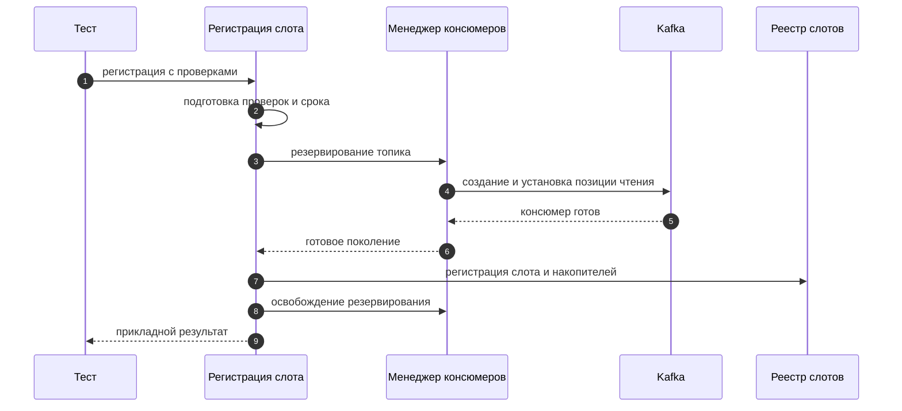
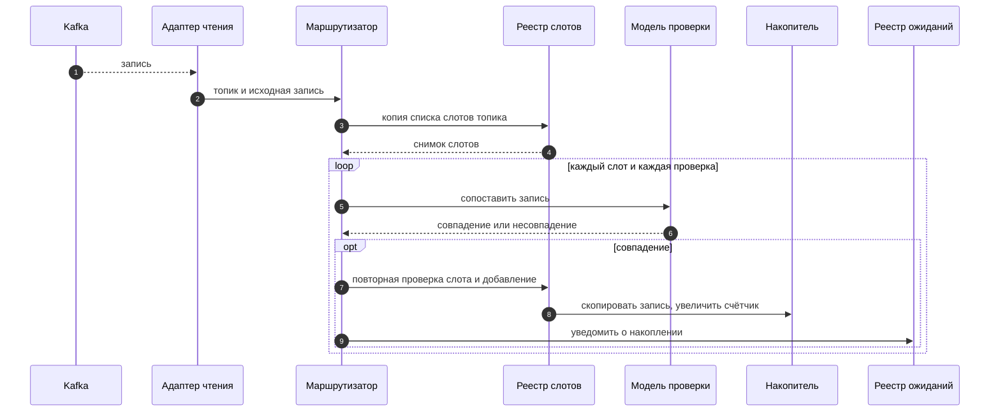
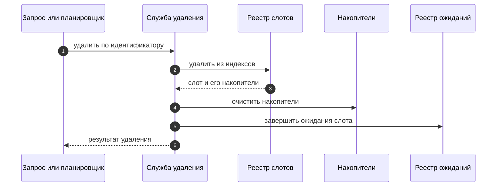

# Инженерная спецификация архитектуры

Документ описывает внутреннюю архитектуру сервиса: компоненты, владельцев состояния, потоки публикации и маршрутизации записей, жизненный цикл слотов и консюмеров, сопоставление проверок, ожидания, фоновые планировщики, конкурентный доступ, тестовую архитектуру и границу Kafka-транспорта. Пользовательское назначение и наблюдаемые ограничения приведены в [`../architecture.md`](../architecture.md#назначение-и-возможности), а внешний HTTP-контракт — в [`../api.md`](../api.md#общие-сведения-и-правила-контракта). Технические детали HTTP-адаптера и подготовки DTO не дублируются: они описаны в [`api.md`](api.md#границы-и-источники-сведений).

Параметры конфигурации упоминаются по именам. Значения по умолчанию и пользовательские ограничения приведены в [документе конфигурации](../configuration.md#общие-правила-конфигурации); загрузка, проверка, преобразование единиц и вычисления — в [инженерной спецификации конфигурации](configuration.md#проверка-конфигурации-и-вычисления-времени).

## Границы архитектуры и композиция

### Слои

Сервис состоит из трёх основных слоёв:

- HTTP-слой преобразует запросы Fastify в вызовы прикладных сервисов и прикладные результаты в HTTP-ответы. Он не владеет состоянием слотов, накопителей и ожиданий; детали маршрутов и DTO находятся в [инженерной спецификации HTTP API](api.md#композиция-http-слоя).
- Прикладной слой реализует публикацию, регистрацию и удаление слотов, запросы чтения и ожидания, маршрутизацию записей, управление консюмерами, планировщики и завершение работы.
- Доменный слой содержит подготовленные проверки, исходные записи, реестр слотов и накопители. Он не зависит от Kafka и HTTP.

Композиционный корень находится в `src/composition/app-composition.ts`: он создаёт реестры, прикладные службы, Kafka-адаптеры, планировщики и HTTP-приложение и связывает их через порты. Состав, зависимости и порядок подготовки описаны только на уровне архитектуры; схема маршрутов и подготовка DTO разобраны в [спецификации HTTP API](api.md#композиция-http-слоя).

### Компоненты и их ответственность

| Компонент | Ответственность |
| --- | --- |
| Сервис публикации | Проверяет допустимость топика и передаёт закодированную запись порту Kafka с выбранным режимом подтверждения. |
| Сервис регистрации слота | Подготавливает все проверки, выбирает эффективный срок, резервирует консюмера, ждёт готовности, регистрирует слот и освобождает резервирование. |
| Реестр слотов | Хранит индекс по идентификатору, индекс по топику и терминальные признаки удаления; возвращает копии списков слотов. |
| Служба запросов слота | Предоставляет внутренние операции подсчёта, чтения снимка и регистрации ожидания для проверок слота. Внешний контракт этих операций находится в [`../api.md`](../api.md#асинхронное-ожидание-записей). |
| Служба удаления слота | Удаляет слот общим путём, очищает накопители и завершает связанные ожидания. |
| Накопитель проверки | Хранит независимую последовательность копий исходных записей и счётчик для каждой проверки слота. |
| Маршрутизатор записей | Перебирает снимок активных слотов топика, сопоставляет запись с каждой проверкой, добавляет совпадения и уведомляет реестр ожиданий. |
| Модель проверки | Сопоставляет все заданные условия заголовков и значений; не имеет собственного изменяемого состояния. |
| Менеджер консюмеров | Ведёт состояние по топикам, поколения, резервирования и сроки; координирует создание, закрытие и удаление группы. |
| Реестр ожиданий | Регистрирует ожидания и завершает их по условию, времени ожидания, удалению слота или остановке приложения. |
| Планировщик очистки слотов | Периодически выбирает просроченные слоты и делегирует их удаление общей службе. |
| Планировщик бездействия консюмеров | Периодически находит кандидатов и просит менеджер повторно проверить условия закрытия. |
| Координатор остановки | Последовательно прекращает приём запросов, завершает ожидания, останавливает планировщики, закрывает консюмеров и освобождает клиенты публикации и управления группами. |
| Инфраструктурные адаптеры Kafka | Скрывают KafkaJS за прикладными портами публикации, чтения и управления группами. Подробности транспорта приведены в разделе [границы Kafka-транспорта](#выбор-kafka-клиента-и-граница-нативного-транспорта). |

### Ветви взаимодействия

Внутреннее взаимодействие образует четыре независимые ветви:

- публикация: HTTP-слой → сервис публикации → порт Kafka;
- наблюдение: порт чтения Kafka → маршрутизатор → реестр слотов и модель проверки → накопитель проверки → реестр ожиданий → продолжение HTTP-запроса ожидания;
- очистка слотов: планировщик очистки → служба удаления → реестр слотов, накопитель и ожидания;
- остановка бездействующих консюмеров: планировщик бездействия → менеджер консюмеров → порт закрытия консюмера и порт удаления группы.

Публикация и наблюдение не вызывают друг друга: они связаны только через записи в Kafka. Планировщики не вызывают друг друга и не используют общий периодический запуск. Удаление группы — часть закрытия консюмера, а не самостоятельная фоновая ветвь.

## Потоки публикации и обработки записей

### Поток публикации

Сервис публикации проверяет топик по подготовленному правилу допуска, кодирует заголовки, ключ и значение в исходные байты и вызывает порт публикации. Результат ожидания Kafka зависит от режима подтверждения; подробная граница результата и внешние ответы определены [контрактом публикации](../api.md#принятие-отправки-без-подтверждения). Публикация не обращается к реестрам слотов и не подтверждает накопление записи.

### Поток обработки записи

Инфраструктурный консюмер преобразует сообщение Kafka в модель исходной записи и передаёт её маршрутизатору. Маршрутизатор получает копию списка слотов конкретного топика, проверяет запись отдельно по всем проверкам каждого слота и добавляет совпадения в отдельные накопители. После успешного добавления уведомляется реестр ожиданий. Если активных слотов нет, запись не сохраняется сервисом.

### Независимость публикации и наблюдения

Успешный результат публикации не означает, что запись уже получена консюмером или добавлена в накопитель. Записи, обработанные до регистрации слота, не добавляются в него. Рекомендуемый пользовательский порядок вызовов описан в [документе API](../api.md#рекомендуемая-последовательность-вызова); внутренние потоки чтения и накопления раскрыты в этой спецификации.

## Взаимодействие компонентов

### Направление зависимостей и инварианты

- HTTP-слой вызывает прикладные службы и не обращается к реестрам и накопителям напрямую. Схемы запросов, подготовка транспортных данных и преобразование результатов в ответы описаны в [инженерной спецификации HTTP API](api.md#границы-и-источники-сведений).
- Сервис публикации не обращается к реестрам слотов, ожиданий и консюмеров; его результат не зависит от наличия слота.
- Менеджер консюмеров является владельцем реестра консюмеров и решает вопросы создания и закрытия. Имя группы предоставляет отдельный компонент формирования имени.
- Реестр слотов меняется при регистрации и удалении через прикладные службы; маршрутизатор использует его снимки и операции добавления.
- Проверка выполняется независимо для каждого сочетания «слот — проверка». Одно сообщение может добавиться в несколько накопителей.
- Чтение и подсчёт не изменяют накопители. Удаление слота очищает его накопители и завершает ожидания этого слота.
- Планировщики независимы: планировщик слотов удаляет только слоты, а планировщик бездействия управляет закрытием консюмеров.
- Сетевые операции Kafka выполняются асинхронно вне синхронных изменений реестров. Прикладные результаты отделены от их HTTP-представления; коды и тела ошибок не дублируются здесь, а определены в [публичном контракте](../api.md#ошибки-ограничения-и-особенности-ответов).

### Матрица взаимодействий

| Инициатор → компонент | Передаваемые данные | Результат и граница асинхронности |
| --- | --- | --- |
| HTTP-маршрут → сервис публикации | Топик, подготовленные поля записи, режим подтверждения | Типизированный результат публикации; ответ ожидает завершения операции порта. |
| HTTP-маршрут → регистрация слота | Топик, проверки, необязательный срок | Асинхронный результат после готовности консюмера и регистрации. |
| HTTP-маршрут → запрос слота | Идентификатор слота, индекс проверки и параметры операции | Подсчёт/чтение возвращают текущее значение/копию; ожидание возвращает обещание завершения. Публичные параметры описаны в [документе API](../api.md#асинхронное-ожидание-записей). |
| HTTP-маршрут или планировщик → удаление слота | Идентификатор слота | Общий путь удаления, очистка накопителей и завершение ожиданий. |
| Регистрация слота → менеджер консюмеров | Топик и срок слота | Резервирование поколения и асинхронное ожидание готовности; по результату регистрации резервирование освобождается. |
| Консюмер Kafka → маршрутизатор | Топик и исходная запись | Синхронный проход по снимку слотов и проверкам, добавление совпадений и уведомление ожиданий. |
| Маршрутизатор → реестр слотов | Топик, идентификатор слота, индекс проверки, запись | Снимок списка, проверка текущего наличия и добавление с новым счётчиком. |
| Маршрутизатор → реестр ожиданий | Идентификатор слота и индекс проверки | Ожидания с выполненным порогом завершаются; продолжения выполняются через обещания. |
| Планировщик бездействия → менеджер консюмеров | Топик и проверка наличия активных слотов | Менеджер повторно проверяет срок, состояние и резервирования и асинхронно закрывает подходящий консюмер. |
| Менеджер консюмеров → Kafka Admin | Идентификатор группы топика | Асинхронная попытка удаления после подтверждённого закрытия консюмера. |
| Координатор остановки → компоненты приложения | Причина остановки | Последовательное завершение ожиданий, планировщиков, консюмеров и клиентов; повторные вызовы присоединяются к одному обещанию остановки. |

### Сквозные сценарии

#### С1. Регистрация слота

1. До обращения к Kafka регистрационная служба подготавливает все проверки. Недопустимый путь останавливает операцию без частичной регистрации; допустимый синтаксис описан в [контракте регистрации](../api.md#ограничения-условий-проверки).
2. Служба выбирает срок слота из запроса либо из конфигурации; внутренние правила описаны в [спецификации конфигурации](configuration.md#проверка-конфигурации-и-вычисления-времени).
3. Менеджер консюмеров создаёт резервирование по топику или присоединяет запрос к создаваемому поколению. Сетевое создание выполняется один раз на поколение.
4. Регистрация ожидает готовность чтения, включая установку начальной позиции для назначенных разделов.
5. После готовности создаётся идентификатор и регистрируется слот с независимыми накопителями проверок; срок слота отсчитывается от регистрации. Затем резервирование освобождается.
6. При отказе готовности слот не появляется. Освобождается резервирование; частичный Kafka-клиент закрывается фабрикой. Внешний результат указан в [контракте регистрации](../api.md#регистрация-слота-и-проверок).

#### С2. Публикация записи

1. Сервис проверяет, разрешён ли топик, и преобразует поля записи в байты.
2. Сервис передаёт запись порту публикации с выбранным режимом подтверждения.
3. HTTP-маршрут формирует ответ по типизированному результату. Служба публикации не обращается к слоту; публичная граница подтверждения описана в [контракте публикации](../api.md#принятие-отправки-без-подтверждения).

#### С3. Обработка записи консюмером

1. Адаптер чтения нормализует сообщение Kafka к исходной записи и вызывает маршрутизатор.
2. Маршрутизатор получает копию слотов топика. Для каждого слота и индекса проверки вычисляется совпадение.
3. Перед добавлением маршрутизатор повторно проверяет, что слот существует и не удалён. Реестр добавляет копию исходной записи в соответствующий накопитель.
4. После добавления маршрутизатор уведомляет реестр ожиданий. Ошибка обработки отдельной записи журналируется адаптером и не прекращает дальнейшее чтение.

#### С4. Ожидание условия

1. Служба запросов получает слот и накопитель нужной проверки и регистрирует ожидание с функцией чтения счётчика.
2. Реестр сразу проверяет условие. Если накопленного числа достаточно, ожидание завершается без таймера; иначе помещается в реестр и получает отложенную задачу тайм-аута.
3. Добавление записи, тайм-аут, удаление слота или остановка приложения завершают ожидание через общий механизм. Внешняя семантика ответов описана в [контракте ожидания](../api.md#асинхронное-ожидание-записей).

#### С5. Удаление слота

1. Ручное удаление и очистка по сроку вызывают одну службу удаления.
2. Реестр удаляет слот из индексов по идентификатору и топику и фиксирует его терминальное удаление.
3. Служба очищает накопители и завершает связанные ожидания результатом удаления.
4. Повторное удаление не восстанавливает данные. Внешнее поведение описано в [контракте удаления](../api.md#удаление-слота).

#### С6. Остановка бездействующего консюмера

1. Планировщик получает снимок топиков и предварительно отбирает кандидатов с истёкшим сроком.
2. Менеджер повторно проверяет актуальное состояние, срок и отсутствие активных слотов и резервирований.
3. При допустимости он фиксирует закрытие и барьер топика, затем асинхронно закрывает консюмера.
4. После успешного закрытия выполняется одна попытка удаления группы. Барьер снимается после завершения попытки; отказ удаления группы регистрируется, но не препятствует последующему открытию.

### Диаграммы последовательности для С1, С3 и С5

Диаграммы показывают последовательность прикладных вызовов и границы асинхронных операций; они не подразумевают физических мьютексов.

С1. Регистрация слота.

С3. Обработка записи.

С5. Удаление слота.

## Жизненный цикл слота и консюмера

### Состояния слота и переходы

Реестр хранит слот в двух индексах: по идентификатору и по топику. У слота есть привязка к топику, подготовленные проверки, срок удаления и накопители проверок. Ожидание является отдельной записью реестра ожиданий, а не самостоятельным состоянием объекта слота.

Регистрация подготавливает проверки до резервирования консюмера. После готовности создаются идентификатор и срок от текущего момента, затем реестр синхронно добавляет объект в оба индекса. Удаление извлекает объект по идентификатору, исключает его из обоих индексов и запоминает идентификатор как удалённый. Идентификаторы после удаления не переиспользуются прикладным источником идентификаторов.

Срок не проверяется при чтении или подсчёте. Слот, чей срок наступил, остаётся доступным до фактического запуска очистки и вызова общего пути удаления. Пользовательские последствия изложены в [описании регистрации](../api.md#регистрация-слота-и-проверок) и [описании удаления](../api.md#удаление-слота).

### Состояния консюмера и переходы

Менеджер консюмеров хранит состояние отдельно для каждого топика. Фактические состояния описаны в типе `ConsumerLifecycleState` и включают отсутствие записи, создание, очистку после отказа создания, готовность, закрытие и удаление группы.

| Состояние | Поведение |
| --- | --- |
| Отсутствует | Первое резервирование создаёт запись поколения и запускает инициализацию. |
| Создаётся | Для топика создаётся один клиент и одно общее обещание готовности; другие открытия присоединяются к поколению через резервирования. |
| Очищается после отказа создания | Новые открытия не используют незавершённую очистку. Частичный клиент закрывается; группа не удаляется. После успешной очистки запись текущего поколения удаляется. |
| Готов | Клиент доступен для слотов топика. Условие бездействия запрещает закрытие, пока есть активные слоты или резервирования. |
| Закрывается | Резервирования текущего поколения очищены, а барьер топика запрещает запуск нового поколения до завершения закрытия и попытки удаления группы. |
| Удаляется группа | Клиент закрыт; выполняется одна попытка удаления группы. Независимо от результата попытки барьер снимается после её завершения. |

Уникальный номер поколения и проверка ссылочной идентичности записи не дают отложенному завершению повредить последующую запись топика. Ошибка закрытия клиента отличается от ошибки удаления группы: при отказе закрытия запись и барьер остаются, повторное открытие не разрешается; отказ удаления группы журналируется, а после него барьер снимается.

### Регистрация, совместное создание и откат

Каждый запрос регистрации слота получает отдельный объект резервирования, связанный с топиком и поколением. Резервирование защищает консюмера от закрытия по бездействию в промежутке между готовностью чтения и регистрацией слота. Несколько открытий одного топика используют общее создание. Для топиков с отдельными записями создание выполняется независимо.

Срок жизни консюмера продлевается при резервировании и повторно после успешной регистрации слота. В обоих случаях новое значение принимается только при увеличении текущего срока. Формула и единицы вычисления приведены в [спецификации конфигурации](configuration.md#проверка-конфигурации-и-вычисления-времени).

Если создание не удалось, менеджер переводит запись в очистку после ошибки, сбрасывает резервирования и дожидается закрытия частичного клиента. Группа не удаляется, поскольку готовый консюмер не был создан. Если отдельная регистрация после готовности не завершается успешно, служба освобождает только своё резервирование; уже зарегистрированные слоты и общая готовность не откатываются.

### Закрытие, барьер и удаление группы

Планировщик передаёт кандидата менеджеру, который повторно проверяет актуальный срок, готовность и наличие активных резервирований и слотов. При выполнении условий менеджер синхронно меняет состояние на закрытие и публикует барьер для этого топика до сетевого действия. Закрытие клиента ожидает завершения активных обработчиков записи.

После подтверждённого закрытия менеджер выполняет ровно одну попытку удаления группы через административный порт. Новое открытие того же топика ожидает весь барьер — завершение закрытия и попытки удаления, — но результат удаления группы не является условием повторного создания. Идентификатор группы вычисляется компонентом имён групп; алгоритм хеширования и конфигурационные параметры приведены в [спецификации конфигурации](configuration.md#формирование-групп-консюмеров).

### Что происходит при удалении слота

Ручное удаление и фоновая очистка используют `SlotDeletionService`:

1. Реестр удаляет слот из индексов и возвращает сам объект с его накопителями; отсутствующий идентификатор даёт результат «не найдено».
2. Каждый накопитель очищает массив записей и обнуляет счётчик.
3. Реестр ожиданий завершает все ожидания данного слота результатом `slot-deleted`, снимает таймеры и удаляет записи ожиданий.
4. Слот перестаёт попадать в следующие снимки по топику; консюмер продолжает работу, даже если слотов топика больше нет, до отдельного условия закрытия.

Операции выполняются последовательно в одном синхронном стеке до возврата из функции удаления. Это не физическая транзакция с откатом: для реестров и накопителей используется синхронный доступ в одном процессе. Внешний результат ожидания и удаления определён в [контракте API](../api.md#асинхронное-ожидание-записей).

## Модель проверок и асинхронного ожидания

### Структура проверки

Скомпилированная проверка [`CompiledCheck`](../../src/domain/check.ts:23) содержит два массива условий: ожидаемые пары имени и значения заголовка, а также пары подготовленного пути `jsonPath` и ожидаемой строки. Публичная структура условий и допустимый синтаксис путей описаны в [контракте регистрации и проверок](../api.md#регистрация-слота-и-проверок); техническая обработка HTTP-представления вынесена в [подготовку условий проверки](api.md#подготовка-условий-проверки).

На границе доменного слоя [`prepareCheck()`](../../src/domain/checking/check.ts:44) формирует скомпилированные условия. Для заголовков сохраняются `name` и `value`, а для значений разбирается строковый `jsonPath` в последовательность доменных сегментов; в обоих случаях сохраняются `operation` и `ignoreCase`. Отсутствующий `operation` нормализуется в `EQUALS`, а отсутствующий `ignoreCase` — в `false`. Поэтому [`CompiledHeaderCondition`](../../src/domain/check.ts:7) и [`CompiledValueCondition`](../../src/domain/check.ts:15) содержат конкретную операцию и логическое значение, а не `undefined`; сопоставление не должно повторно разрешать значения по умолчанию. Если хотя бы один путь некорректен, подготовка завершается отказом без создания частичного результата.

### Правило совпадения

Запись удовлетворяет проверке, когда каждый заданный заголовок и каждое заданное значение удовлетворяют соответствующему условию. Пустой список условий по любой части не ограничивает совпадение; проверка без условий принимает запись. Частичное совпадение не накапливается. Одна запись добавляется не более одного раза в каждый накопитель проверки.

Строковые значения сопоставляются общим компаратором [`matchesStringCondition()`](../../src/domain/checking/string-condition.ts:5). При `ignoreCase: false` строки передаются в сравнение без преобразования; при `ignoreCase: true` к обеим строкам применяется `caseFold`, но Unicode-нормализация не выполняется. Затем `EQUALS` требует полного равенства, а `CONTAINS` — вхождения ожидаемой строки в фактическую. Подробности выбранной реализации приведения регистра приведены в разделе [«Реализация Unicode case folding»](#реализация-unicode-case-folding).

Одинаковые `operation` и `ignoreCase` задают эту семантику и для декодированных значений заголовков, и для строковых представлений выбранных JSON-узлов. Имя заголовка используется только для выбора кандидатов, а `jsonPath` — только для выбора узлов: ни одно из них не сравнивается как строковое значение и не подвергается приведению регистра. Отсутствующие данные, ошибки строгого декодирования или разбора JSON приводят к несовпадению только там, где соответствующее поле участвует в условии. Ключ записи проверкой не анализируется.

### Реализация Unicode case folding

Для `ignoreCase: false` сохраняется строгое равенство декодированных строк без folding: не применяются ни изменение регистра, ни нормализация, ни удаление пробелов. Для `ignoreCase: true` обе строки сначала передаются в `caseFold` из пакета `unicode-case-folding@1.1.2`, а затем сравниваются. В `EQUALS` сравниваются полученные строки целиком; в `CONTAINS` folded-строка фактического значения должна содержать folded-строку ожидаемого значения. Пустая ожидаемая строка при `CONTAINS` совпадает по обычному правилу `includes`.

Выбран пакет [`unicode-case-folding@1.1.2`](https://www.npmjs.com/package/unicode-case-folding), поскольку опубликованный `index.js` содержит таблицу отображений из Unicode Character Database, поддерживает многосимвольные результаты и обходит вход по кодовым точкам через `for...of`. Пакет является ESM, содержит TypeScript-декларации, не имеет runtime-зависимостей и не требует нативной сборки. В исходнике нет вызовов `normalize`; folding не объединяет канонически эквивалентные последовательности. Версия закреплена точно в `package.json` и `package-lock.json` с integrity-хешем. Проверка актуальности и безопасности выполнена 2026-11-01: `npm view` подтвердил версию `1.1.2`, а `npm audit --json` до установки сообщил 0 уязвимостей в 176 зависимостях и после установки — 0 уязвимостей в 177 зависимостях. Пакет принят.

Пакет ссылается на [`CaseFolding.txt`](https://www.unicode.org/Public/UCD/latest/ucd/CaseFolding.txt) через `UCD/latest`, поэтому конкретный выпуск Unicode не объявлен в метаданных пакета. Это принятое ограничение выбора: поведение зафиксировано версией npm-пакета и lock-файлом, а смена версии пакета или его таблицы требует повторной проверки. Стандартные `toLowerCase` и `toUpperCase` не являются заменой: они не задают полного многосимвольного folding, могут учитывать контекст (например, конечную греческую сигму) и имеют другую семантику для `ß`. `Intl.Collator` выполняет зависящее от локали сравнение, но не возвращает folded-строку для `CONTAINS`; регулярное выражение с флагами `iu` также не заменяет многосимвольные отображения.

Сравнение применяется только к значениям условий: к строго декодированному значению заголовка и к строке, полученной из выбранного JSON-узла через `nodeToString`. Имена заголовков, `jsonPath`, строгая UTF-8-декодировка, выбор узлов и правила преобразования JSON-узлов не folding-ятся и не нормализуются.

Представительная матрица для значений заголовков и JSON одинакова; `да` означает совпадение при `EQUALS`, если не указано `CONTAINS`.

| Фактическое значение | Ожидаемое значение | Результат при `ignoreCase: true` |
| --- | --- | --- |
| `A` | `a` | да |
| `ß` | `SS` | да; расширение `ß` в `ss` |
| `Straße` | `STRASSE` (`CONTAINS`) | да |
| `Σ`, `ς`, `ΟΣ` | `σ`, `σ`, `οσ` | да; конечная и срединная сигма сводятся к `σ` |
| `İ` | `i` | нет; результат — `i` + U+0307 |
| `İ` | `i` + U+0307 | да |
| `I` | `ı` | нет; турецкое `ı` не приравнивается к `i` |
| `É` | `é` | да |
| `é` | `e` + U+0301 | нет; NFC и NFD не нормализуются |
| `ff` | `ff` | да; раскрытие лигатуры |

При `ignoreCase: false` все эти пары, кроме буквально одинаковых строк, не совпадают; это особенно важно для `ß`/`SS`, различий регистра и NFC/NFD.

### Сопоставление заголовков и повторяющихся имён

Для каждого ожидаемого условия [`matchesHeaders()`](../../src/domain/checking/headers.ts:7) независимо просматривает заголовки с точно совпадающим именем. Имя чувствительно к регистру и не проходит через общий компаратор. Условие выполнено, если среди заголовков с таким именем есть хотя бы одно присутствующее значение, строго декодируемое как UTF-8 и удовлетворяющее [`matchesStringCondition()`](../../src/domain/checking/string-condition.ts:5) с его `operation` и `ignoreCase`. Ошибочный UTF-8 или отсутствие значения исключают только конкретного кандидата; проверка другого одноимённого заголовка продолжается.

Повторяющиеся условия независимы и могут удовлетворяться одним и тем же заголовком. Кандидаты не расходуются, количество повторов не сопоставляется. Пустые байты соответствуют пустой строке. Непроверяемые заголовки не декодируются и не влияют на результат.

### Преобразование и сопоставление результатов JSONPath

Значение записи строго декодируется как UTF-8, затем разбирается стандартным `JSON.parse`. Для каждого условия [`matchesValueCondition()`](../../src/domain/checking/value-check.ts:9) подготовленный путь выбирает последовательность узлов; после преобразования узлов в строки условие совпадает, если хотя бы один выбранный узел удовлетворяет [`matchesStringCondition()`](../../src/domain/checking/string-condition.ts:5) с теми же параметрами `operation` и `ignoreCase`. Отсутствие узлов, ошибка разбора или неподдерживаемое строковое представление дают несовпадение. Подробности выбора узлов и преобразования JSON-значений приведены далее и не изменяются этим правилом.

| Узел | Строковое представление для сравнения |
| --- | --- |
| Строка | Содержимое без JSON-кавычек и дополнительного экранирования |
| Конечное число | `String(number)` в представлении JavaScript |
| Логическое значение | `true` или `false` |
| `null` | `null` |
| Объект или массив | Компактный результат `JSON.stringify`, только если структура не содержит неподдерживаемых значений |
| Нет результата, ошибка или неподдерживаемый узел | Совпадения нет |

Условия с одинаковым путём проверяются независимо; выбранные результаты не расходуются. При JSON-сериализации порядок свойств соответствует порядку JavaScript после разбора, индексные свойства объекта упорядочиваются по правилам JavaScript. Сравнение объектов строковое, не структурное. Неконечное число — как отдельный узел или вложенное в объект/массив — делает данный кандидат непредставимым для сравнения, а не заменяется на `null`.

### Безопасное вычисление JSONPath

Синтаксис разбирается внутренней реализацией `parseJsonPath` в подготовленные сегменты, а обход выполняет `selectNodes`. Пользовательская строка не исполняется как код и не передаётся в универсальный вычислитель выражений. Поддерживаемые пользователю формы пути перечислены в [контракте API](../api.md#допустимый-синтаксис-jsonpath).

Обход объектов использует только собственные свойства; унаследованные свойства недоступны. Индекс выбирает существующий собственный элемент массива. Выбор `[*]` возвращает непосредственные элементы массива или значения собственных свойств объекта, не разворачивая выбранные вложенные массивы. Несовпадение типа узла или исключение дают пустой результат. Ошибка пути при подготовке отклоняет регистрацию до изменения состояния.

### Накопление и порядок записей

Каждая проверка слота имеет отдельный накопитель. При добавлении накапливается глубокая копия полей записи и байтов; отсутствие значения сохраняется как отсутствие, не подменяется пустым буфером или JSON `null`. Непредставимость записи в HTTP-ответе не мешает её накоплению, если она удовлетворяет проверке.

Накопитель сохраняет порядок вызовов добавления. Kafka гарантирует порядок в рамках раздела, но сервис не задаёт единого абсолютного порядка между несколькими разделами. Счётчик растёт при каждом добавлении и не сбрасывается при ожидании или чтении. Чтение создаёт копию выбранной страницы; последующее преобразование для HTTP выполняется отдельно. Внутреннее преобразование HTTP-представления не дублируется здесь; инженерное описание находится в [спецификации API](api.md#представление-страницы-чтения), а внешнее поведение — в [контракте чтения](../api.md#непредставимая-запись-и-ответ-всей-страницы).

### Модель ожидания

Ожидание представлено записью реестра с идентификатором, запросом, функцией получения текущего счётчика, таймером, признаком завершения и функциями разрешения или локальной отмены. Ожидания по разным слотам, проверкам и порогам независимы.

1. При регистрации счётчик проверяется немедленно. Если порог уже достигнут, реестр завершает обещание результатом `condition` и таймер не создаётся.
2. Иначе ожидание добавляется в реестр и получает отложенную задачу тайм-аута.
3. После успешного добавления записи маршрутизатор вызывает `notifyAccumulated`; реестр проверяет все ожидающие с теми же идентификаторами слота и проверки и завершает достигшие своего порога.
4. Условие, тайм-аут, удаление слота и остановка приложения проходят через общий механизм завершения: устанавливается признак, снимается таймер, ожидание удаляется из реестра, результат разрешается один раз.
5. Локальная отмена (`cancel`) отличается от штатного результата: запись и таймер удаляются, обещание отклоняется `WaitCancelledError`, а вызывающий обязан обработать отказ.

Синхронные действия метода реестра не содержат `await`; события цикла событий последовательно меняют его состояние. Поэтому из пары «уведомление о выполнении условия» и «обработчик тайм-аута» результат фиксирует первое обработанное событие. Остановка вызывает `settleAll('service-stopping')`, завершая уже зарегистрированные ожидания; в службе запросов нет отдельной проверки признака остановки перед самой регистрацией ожидания. Публичные результаты и коды определены в [контракте ожидания](../api.md#асинхронное-ожидание-записей).

## Фоновая очистка и завершение ресурсов

### Периодические планировщики

В приложении два независимых экземпляра периодического исполнителя:

| Планировщик | Работа |
| --- | --- |
| Очистка слотов | Снимает список слотов, сравнивает сроки с текущим временем и удаляет подходящие слоты через общий сервис удаления. |
| Проверка бездействия консюмеров | Снимает список топиков; менеджер проверяет истёкший срок, активные слоты и резервирования и закрывает допустимых кандидатов. |

Интервалы и механизм отсчёта времени описаны в [спецификации конфигурации](configuration.md#периодические-и-отложенные-таймеры).

Интервалы заданы в коде, а не конфигурацией. Периодический исполнитель не допускает перекрытия проходов; при остановке отменяет ожидающий запуск и дожидается уже выполняющегося прохода. Ошибка одного слота или топика журналируется и не должна прерывать обработку остальных.

Планировщик слотов удаляет слот, но не закрывает консюмера. Планировщик бездействия не удаляет слоты. Если слот удалён первым, последующая проверка консюмера увидит актуальный список слотов; если консюмер закрывается, регистрация слота учитывает барьер топика.

### Остановка приложения

Координатор остановки обеспечивает идемпотентность: повторный вызов возвращает то же обещание. Последовательность действий:

1. Начинается закрытие HTTP-сервера и завершаются все уже зарегистрированные ожидания исходом `service-stopping`.
2. Оба планировщика останавливаются; текущие проходы дожидаются завершения.
3. Менеджер последовательно закрывает готовых консюмеров. После успешного закрытия для каждого выполняется попытка удаления группы; отдельный отказ одного консюмера не прекращает закрытие остальных.
4. Публикатор ограниченно дожидается незавершённых отправок с заданным сроком, затем закрываются публикатор, административный клиент групп и отдельный клиент производителя, если он создан.
5. Ожидается завершение закрытия HTTP-сервера.

Штатная остановка завершает ожидания до закрытия консюмеров. В отличие от изначального описания, механизм регистрации ожидания сам по себе не проверяет признак остановки: это поведение следует описывать с учётом фактического порядка закрытия HTTP-сервера и `settleAll`. Политика видимых ответов ожидания приведена в [контракте API](../api.md#асинхронное-ожидание-записей).

## Конкурентный доступ и логические критические участки

### Модель конкурентности в Node.js

Реестры и накопители являются структурами памяти процесса и используются в одном цикле событий Node.js. В проекте нет физических мьютексов для этих структур. Слова «атомарно» и «синхронный участок» относятся к фрагменту синхронного выполнения без `await`, когда другой обработчик цикла событий не может вклиниться между операциями этого фрагмента.

Сетевые операции выполняются асинхронно. Менеджер консюмеров сначала записывает состояние поколения и общий результат создания/закрытия, затем ждёт внешнюю операцию и после её завершения проверяет, что запись всё ещё относится к нужному поколению. Барьер топика не удерживает цикл событий; он лишь даёт будущим открытиям общее обещание ожидания.

### Снимки и актуальность ссылки

`listByTopic` возвращает новый массив, но элементы массива являются ссылками на зарегистрированные слоты. Между получением списка и использованием ссылки слот может быть удалён. Поэтому маршрутизатор повторно проверяет наличие слота и затем вызывает добавление через реестр; удалённый слот не возвращается в накопление.

Операции подсчёта и чтения сначала получают объект зарегистрированного слота, затем синхронно читают счётчик или копируют страницу накопителя. Снимок записей создаётся клонированием исходных байтов, поэтому последующее удаление/очистка накопителя не меняет уже возвращённую копию.

### Реестр ожиданий и порядок событий

Изменения реестра ожиданий синхронны: регистрация, проверка счётчика, постановка таймера, уведомление о накоплении и завершение выполняются без передачи управления внутри каждого метода. Все пути завершения используют признак `settled`, удаляют запись и отменяют таймер, чтобы результат выбирался однократно.

Важное уточнение фактической реализации: реестр ожиданий не имеет отдельной блокировки на каждый слот, а сервис не объединяет операцию получения счётчика и регистрацию с операциями накопителя в одну физическую транзакцию. Согласование достигается синхронными вызовами одного процесса и повторным уведомлением после добавления. При интеграции новой конкурентной модели требуется повторно проверить гонку «снимок счётчика — регистрация — накопление».

Локальная отмена отличается от четырёх штатных исходов: `cancel` отклоняет обещание исключением `WaitCancelledError`; вызывающая сторона обязана обработать его. Не следует описывать локальную отмену как обычное разрешение результатом ожидания.

### Ошибки на границах

Прикладные службы возвращают типизированные результаты и не формируют HTTP-коды. Для наблюдаемых кодов и тел ошибок используется единственный источник — [документ API](../api.md#ошибки-ограничения-и-особенности-ответов); устройство преобразования результатов и HTTP-ошибок описано в [спецификации API](api.md#преобразование-результатов-и-ошибок).

Отказ Kafka при создании консюмера не оставляет зарегистрированный слот; частичный клиент закрывает фабрика, группа не удаляется. Ошибка сопоставления записи трактуется как несовпадение, ошибка одного обработчика записи регистрируется и не останавливает Kafka-чтение. Ошибка удаления группы не равна отказу закрытия клиента. Ошибки фоновой операции журналируются; проход продолжает обработку следующих кандидатов.

## Тестовая архитектура

### Модульные тесты

Модульные тесты проверяют доменные и прикладные правила без настоящего брокера Kafka и без HTTP-сервера:

- проверки заголовков, декодирование UTF-8, разбор и обход JSONPath, преобразование узлов и правила точного совпадения;
- индексы реестра слотов, клонирование записей, накопители, снимки и очистка;
- регистрацию слота, отказ готовности и освобождение резервирования;
- маршрутизацию записи по слотам и проверкам, включая пропуск удалённой ссылки;
- независимое завершение ожиданий по условию и тайм-ауту, удаление ожидания и локальную отмену;
- создание/закрытие консюмеров, совместные открытия, поколения, резервирования, временные барьеры и удаление групп;
- планировщики, повторный запуск и остановку текущего прохода;
- координатор остановки, порядок закрытия и идемпотентность.

Вместо реального времени применяются управляемые часы (`ManualClock`), вместо Kafka — управляемые фабрики и поддельные клиенты (`FakeConsumer`, `FakeProducer`). Это позволяет воспроизводить отложенную готовность, отказы, тайм-ауты и конкурирующие события в заданном порядке.

### Контрактные и интеграционные тесты

Контрактные тесты запускают HTTP-приложение и проверяют маршруты, ответы и OpenAPI против реализации. Их область — публичный интерфейс, поэтому техническое описание DTO и маршрутов остаётся в [спецификации API](api.md#формирование-openapi).

Интеграционные тесты используют настроенный внешний брокер Kafka, если он доступен. Они покрывают публикацию, жизненный цикл слота, ожидания, чтение, повторное открытие консюмера, независимость групп и остановку. Брокер не разворачивается и не администрируется тестами как часть приложения; при отсутствии доступности интеграционный набор сообщает о пропуске сценариев. Для соединения по умолчанию используется `localhost:9092`, адрес может задаваться переменной `KAFKA_TESTING_REST_CLUSTER`; интеграционные тесты запускаются отдельно командой `npm run test:integration`.

### Проверяемые гонки и отказные сценарии

Модульные и интеграционные тесты отдельно проверяют следующие границы:

- общий запуск одного создания для нескольких одновременных регистраций одного топика и независимый запуск для разных топиков;
- очистку частичного клиента после отказа создания без удаления группы и без регистрации слотов;
- запрет закрытия консюмера при активном слоте или резервировании и повторную проверку состояния после задержки;
- барьер повторного открытия, сохраняющийся до завершения закрытия и одной попытки удаления группы, включая отказ удаления; отказ самого закрытия не снимает барьер;
- неизменность достигнутого срока консюмера при коротком повторном сроке и продление после долгой инициализации от момента регистрации слота;
- отсутствие воспроизведения записей, опубликованных во время закрытия консюмера, в том числе при отказе удаления группы;
- независимость двух планировщиков и отсутствие пересечения проходов;
- завершение ожидания один раз при очередности «тайм-аут до уведомления» и «уведомление до тайм-аута», сохраняя накопленную запись в обоих случаях;
- игнорирование ранее полученной ссылки на уже удалённый слот при маршрутизации;
- ожидание активного обработчика записи перед освобождением Kafka-клиента.

Эти проверки подтверждают предусмотренные состояния и последовательности, но сами по себе не вводят отдельные блокировки или общие транзакции, отсутствующие в реализации.

## Принятые архитектурные решения

1. **Один консюмер на топик в пределах процесса.** Менеджер объединяет конкурентные открытия одного топика в одно создание, но разные топики создаются независимо.
2. **Начало чтения с конца разделов.** `fromBeginning: false` не считается достаточной гарантией: адаптер получает смещения разделов и вызывает `seek` после назначения разделов. Готовность подтверждается после применения позиции чтения.
3. **Накопитель на каждую проверку.** Это обеспечивает независимый подсчёт и чтение совпавших записей для каждого индекса проверки.
4. **Проверка всех условий полным проходом.** Для целевой нагрузки отдельный индекс условий не поддерживается; маршрутизатор последовательно проверяет слоты и проверки топика.
5. **Два независимых планировщика.** Очистка слотов и закрытие бездействующих консюмеров имеют разные интервалы и не вызывают друг друга.
6. **Ожидания завершаются только прикладным событием.** Реестр использует уведомления после добавления записи, таймер и сигналы удаления/остановки; опроса счётчика в цикле нет.
7. **Состояние не персистентно.** Реестры и накопители существуют только в памяти текущего процесса; после перезапуска они не восстанавливаются. Пользовательские последствия перечислены в [ограничениях сервиса](../architecture.md#ограничения).

## Выбор Kafka-клиента и граница нативного транспорта

### Выбор KafkaJS

Проект использует `kafkajs` как Kafka-клиент. KafkaJS выбран как чистая JavaScript-библиотека без нативной сборки и транзитивных зависимостей; альтернативой в принятом сравнении был `node-rdkafka`, требующий нативной сборки и пакетов `bindings` и `nan`. KafkaJS изолирован инфраструктурными адаптерами; прикладные службы зависят от портов и не используют типы KafkaJS.

На момент исходного сравнения указывались версии KafkaJS `2.2.4` и `node-rdkafka` `3.6.1`; требования Node.js и дата публикации — исторические данные сравнения, а не текущая политика обновления. Проект требует Node.js `>=22`, точная версия KafkaJS задаётся в [`package.json`](../../package.json). В документе выбора была зафиксирована проверка `npm audit` без найденных уязвимостей на момент проверки; актуальное состояние нужно определять повторным аудитом зависимостей, а не этим историческим результатом.

### Публикация и чтение

Адаптер публикации передаёт ключ и значение как байты, заголовки преобразует в форму KafkaJS и передаёт выбранный режим `acks`. Публичная кодировка транспортных полей определена в [контракте публикации](../api.md#правила-преобразования-в-байты), а преобразование из HTTP-формы в байты раскрыто в [спецификации API](api.md#передача-байтов-при-публикации).

Адаптер консюмера подключается и подписывается на топик, получает последние смещения, запускает цикл чтения и ждёт события назначения разделов. Для каждого назначенного раздела он устанавливает позицию через `seek`; при последующих переназначениях смещения запрашиваются снова. Готовый адаптер ожидает активные обработчики при закрытии, снимает обработчик события и освобождает клиента консюмера и вспомогательный клиент администратора.

### Повторяющиеся заголовки и исходные байты

KafkaJS представляет заголовки как объект: разные имена не являются упорядоченным массивом пар, а повторяющиеся значения одного имени могут быть массивом. При чтении адаптер разворачивает повторяющиеся значения в список исходных заголовков; порядок значений внутри одного имени сохраняется. Порядок между разными именами не является гарантией адаптера.

Адаптер сохраняет исходные байты и различает отсутствующее значение от существующего пустого значения. Интерпретация байтов для проверки и чтения разделена: условия проверки строго декодируют только данные, нужные условию, а представление HTTP выполняет отдельное преобразование.

### Управление группами

Удаление группы вынесено в отдельный административный порт. Его вызывает менеджер консюмеров только после подтверждённого закрытия соответствующего клиента; фабрика консюмера не удаляет группы при закрытии или отказе инициализации. Детали формирования имени и связанные конфигурационные значения приведены в [спецификации конфигурации](configuration.md#формирование-групп-консюмеров).
