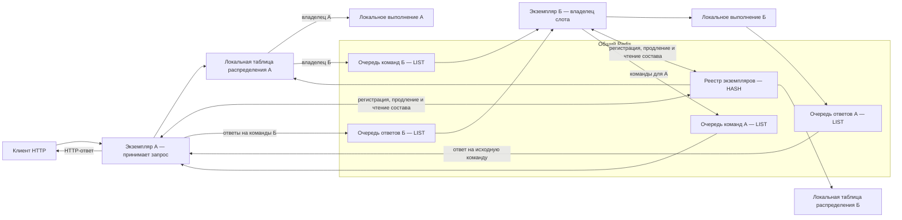
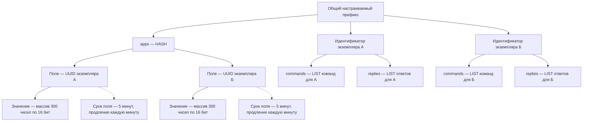

# Идея параллельной работы реплик сервиса через Redis

## Статус и границы

Документ фиксирует идею будущего развития, а не реализованную возможность или утверждённую инженерную спецификацию. Описание не изменяет действующие HTTP API, конфигурацию и гарантии сервиса.

Сейчас сервис рассчитан на одну реплику и хранит состояние в памяти процесса. Текущие ограничения описаны в [основном документе](../readme.md#назначение), а устройство компонентов — в [инженерной спецификации архитектуры](../docs/specs/architecture.md#границы-архитектуры-и-композиция).

Исходная идея изложена ниже с учётом [принятых допущений](#принятые-допущения) и отдельно от [открытых вопросов и рисков](#открытые-вопросы-и-риски). Варианты решения оставшихся открытых вопросов намеренно не выбираются.

## Целевая нагрузка

| Характеристика | Ориентир |
| --- | --- |
| Суммарная входящая нагрузка на сервис | До 1000 HTTP-запросов в секунду |
| Количество одновременно работающих экземпляров | 20–50 |
| Связь между экземплярами | Через Redis |
| Распределение слотов | Консистентное хэширование по идентификатору слота |

Это ориентиры проектирования, а не подтверждённые результаты нагрузочных испытаний. Доли операций, размеры сообщений и количество одновременных ожиданий пока не заданы.

## Принятые допущения

- Сервис предназначен для тестирования, а не для промышленной эксплуатации. Непрерывная доступность и сохранность состояния при отказах не являются целями этой идеи.
- К началу тестирования число реплик зафиксировано. Штатный сценарий предполагает неизменный состав экземпляров на протяжении тестового прогона; плановое масштабирование и замена реплик во время прогона не предполагаются. Одинаковое число экземпляров после перезапуска не означает неизменный состав, поскольку новый запуск получает новый UUID.
- Падение экземпляра и потеря связанных с ним слотов, накопленных записей и ожиданий допустимы. Прозрачное восстановление или перенос этого состояния на другие экземпляры не требуются.
- Временное рассогласование представлений о составе реплик и локальных таблиц распределения допустимо. Мгновенное согласованное переключение маршрутизации между всеми экземплярами не требуется.
- Ориентир допустимой неравномерности распределения — 5% относительно идеальной доли реплики, а не 5 процентных пунктов. Выбранные параметры не гарантируют соблюдение этого допуска каждой репликой; ожидаемый разброс указан в [оценке неравномерности](#оценка-неравномерности-для-20-реплик).
- Изменение состава из-за отказа или перезапуска может нарушить выполнение затронутых тестов и доступ к существующим слотам. Сохранение привязки всех существующих слотов при перестроении кольца не гарантируется; такие последствия допустимы в рамках тестового назначения сервиса.

## Основная идея

- Все экземпляры сервиса используют общий Redis и общее пространство служебных ключей.
- При каждом запуске экземпляр создаёт уникальный идентификатор UUID. Он используется для регистрации экземпляра, адресации команд и получения ответов.
- При запуске экземпляр один раз генерирует массив из 300 случайных 16-битных целых чисел. Массив задаёт его виртуальные точки для консистентного хэширования и не меняется в течение жизни этого экземпляра.
- Владелец слота определяется по хэшу идентификатора слота. Такая маршрутизация применяется уже при создании слота и затем при выполнении запросов к нему.
- При неизменном составе реплик и согласованных таблицах распределения слот закреплён за одним экземпляром от создания до последующих запросов. Последствия отказов и изменения состава ограничены [принятыми допущениями](#принятые-допущения).
- Если запрос принят не владельцем слота, экземпляры обмениваются командой и ответом через списки Redis, используемые как очереди.
- Redis в этой идее содержит реестр экземпляров и очереди обмена. Хранение в нём самих слотов, накопленных записей и состояния ожиданий не определено.

## Схема компонентов

На схеме показан пример: HTTP-запрос поступил экземпляру А, а владельцем слота является экземпляр Б. Направления стрелок отражают передачу данных, а не инициатора сетевого соединения.



Каждый экземпляр имеет одинаковые роли: принимает HTTP-запросы, определяет владельца слота, исполняет адресованные ему команды и получает ответы на свои команды. Таблица распределения строится локально; отдельный ключ Redis для неё исходной идеей не предусмотрен.

## Схема данных в Redis

### Пространство ключей

Все служебные ключи имеют общий настраиваемый префикс. Значение по умолчанию — [`kafka-testing-rest:`](parallel-replicas.md#пространство-ключей). Имя параметра конфигурации пока не определено; это не существующая настройка сервиса.

В таблице [`app_id`](parallel-replicas.md#пространство-ключей) обозначает UUID конкретного запуска экземпляра.

| Ключ с префиксом по умолчанию | Тип Redis | Содержимое |
| --- | --- | --- |
| [`kafka-testing-rest:apps`](parallel-replicas.md#реестр-экземпляров) | HASH — хэш с полями по идентификаторам экземпляров | Поле — идентификатор экземпляра; значение — массив его 300 случайных 16-битных чисел |
| [`kafka-testing-rest:{app_id}:commands`](parallel-replicas.md#очереди-команд-и-ответов) | LIST — список для очереди команд | Сериализованные команды, адресованные экземпляру |
| [`kafka-testing-rest:{app_id}:replies`](parallel-replicas.md#очереди-команд-и-ответов) | LIST — список для очереди ответов | Сериализованные ответы на команды, инициированные экземпляром |

Фигурные скобки в шаблонах обозначают место подстановки идентификатора. Необходимость сохранять их буквально в ключе и использовать как метку Redis Cluster исходной идеей не определена.



### Реестр экземпляров

В общем хэше [`apps`](parallel-replicas.md#реестр-экземпляров) каждому экземпляру соответствует отдельное поле:

- имя поля — UUID экземпляра, созданный при запуске;
- значение — массив из 300 случайных 16-битных целых чисел;
- срок действия поля — 5 минут;
- период продления поля самим экземпляром — 1 минута.

Срок действия и период продления конфигурируются. Продление не меняет массив чисел. Истечение должно происходить независимо для каждого поля, а не для всего общего хэша. Формат сериализации массива не определён.

### Очереди команд и ответов

Для каждого идентификатора предусмотрены две очереди: входящих команд и ответов. Команда помещается в очередь целевого экземпляра. Ответ помещается в очередь экземпляра, указанного отправителем в поле [`reply-id`](parallel-replicas.md#формат-команды).

Очереди основаны на Redis LIST. Ключам обеих очередей при создании, в том числе повторном, задаётся срок жизни 30–60 минут, который периодически продлевается в течение работы соответствующего экземпляра. Точное значение срока жизни и период продления пока не определены. Срок жизни относится ко всему ключу, а не к отдельным сообщениям: пока он продлевается, сообщения сами по себе по этому сроку не удаляются.

При штатном завершении экземпляр удаляет все принадлежащие ему служебные ключи, включая обе очереди, и своё поле в общем реестре экземпляров. Общий ключ реестра и данные других экземпляров не удаляются. При аварийном завершении продление прекращается: ключи очередей удаляются по истечении оставшегося срока жизни, а поле реестра — по своему [сроку действия](#реестр-экземпляров).

Конкретные операции добавления и извлечения, подтверждения обработки и сроки хранения отдельных сообщений пока не определены. В частности, наличие записи в очереди само по себе не означает успешное выполнение команды.

## Протокол обмена

### Формат команды

| Поле | Содержимое |
| --- | --- |
| [`request-id`](parallel-replicas.md#формат-команды) | UUID команды для сопоставления с ответом |
| [`reply-id`](parallel-replicas.md#формат-команды) | Идентификатор экземпляра, в очередь которого нужно отправить ответ |
| [`command`](parallel-replicas.md#формат-команды) | Вид команды из перечисления ниже |
| [`payload`](parallel-replicas.md#формат-команды) | Данные команды в формате JSON; точные схемы пока не определены |

Пример оболочки команды создания слота; пустой объект иллюстрирует только место данных, а не допустимое тело операции:

```json
{
  "request-id": "842e1715-6767-4eb9-9b55-94169898b642",
  "reply-id": "69a34696-aea2-4c94-b3cd-73fa487394d3",
  "command": "CREATE_SLOT",
  "payload": {}
}
```

Предполагаемые виды команд:

| Команда | Назначение в исходной идее |
| --- | --- |
| [`REFRESH`](parallel-replicas.md#обновление-состава-реплик) | Перечитать реестр экземпляров и проверить необходимость перестроения распределения |
| [`CREATE_SLOT`](parallel-replicas.md#формат-команды) | Создать слот у выбранного владельца |
| [`WAIT`](parallel-replicas.md#формат-команды) | Выполнить ожидание для слота |
| [`CHECK`](parallel-replicas.md#формат-команды) | Выполнить операцию проверки; точное соответствие прикладной операции не определено |
| [`GET`](parallel-replicas.md#формат-команды) | Получить данные слота; точный состав результата не определён |

В исходном перечне название команды обновления содержало опечатку. Здесь используется единое написание [`REFRESH`](parallel-replicas.md#обновление-состава-реплик).

### Формат ответа

| Поле | Содержимое |
| --- | --- |
| [`request-id`](parallel-replicas.md#формат-ответа) | Идентификатор исходной команды |
| [`payload`](parallel-replicas.md#формат-ответа) | Результат в формате JSON; точная схема пока не определена |

Пример оболочки ответа на приведённую команду:

```json
{
  "request-id": "842e1715-6767-4eb9-9b55-94169898b642",
  "payload": {}
}
```

Отдельные поля статуса и ошибки исходной идеей не заданы. Пустой объект в примере не определяет результат создания слота.

### Обработка запроса к слоту

1. Экземпляр, принявший запрос, получает идентификатор слота и по его хэшу определяет владельца в локальной таблице распределения.
2. Если владелец — этот экземпляр, операция выполняется локально.
3. Если владелец — другой экземпляр, отправитель создаёт UUID команды, указывает собственный идентификатор для ответа и помещает команду в очередь владельца.
4. Владелец извлекает команду, выполняет операцию и отправляет результат в очередь ответов отправителя.
5. Отправитель сопоставляет ответ с ожидающей командой по её UUID и завершает исходный HTTP-запрос.

При создании слота его идентификатор должен быть известен до выбора владельца. Место генерации идентификатора и порядок передачи его исполнителю требуют уточнения: в текущей реализации идентификатор создаётся внутри регистрации после готовности консюмера, как описано в [существующем сценарии регистрации](../docs/specs/architecture.md#с1-регистрация-слота).

## Распределение слотов

### Кольцо и локальная таблица

Размер кольца консистентного хэширования — 2¹⁵, то есть 32 768 позиций с номерами от 0 до 32 767.

Каждый экземпляр получает из реестра массивы виртуальных точек всех известных реплик. Каждый массив содержит 300 чисел до учёта совпадений позиций на кольце.

На основании этих данных экземпляр строит локальную таблицу, сопоставляющую каждой позиции кольца идентификатор владельца. Идентификатор слота хэшируется, результат приводится к позиции кольца, а владелец выбирается по таблице.

Таблица строится при первоначальном получении состава и затем один раз на каждое обнаруженное изменение набора идентификаторов экземпляров. Она не перестраивается для каждого запроса или продления срока поля. Неизменность массивов в течение жизни экземпляра позволяет использовать изменение состава идентификаторов как критерий перестроения.

Позиция виртуальной точки получается как неотрицательный остаток от деления случайного 16-битного числа на 32 768. Так же к размеру кольца приводится хэш идентификатора слота. При равномерной генерации по всему диапазону 16-битных значений такое преобразование не вносит смещения.

Функция хэширования идентификатора слота, представление исходных чисел, направление обхода и разрешение коллизий пока не определены. Для одинакового распределения на всех репликах эти правила должны быть детерминированными и общими.

### Оценка неравномерности для 20 реплик

При 20 репликах, 300 независимых равномерных случайных точках на реплику и кольце 2¹⁵ ориентир ожидаемой неравномерности — **около 5,6% относительного среднеквадратичного разброса долей кольца**. Это приближённая оценка по непрерывной модели, а не максимальное отклонение или гарантия допуска ±5% каждой репликой. Точный разброс дискретной таблицы зависит от разрешения коллизий.

Оценка предполагает равномерный хэш слотов и обычное назначение интервала ближайшей следующей точке по выбранному направлению. Она не является результатом моделирования или нагрузочных испытаний. Различия активности слотов могут дополнительно увеличить неравномерность запросов.

### Обновление состава реплик

Перечитывание реестра запускается:

- по служебной команде [`REFRESH`](parallel-replicas.md#обновление-состава-реплик);
- по таймеру один раз в 10 минут.

После чтения экземпляр сравнивает полученный набор идентификаторов с набором, использованным для текущей таблицы. Если состав изменился, таблица пересчитывается; если нет — сохраняется. Изменение порядка получения полей не является изменением состава.

Кто инициирует рассылку команды обновления, каким репликам она отправляется и конфигурируется ли период перечитывания, исходной идеей не определено.

## Открытые вопросы и риски

Следующие пункты описывают оставшиеся вопросы и допустимые ограничения с учётом [принятых допущений](#принятые-допущения), а не дополнительные требования к промышленной отказоустойчивости.

1. **Изменение владельца при перестроении кольца.** Перестроение меняет владельцев части позиций, и запрос существующего слота может попасть на другой экземпляр без его состояния. Штатный прогон предполагает неизменный состав реплик; при его нарушении такая недоступность допустима. Прозрачное сохранение владельца и перенос состояния не требуются.
2. **Падение и перезапуск владельца.** Потеря слотов, записей и ожиданий упавшего экземпляра допустима. При перезапуске он получает новый UUID; изменение маршрутизации не восстанавливает прежнее состояние. Прозрачное восстановление не требуется, а затронутые тесты могут завершиться неуспешно.
3. **Истечение полей хэша.** Независимое истечение полей HASH поддерживается начиная с Redis 7.4. Требуемая версия Redis и допустимость этой зависимости должны быть уточнены. Срок всего ключа не заменяет независимые сроки полей.
4. **Задержка обнаружения изменений.** Срок поля 5 минут не означает, что все реплики исключат экземпляр из своей таблицы через 5 минут. Без команды обновления после истечения поля ожидание следующего перечитывания может добавить почти 10 минут. Механизм оперативного уведомления о запуске и остановке не задан.
5. **Несогласованные таблицы.** Временные различия в составе и выборе владельца допустимы; синхронное обновление всех таблиц не требуется. При этом остаётся уточнить завершение запроса, отправленного по устаревшей таблице, и поведение при возможных перенаправлениях, чтобы допущение о рассогласовании не означало неограниченного ожидания или циклов.
6. **Точность правил кольца и неравномерность.** Для 300 точек на реплику и кольца 2¹⁵ приведение к позиции задано остатком от деления на 32 768. Требуют уточнения представление и диапазон исходных чисел, допустимость повторов, выбор владельца и разрешение совпадающих точек разных реплик. Ожидаемый разброс описан в [оценке неравномерности для 20 реплик](#оценка-неравномерности-для-20-реплик); распределение реальных запросов требует отдельной проверки.
7. **Доставка и повторы команд.** LIST сам по себе не задаёт подтверждение исполнения или повторную доставку после сбоя обработчика. Не определены гарантии доставки, идемпотентность, устранение дубликатов и повторное создание слота после потери ответа.
8. **Долгие ожидания.** Не заданы сроки ожидания ответа, отмена при разрыве HTTP-соединения, обработка поздних ответов и параллелизм исполнения. Длительное ожидание не должно неявно означать остановку обработки остальных команд экземпляра.
9. **Полнота протокола.** Требуют уточнения данные каждой команды, формат ошибок, смысл операции проверки и соответствие протокола всем операциям слота. Отдельная команда удаления в исходном перечне отсутствует. Нужен ли ответ на служебное обновление, также не определено.
10. **Ресурсы очередей.** [Срок жизни ключей очередей и их очистка](#очереди-команд-и-ответов) определены: при штатном завершении ключи удаляются, при аварийном — истекают после прекращения продления. Остаются открытыми ограничения длины, политика переполнения и сроки хранения отдельных ответов. При 20–50 работающих экземплярах предусмотрено 40–100 списков очередей; периодическое продление срока жизни ключей не ограничивает накопление сообщений и потребление памяти независимо от числа активных слотов.
11. **Недоступность Redis.** Не описаны готовность экземпляров к приёму запросов, возможность локальных операций, повторное подключение и последствия истечения регистрации живого экземпляра во время разрыва связи.
12. **Взаимодействие с Kafka.** Требуют отдельного рассмотрения уникальность групп консюмеров разных экземпляров и получение каждым владельцем всех записей, необходимых его слотам. Распределение слотов через Redis само по себе не определяет распределение чтения Kafka.
13. **Проверка целевой нагрузки.** Для оценки 1000 запросов в секунду недостаточно числа реплик: нужны доля межрепличных команд, размеры результатов, длительность ожиданий и ограничения памяти. Производительность и отказоустойчивость Redis также требуют проверки, а не следуют из выбора LIST.
